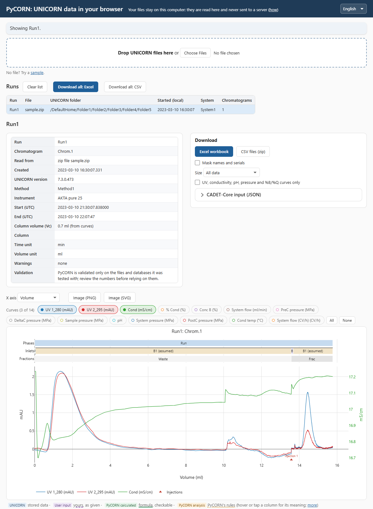

# PyCORN

Read ÄKTA chromatography runs from UNICORN result files or straight from the UNICORN
SQL Server database, into one Python model: curves, events, method variables and run log,
with time, volume, column-volume and wall-clock (UTC) axes.

- **Files**: UNICORN 6+ `.zip` / `.Result` exports, `.UFol` folder exports, and legacy
  UNICORN 3-5 `.res` files (`PcRes3`).
- **Database**: search and load results over TCP/IP with `pymssql` (no ODBC), across
  several servers and databases.
- **Analysis**: find curves by role (UV, conductivity, pH, %B, flow, ...) instead of
  instrument-specific names; phase, injection and fraction tables; unit conversion;
  mg/ml from UV with your extinction coefficient.
- **Export**: build a CADET / CADET-Process experiment (SI units) from what the run
  actually executed.
- **No install**: [open PyCORN in your browser](https://traylosj.github.io/PyCORN/), drop
  result files, get the plot, tables and Excel. Your files stay on your computer
  ([how](docs/WEB_PRIVACY.md)).

> **Validation scope:** PyCORN has only been validated against the UNICORN files and
> databases we have had access to. Other instruments, UNICORN versions, methods or
> scenarios may behave differently, so review the outputs carefully before relying on
> them. If you find an issue with a new file type or scenario, open a
> [GitHub issue](https://github.com/traylosj/PyCORN/issues) with a ZIP export of the run
> and an explanation of the expected behavior, for the project owner to review. Issues are
> public: only attach runs you are allowed to share.

**New to PyCORN?** Start with the [getting-started guide](docs/GETTING_STARTED.md): by task,
from a file to Excel, finding runs, and connecting to the database. No programming needed.

## Installation

```
pip install "pycorn[database] @ git+https://github.com/traylosj/PyCORN.git@master"
```

Python 3.9+; installs numpy, pandas, xmltodict and xlsxwriter. Extras: `database` (pymssql),
`plotting` (matplotlib), `testing` (pytest), `cadet`
(CADET-Process 0.12), `cadet-core` (h5py, for `.h5` CADET-Core input).

## No install: in the browser

**[Open PyCORN in your browser](https://traylosj.github.io/PyCORN/)** and drop `.zip` /
`.UFol` result files on it: chromatogram, phase / injection / fraction tables, method
variables and warnings, and the Excel workbook, csv files or CADET-Core input as downloads.
The chart has phase, inlet, fraction and pause tracks, an x axis of clock, time, volume or CV, and a
chip for every curve; the page speaks English, German, French, Italian and Swedish. Files
only, no database search. The first visit downloads about 15 MB; the browser
normally keeps it, so later visits download almost nothing.



### Your data stays private

There is no PyCORN server. The page runs Python inside your browser tab: files you drop are
read there, downloads are made there, and nothing is uploaded. Closing the tab clears
your files and results. How it works, how to check it yourself (disconnect from the network, or watch the
Network tab) and how to run the page from a shared drive:
[docs/WEB_PRIVACY.md](docs/WEB_PRIVACY.md).

## Quick start

### From a file

```python
from pycorn import open_run, open_folder

run = open_run("my_run.zip")          # UNICORN 6+ export
chrom = run.chromatogram()
uv = chrom.curves_with_role("uv")[0]  # names differ between systems; look up by role
df = uv.to_frame()                    # time, volume, adjusted axes, cv, utc, value

chrom.phase_table()                   # also injection_table(), fraction_table()
run.variables()                       # method variables as the run used them

runs = open_folder("project.UFol")    # every result in a folder export
```

### From the database

Run `pycorn-setup`: it asks for the server and login, saves them for your user and tests the
connection. Or copy `sql/.env.example` to `sql/.env`, fill it in (the file is gitignored) and
check it with `python sql/test_connection.py`. Where the file can live, and how to add more
servers and databases, is in the [connector guide](sql/CONNECTOR_GUIDE.md).

```python
from pycorn import PyCORNDatabase

db = PyCORNDatabase()
cat = db.find(folder="/DefaultHome/Projects/**",
              run_start=("2024-01-01", "2024-06-30"),
              has_curve_roles=["uv"])   # one page; see find_pages(), count(), pick_list()
run = db.load_run(cat.iloc[0])          # the same Run model as open_run()
```

Searches are paged and filtered in SQL, never a whole-database query.

### From the command line

```
pycorn find --folder "/DefaultHome/Projects/**" --run-start 2024-01-01..2024-06-30 --csv runs.csv
pycorn export --from runs.csv --out exports/ --format csv,xlsx
pycorn export my_run.zip project.UFol --out exports/
```

`export` writes one folder per run, with a file per chromatogram (every curve on every axis)
and tables for phases, sections, Vc, warnings and more. Every flag, file and column is in
the [export guide](docs/EXPORT_GUIDE.md).

### To CADET

**Experimental:** the CADET export's assumptions are incomplete and not yet tested, and will
change significantly as development continues.

PyCORN turns what a run actually executed (run-log sections, flows, valve switches, UV,
column geometry) into input for
[CADET-Process](https://github.com/fau-advanced-separations/CADET-Process) 0.12 and CADET-Core 5 or 6,
in SI units:

```python
import pycorn

run = pycorn.open_run("my_run.zip")
out = pycorn.export_cadet(run, "cadet_out/", core_version="6",       # "5" or "6"; None: CADET-Process only
                          bed_height=(2.5, "cm"), diameter=(1.6, "cm"),  # only where the run stores none
                          epsilon={280: (1.4, "ml/(mg*cm)")},          # your protein's values;
                          molecular_weight=(66000, "g/mol"))           # CADET works in mol/m^3
out["written"], out["warnings"]
```

The run gives the process, not the column model. Without your values, the Core file uses
placeholders (listed in its warnings). You set model values in CADET-Core's own names with
`core_overrides`. Options, files, your model values and known limitations are in the
[CADET guide](docs/CADET_GUIDE.md).

### Sharing a result file

A result `.zip` names people, computers, instruments and projects. Before a file leaves
your lab (for example, as a sample here), sanitize it:

```
python tools/anonymize_zip.py IN.zip OUT.zip --token SURNAME
```

The fields it replaces, and what to check by hand, are listed at the top of
[`tools/anonymize_zip.py`](tools/anonymize_zip.py).

## Documentation

| Topic | Where |
|-------|-------|
| Getting started, by task (browser, Excel, find runs, database setup) | [docs/GETTING_STARTED.md](docs/GETTING_STARTED.md) |
| User guide: the run model, axes, roles, units, tables | [docs/USER_GUIDE.md](docs/USER_GUIDE.md) |
| `pycorn find` / `pycorn export`: flags, files, columns | [docs/EXPORT_GUIDE.md](docs/EXPORT_GUIDE.md) |
| From scripts and AI agents: `pycorn schema --json`, exit codes, the public API, masking | [docs/AGENT_GUIDE.md](docs/AGENT_GUIDE.md) |
| CADET / CADET-Process export: options, files, model values | [docs/CADET_GUIDE.md](docs/CADET_GUIDE.md) |
| The browser page: how it works, why your data stays private | [docs/WEB_PRIVACY.md](docs/WEB_PRIVACY.md) |
| Legacy file API (`PcRes3`, `PcUni6`) | [pycorn/docs/USAGE_pycorn_module.md](pycorn/docs/USAGE_pycorn_module.md) |
| Database connector and `.env` | [sql/CONNECTOR_GUIDE.md](sql/CONNECTOR_GUIDE.md) |
| What a UNICORN 6+ export contains | [samples/SAMPLE_ZIP_CONTENTS.md](samples/SAMPLE_ZIP_CONTENTS.md) |
| Sanitizing a result before sharing | [tools/anonymize_zip.py](tools/anonymize_zip.py) (fields to check: its docstring) |
| What changed in each release | [CHANGELOG.md](CHANGELOG.md) |
| Repository overview | [docs/PROJECT_SUMMARY.md](docs/PROJECT_SUMMARY.md) |
| Design decisions and open work | [docs/ROADMAP.md](docs/ROADMAP.md) |
| Phases, sections, pauses and holds: how PyCORN reads what ran | [docs/RUN_STRUCTURE_GUIDE.md](docs/RUN_STRUCTURE_GUIDE.md) |
| Run structure for experts: instrument vs model vs user views, open choices | [docs/RUN_STRUCTURE_REVIEW.md](docs/RUN_STRUCTURE_REVIEW.md) |
| Database findings (schema, units, Vc) | [docs/PHASE0_FINDINGS.md](docs/PHASE0_FINDINGS.md) |

Tests: `python -m pytest` from the repository root (the database tests run only when
`sql/.env` exists and the server answers).

## Acknowledgements

PyCORN builds on the work of earlier contributors:

- [pyahmed](https://github.com/pyahmed) wrote the original PyCORN (2014), including the
  `.res` file parser, fraction and injection handling, and plotting.
- Wendell Smith reorganised the script into an importable package with `setup.py`,
  added multi-file support and examples, and extended the plotting options (2015).
- [ronald-jaepel](https://github.com/ronald-jaepel/PyCORN) refactored the code, added
  UNICORN 6+ `.zip` reading and the first tests (2024).
- [traylosj](https://github.com/traylosj/PyCORN), Lye Lin Lock and Kochu Govind
  co-developed a separate UNICORN data unpacker, entirely independently of this work
  (2019–2025). It was presented in: S. Traylor, L. L. Lock, K. Pavuluri and J. Pollard (Bristol Myers Squibb, Devens, MA, USA),
  "Value Capture of HTPD Through Effective Digital Tools", High-Throughput Process
  Development (HTPD) conference, Uppsala, Sweden, May 26–29, 2025.
- [alters9595](https://github.com/alters9595) raised the accuracy of UV-derived
  concentration ([issue #1](https://github.com/traylosj/PyCORN/issues/1)) and suggested
  calibrating the extinction coefficient from by-pass injections and an optional detector
  response correction (2026).

Maintained by [traylosj](https://github.com/traylosj/PyCORN), who added the UNICORN
database reader, the unified run model with volume, column-volume and UTC axes, run search,
and the CADET exporter.

Much of the recent code, tests and documentation was written with the help of
[Claude Code](https://claude.com/claude-code) (Anthropic), an AI coding assistant, working
under the maintainer's direction. The maintainer reviews these changes and checks them against
real UNICORN data. Commits made through Claude Code carry a `Co-Authored-By: Claude` trailer;
other commits were written by the maintainer, some by hand and some with AI help on parts of
the code.

We thank Prof. Abraham (Bramie) Lenhoff, Daniella Haught and Ming Chen Chien, and the
University of Delaware Department of Chemical and Biomolecular Engineering, for access to their laboratories
and ÄKTA systems for test runs, and for providing sample data files for parsing, including
those test runs and experimental data exports from column qualifications and other runs.

PyCORN also relies on these open-source projects:
[pandas](https://pandas.pydata.org/), [pymssql](https://github.com/pymssql/pymssql),
[matplotlib](https://matplotlib.org/) and [XlsxWriter](https://github.com/jmcnamara/XlsxWriter);
the browser page on [Pyodide](https://pyodide.org/) and [Plotly](https://plotly.com/javascript/).
The CADET exporter targets [CADET](https://cadet.github.io/) and
[CADET-Process](https://github.com/fau-advanced-separations/CADET-Process).

UNICORN and ÄKTA are trademarks of Cytiva. PyCORN is not affiliated with or endorsed by Cytiva.

## License

GPLv2, see [pycorn/docs/LICENSE.txt](pycorn/docs/LICENSE.txt).
