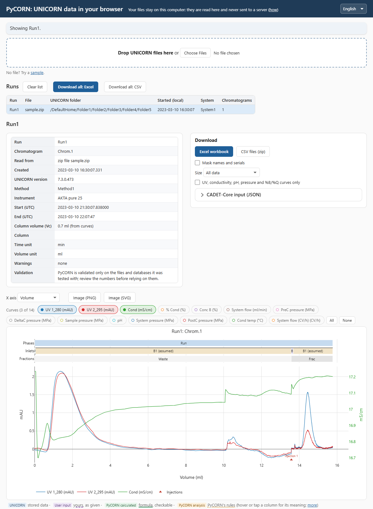
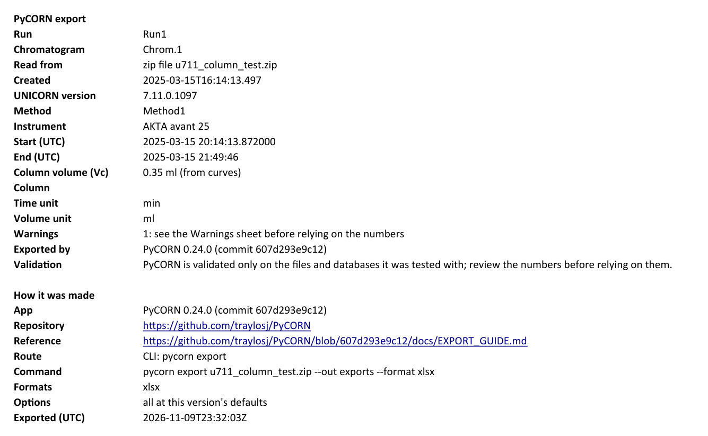
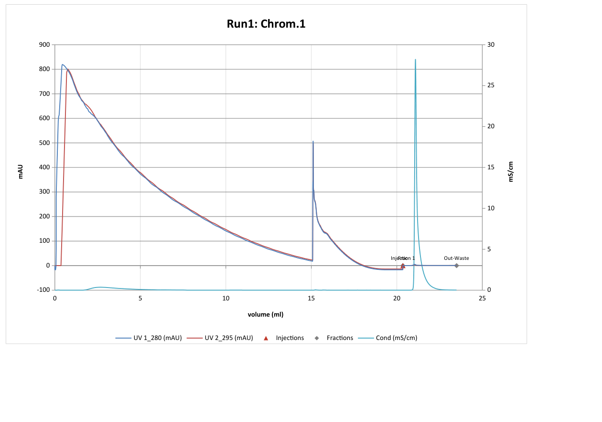

# Getting Started

Pick the task you have. You do not need to program for any of these.

| I want to... | Go to |
|--------------|-------|
| Look at a run, or get Excel, without installing anything | [1. In the browser](#1-in-the-browser) |
| Turn result files into Excel or csv on my computer | [2. Zip to Excel](#2-zip-to-excel) |
| Find runs in the UNICORN database | [3. Find runs](#3-find-runs-in-the-database) |
| Connect to the UNICORN database | [4. Set up the database](#4-set-up-the-database) |
| Fix an error | [5. When something goes wrong](#5-when-something-goes-wrong) |
| Build CADET input, convert units, use UV concentration | [Next steps](#next-steps) |

> PyCORN has only been checked against the UNICORN files and databases we had access to.
> Review every output before relying on it. Each exported run has a `warnings.csv` (and a
> Warnings sheet in Excel): read it.

## 1. In the browser

Open **<https://traylosj.github.io/PyCORN/>** and drop one or more `.zip` or `.UFol` result
files on it (export them from UNICORN first). You get the chromatogram, the phase, injection
and fraction tables, the method variables and any warnings. Buttons download the Excel
workbook, csv files or CADET-Core input. Above the chart, pick the x axis (clock, time,
volume or CV) and switch curves on and off with their chips; the tracks show phases,
inlets, fractions and pauses. **Cancel** stops a long read or download; **Stop now** restarts Python
if a step takes too long.

In the run list, a click shows a run (and ticks only that one). Ctrl-click (Cmd-click on a Mac)
or Shift-click ticks several, as in a file explorer; the tick box ticks one run without
clearing the others. With two or more ticked the chart overlays them (up to 10), and the
download offers "Ticked runs" first; the tables stay on the run you clicked last. "This run" on
the chart bar shows that run alone until the ticks change.

**Phase window statistics** (folded, below the key tables): add a window relative to a phase
(phase, from, to, unit; e.g. the last 2 CV of Elution, written `Elution:end-2:end CV`) and tick
a curve role such as UV. The table then gives n, mean, median, SD, min and max for each ticked
run, and the downloads include it, as `pycorn export --window` does
([EXPORT_GUIDE.md](EXPORT_GUIDE.md#phase-window-statistics---window)). Nothing is set at first;
**Clear** removes your windows and curves.



- The first visit downloads about 15 MB (the status line says "Downloading", then "Starting
  Python"). The browser normally keeps it, so later visits download almost nothing; a private
  window, or cleared browser data, downloads it again.
- Your files are not uploaded: the page runs inside your browser tab. How to check that
  yourself: [WEB_PRIVACY.md](WEB_PRIVACY.md).
- It reads files only. To search the database, use steps 3 and 4.

## 2. Zip to Excel

Use this for many files at once, for a whole `.UFol` folder, or when you want the same
folder layout every time.

**Install (once).** You need Python 3.9 or newer and [Git](https://git-scm.com/downloads).
In a terminal (Command Prompt or PowerShell on Windows):

```
python -m pip install "pycorn[database] @ git+https://github.com/traylosj/PyCORN.git@master"
```

`[database]` adds what step 3 needs; it does no harm if you only use files. To update
later, run the same command with `--upgrade --force-reinstall` added. A package index
(`pip install pycorn`) is planned; until then, use the line above.

**Export.** Give `pycorn export` your files, a `.UFol` folder, or a folder holding them,
and a folder to write to:

```
pycorn export my_run.zip --out exports/ --format xlsx
```

If the terminal says `pycorn` is not found, use `python -m pycorn export ...` instead.

`--format` takes `csv` (the default), `xlsx` or both (`--format csv,xlsx`). `exports/` then
holds one folder per run (inside it, the run's UNICORN folder path). For Excel, open the
`.xlsx` in it, named after the run and chromatogram (such as `Run1_Chrom.1.xlsx`):

- **Summary** first: the run, method, instrument, column, how many warnings to check, how
  the workbook was made, and what every other sheet holds.
- **Chart**: the chromatogram, with injection and fraction starts marked.
- One sheet per table (phases, injections, fractions, method variables, warnings, ...).





These are from a sample run in this repository (`samples/u711_column_test.zip`), made as
shown above.

Running the command again skips runs already exported. Add `--update` to redo only the ones
that changed, or `--overwrite` to redo all. Every flag, file and column:
[EXPORT_GUIDE.md](EXPORT_GUIDE.md). Each column's origin (UNICORN, your input, or
calculated by PyCORN) is listed in the workbook's `Column guide` sheet.

**Sharing a file?** A result `.zip` names people, computers, instruments and projects. Add
`--mask-identifying` to the export to blank those in the tables, or see
[`tools/anonymize_zip.py`](../tools/anonymize_zip.py) before sending the zip itself.

## 3. Find runs in the database

This needs step 4 done first. `pycorn find` searches in the database (it never reads the
whole database), prints how many runs match and shows the first 20:

```
pycorn find --folder "/DefaultHome/Projects/**" --run-start 2024-01-01..2024-06-30 --csv runs.csv
```

- `--folder`: the folder path from the root; `**` includes subfolders.
- `--run-start`: a date range, `from..to`. Either end can be left empty (`2024-03-01..`), and
  one date means that day.
- `--name "*Test*"`: `*` and `?` are wildcards. Repeating a flag means "any of".
- Other filters: system, user, column, batch, curve roles (`--has-role uv`), method
  variables (`--var "Flow rate>=1 ml/min"`). The full list is in
  [EXPORT_GUIDE.md](EXPORT_GUIDE.md#pycorn-find).

`--csv runs.csv` saves the selection. Open it in Excel and delete the rows you do not want,
then export exactly those:

```
pycorn export --from runs.csv --out exports/ --format xlsx
```

If more than 500 runs match, `find` prints how to continue (`--after ...`) or use `--all`.

## 4. Set up the database

You need a SQL Server login for the UNICORN database. Ask your UNICORN administrator for
one: the repository holds an admin script that creates a read-only login
([`sql/scripts/create-user.sql`](../sql/scripts/create-user.sql)). Windows sign-in is not
supported, only a SQL Server login and password.

Run:

```
pycorn-setup
```

It asks for the server (name or address), port (Enter for the default, 1433), database name,
login and password. The password is not shown while you type. It saves the answers in a
settings file for your user and then tests the connection, ending in `[OK] connected` or
`[FAIL]` with a reason. Nothing you typed is printed back. A session looks like this (the
values here are placeholders, and the file is under your own user folder):

```
PyCORN database settings: C:\Users\YOU\AppData\Roaming\pycorn\.env
Database server (name or IP address of the UNICORN SQL Server): YOUR_SERVER
Port (Enter for the default, 1433):
Database name (Enter for the login's default database): YOUR_DATABASE
SQL Server login name: YOUR_LOGIN
Password (not shown while typing):
Saved (UNICORN_SERVER set, UNICORN_PORT empty, UNICORN_DATABASE set, UNICORN_USER set, UNICORN_PASSWORD set).
Testing the connection...
[OK] connected
```

If a settings file exists already, it says "Updating the existing file" and shows `set` or
`empty` for each setting, and Enter keeps the current value.

- To check the connection again later without answering questions: `pycorn-setup --test-only`
  (it tests the settings `pycorn find` uses, each server in turn).
- To change a setting, run `pycorn-setup` again: Enter keeps the current value. The old file
  is kept next to it as a dated copy (`.env.<date>_<time>.bak`); each holds the password, so
  remove old ones you no longer need (PyCORN warns when there are more than 5).
- For administrators setting up many PCs: `pycorn-setup --from-env` asks nothing and writes
  the file from the `UNICORN_*` environment variables (`--overwrite` to update an existing
  file); see `pycorn-setup --help`.
- Keep the settings file private. Do not paste it, or the server or login, into a chat, an
  issue or an email.
- Several servers or databases, and where the settings file can live:
  [CONNECTOR_GUIDE.md](../sql/CONNECTOR_GUIDE.md).

## 5. When something goes wrong

Every command says what went wrong in one line, then exits with a code:

| Exit | Meaning | What to do |
|------|---------|------------|
| 0 | Everything asked for was done | |
| 1 | It ran but left something out | Read the lines above the end: a database not reached, a file not read, a run not loaded |
| 2 | `error: ...` and nothing was done | Check the flag, file name or settings; for the database, run `pycorn-setup --test-only` |
| 3 | `unexpected error (...)` | Run the same command again with `--debug` and report it |

Common messages:

- **"no database server is set up"**: run `pycorn-setup`.
- **"cannot reach the SQL Server"**: the server name or port is wrong, or you are not on the
  network that can see it (VPN?).
- **"the server refused the login"**: wrong login name or password.
- **"not a zip file, or the file is damaged" / "not a UNICORN result"**: export the result
  from UNICORN again as `.zip`.
- **`incomplete` or `not loaded` in `index.csv`**: the run could not be fully written; the
  warning printed in the terminal says why.

Report a problem, or a file that does not read right, at
<https://github.com/traylosj/PyCORN/issues>. Issues are public: attach only runs you are
allowed to share (see "Sharing a file?" in step 2).

## Next steps

| If you want to... | Read |
|-------------------|------|
| Every flag, file and column of `find` and `export` | [EXPORT_GUIDE.md](EXPORT_GUIDE.md) |
| Use PyCORN from Python: curves by role, axes, units, tables | [USER_GUIDE.md](USER_GUIDE.md) |
| Run PyCORN from a script or an AI agent | [AGENT_GUIDE.md](AGENT_GUIDE.md) |
| Feed CADET or CADET-Process, or calibrate UV to concentration | [CADET_GUIDE.md](CADET_GUIDE.md) |
| Understand how phases, holds and pauses are read | [RUN_STRUCTURE_GUIDE.md](RUN_STRUCTURE_GUIDE.md) |
| Search several servers and databases | [CONNECTOR_GUIDE.md](../sql/CONNECTOR_GUIDE.md) |
