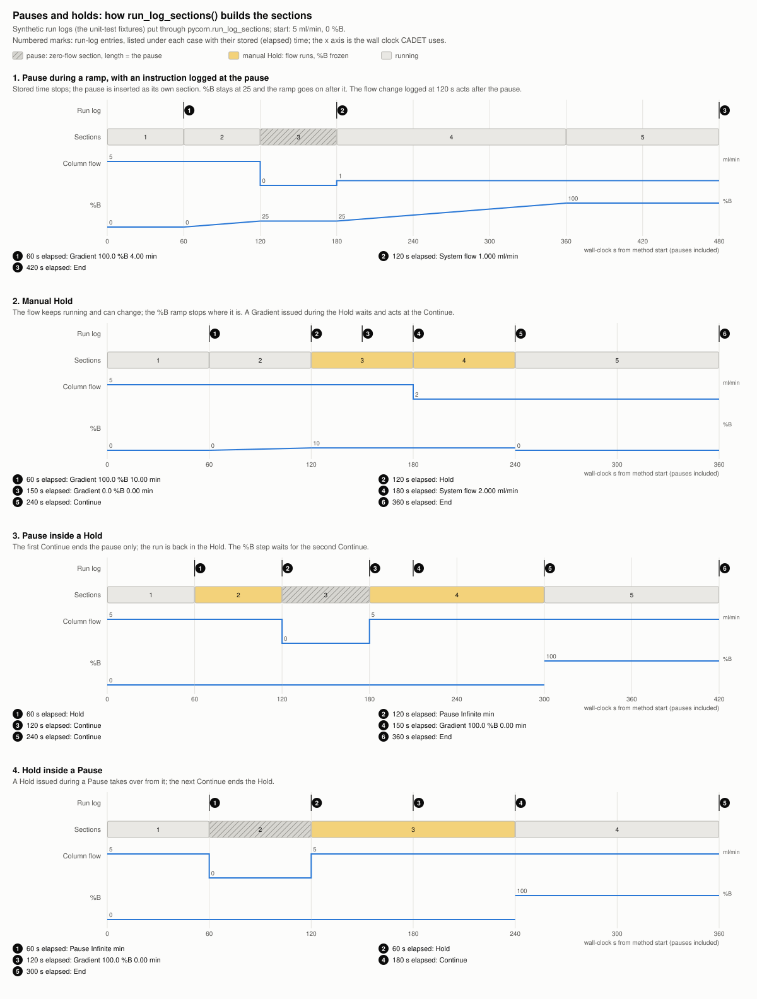
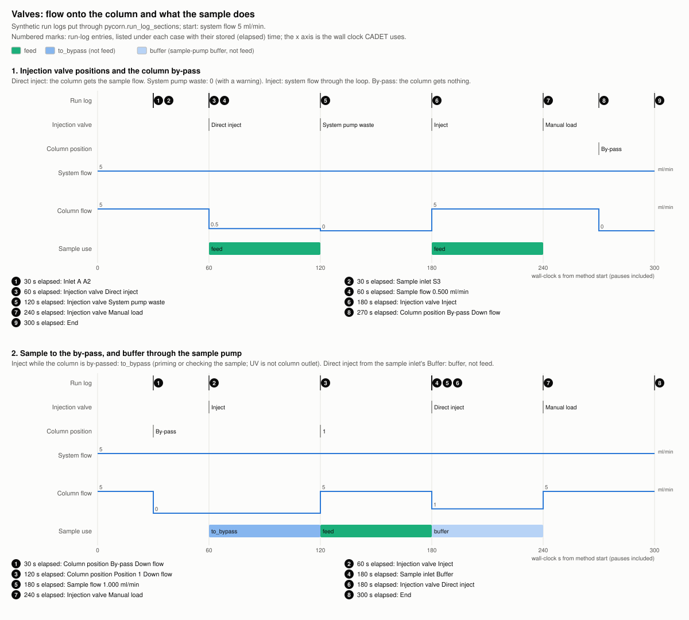
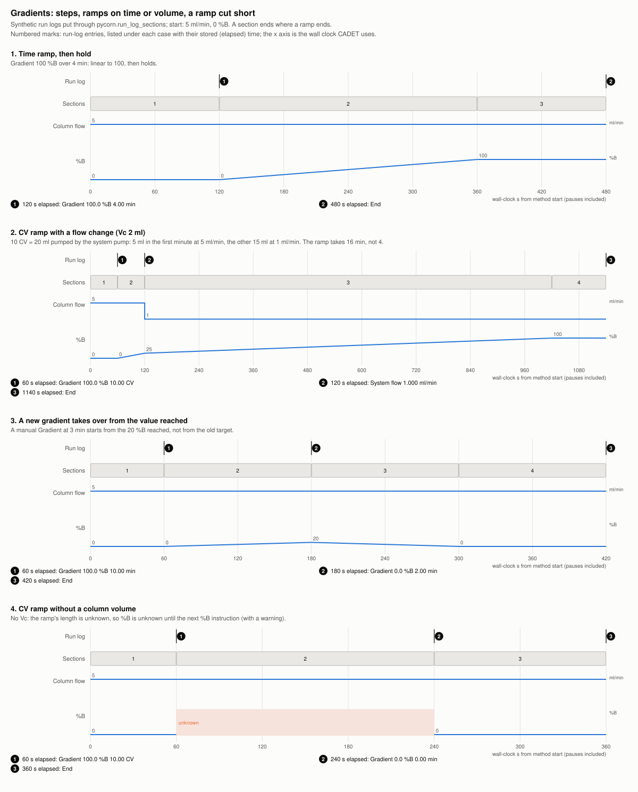

# Phases, sections and pauses: how PyCORN reads what ran

For new users. This page explains how a UNICORN run is structured and how PyCORN turns it into
tables and the CADET export. It describes what PyCORN does today. Choices still being made
are in [`docs/RUN_STRUCTURE_REVIEW.md`](RUN_STRUCTURE_REVIEW.md) (for experts).

## What a run contains

- **Method.** What was planned: **phases** (Equilibration, Sample Application, Elution, ...),
  each made of **blocks** (Equilibrate, Inject, Isocratic, ...), each a list of
  **instructions** (`System flow 5 {ml/min}`, `Gradient 100 {%B} 0 {min}`, `Injection valve
  Inject`, ...).
- **Run log.** What actually ran, entry by entry, with times. It records phase and block
  starts, every instruction, manual changes, pauses and holds.
- **Curves.** What was measured: UV, conductivity, pH, pressure, flow, %B, ...

PyCORN builds everything from the **run log**, because a run can differ from its method
(manual changes, skipped blocks, breakpoints). The method is only used as a hint.

## Three levels of detail

| Level | One row is | Where you see it |
|---|---|---|
| **Phase** | One phase of the method | `chrom.phase_table()`, the `phases` CSV and Excel sheet, the web page |
| **Block** | One block inside a phase | the `blocks` column of the phase table |
| **Section** | A stretch where nothing changes: same flow, same %B (or one straight ramp), same valves | `run_log_sections()`, and one CADET section each |

A section starts whenever any setting changes, a %B ramp ends, or a block starts or ends.
A typical run has a few phases and 20-40 sections. `samples/u73_blank.zip` has 6 phases and
29 sections.

## What a phase row tells you

Each phase row has its start, end and length in time, volume and column volumes (CV), and
what ran in it. When a setting changed inside the phase, all its values are listed in order:
`5 -> 1` means the flow was 5 ml/min, then 1 ml/min.

**Why a phase often starts with the previous phase's values.** UNICORN logs the phase start
first and then runs the phase's opening instructions one by one, about 0.2 s apart. For the
first 0.4-2.4 s the previous flow or %B still holds. PyCORN reports this as it ran, so a
phase that sets 1 ml/min can show `5 -> 1`.

## Seeing it on the web page

Above the chart, the [web page](https://traylosj.github.io/PyCORN/) draws tracks for the
phases, the inlets, the fractions and the pauses: bars from start to end, and a mark for a pause. Move the cursor along the chart
and its label names the phase, fraction and pause at that point. Pick the x axis above the
chart: **clock time** (the instrument's local time, pauses included), **method time**,
**volume** or **CV**. A pause has no method time, volume or CV, so on those axes it is a mark
with a dotted line; on clock time it has its real length.

## Pauses and holds

- **Pause.** The pumps stop and UNICORN's clock stops. PyCORN puts the pause in as a section
  with zero flow, as long as the pause. Times on the wall clock (UTC, and the CADET time axis)
  include the pause. UNICORN's method time doesn't. UNICORN also stops its clock without
  logging a pause, after washes, alarms and errors. PyCORN finds these from the date stamps in
  the run log.
- **Hold.** The flow keeps running and the clock runs, but a %B gradient stops where it is. A
  gradient started during the hold waits for `Continue`.
- `Hold until ...` (wait for a stable UV signal, for example) is a normal block, not a hold.

## Flow and the sample

The flow through the column depends on the valves:

| Injection valve | Column flow | Sample |
|---|---|---|
| Manual load | system flow | none |
| Inject (sample loop) | system flow, through the loop | feed |
| Direct inject (sample pump) | sample flow | feed (buffer if the sample inlet is at Buffer) |
| System pump waste | 0 | none |
| any, with the column valve at by-pass | 0 | sample to the by-pass is not feed; UV there is not the column outlet |

UNICORN doesn't log the loop volume or the sample tubing volume. The tables show the valve
as it was set. In Python, the CADET export can end the feed when the loop is empty, if you
give it the loop volume (`build_experiment(run, loop_volume=(0.5, "ml"))`, see
[`docs/CADET_GUIDE.md`](CADET_GUIDE.md)). `pycorn export` doesn't pass a loop volume to the CADET files yet.

## Inlets

The `inlets` column and the page's inlets track show which inlets the run drew from: line A
below 100 %B, line B above 0 %B, the loop or the sample inlet while the injection valve sends
sample. The run log often doesn't say which position a line was on, so PyCORN also reads the
system's valves and pumps, which each result stores (`run.system_configuration()`):

| What the run log and the system say | Shown as | `inlets_source` |
|---|---|---|
| the run log set the position | `B2` | known |
| the line has no inlet valve (one fixed line, nothing to set) | `B` | known |
| the line has a valve, no position set yet | its first position: `B1 (assumed)`; sample inlet valve: `Buffer (assumed)` | assumed |
| the stored configuration doesn't say | `B (not known)` | not known |

What the run log set always wins. The valves are read per result, from the hardware it lists,
never from the system model: any valve can be missing on one system and installed on another.
On a system with a quaternary valve, its shares are listed as logged (`Q1 50%+Q2 50%`); for now
its lines are taken as feeding the A and B pumps (provisional, with a warning).

## Gradients

- `Gradient 100 {%B} 0 {min}` is a step. A length other than 0 is a straight ramp from the %B
  in force to the target.
- The ramp length is given in the unit of the block's `Base` instruction: min (Time), ml
  (Volume) or CV (column volumes). UNICORN accepts any of the three, and the instrument runs
  the ramp the same way.
- A ramp in ml or CV follows the volume the system pump delivers, so if the flow drops the
  ramp takes longer. A ramp in min follows the clock, so if the flow drops it delivers less
  volume.
- A new gradient during a ramp starts from the %B reached.
- A ramp in ml or min needs no column volume. A block with a CV base always carries one:
  the run log starts it with `Base CV, Vc=<volume> {ml}` (a column type's volume, or one
  typed for `Any`), and the instrument uses it. PyCORN reads that volume to turn CV into ml.
  If it can't find it in the log or elsewhere, it shows %B as unknown for that ramp, with a
  warning. The ramp still ran; PyCORN just can't place it.

## Warnings

PyCORN never guesses silently. When it has to assume something (a flow before the first
flow instruction is taken from the flow curve, an instruction it doesn't know is ignored, a
set-point doesn't match its curve), it says so in the warnings. Each warning names the time
and the value used.

## More

- [`docs/USER_GUIDE.md`](USER_GUIDE.md): the `Run` model, axes, roles, units and tables
- [`docs/EXPORT_GUIDE.md`](EXPORT_GUIDE.md): every exported file and column
- [`docs/CADET_GUIDE.md`](CADET_GUIDE.md): the CADET export
