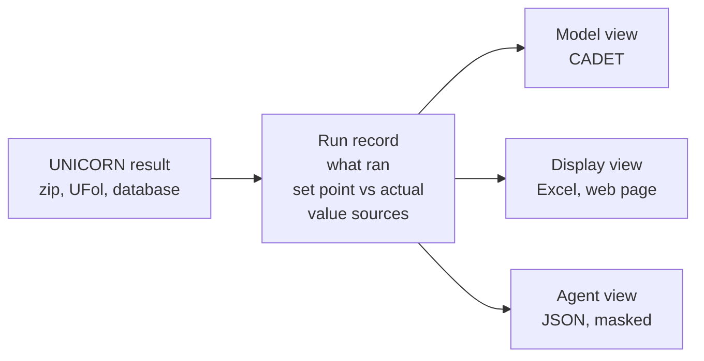
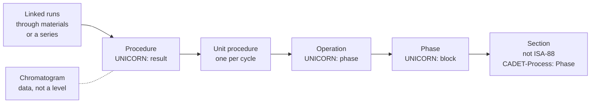
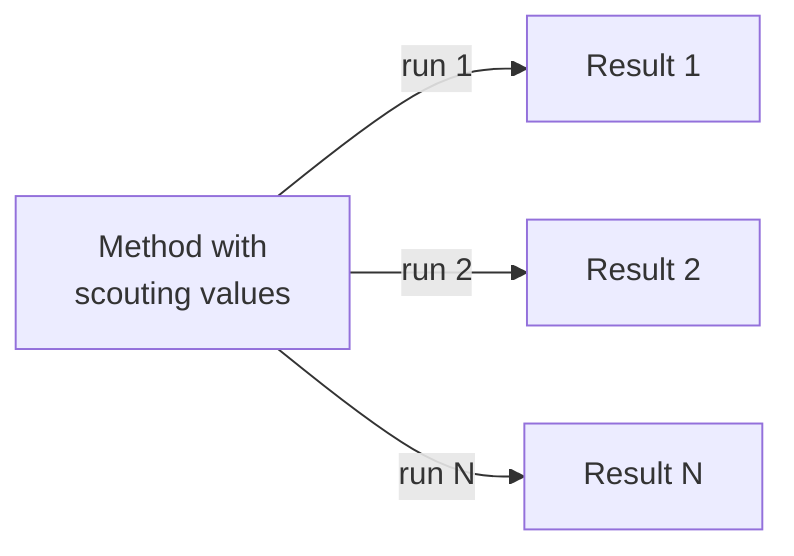
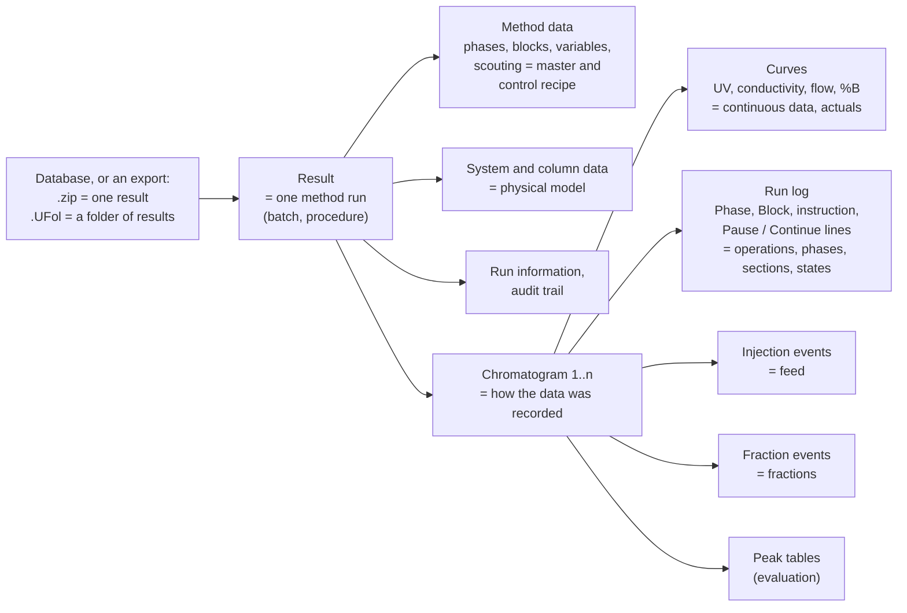
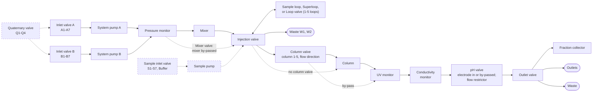
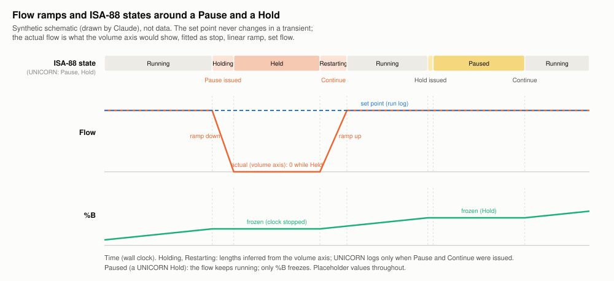
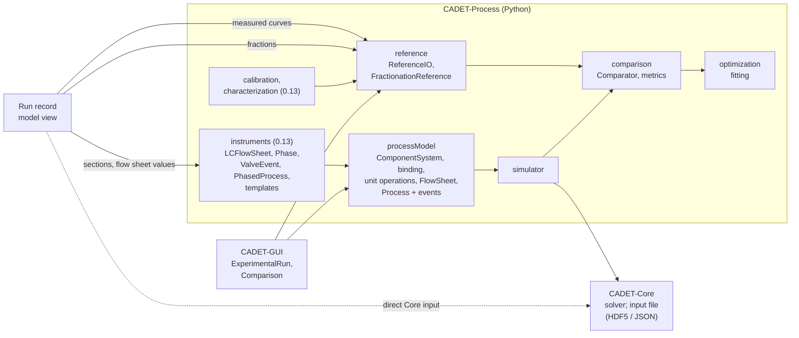
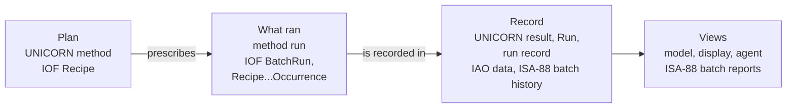

# Run structure: read a run once, describe it for plant and lab (proposal)

Draft for the owner's review, started 2026-11-12, reorganized 2026-11-14. Nothing here is
built.

> **About the diagrams.** Every diagram in this document is synthetic: drawn by Claude (an
> AI assistant) to illustrate the proposal, not taken from UNICORN, CADET or a standard.
> The Mermaid diagrams, the cycles figure and the transient-states figure are schematics
> with made-up examples (names such as "Lot X", "Run 1" or "Phase P1" are placeholders, not
> real data). Figure 7 was also drawn by Claude, from a public example result
> (`samples/u73_blank.zip`), and Figures 8a and 8b from Cytiva's public instrument
> documents. Check them against the text and the sources before relying on them.

## 1. In short

**The problem.** A UNICORN result records a run in UNICORN's own terms: the method, the run
log and the curves. Three groups read it, each with its own terms and expectations:

- **scientists** expect the method as they wrote it: phases in UNICORN's words, each with
  its flow and %B;
- **industrial standards** (ISA-88 and the batch systems built on it) expect a batch history:
  procedural levels, states, set points next to actual values, entries reflecting what
  actually happened;
- **modeling tools** (CADET) expect what the instrument did, to the second: every change of
  flow, composition and valve, the flow actually delivered.

Translating UNICORN's terms into each group's terms takes choices, and the choices have to
agree with each other (sections 3.5, 3.7 and 3.8 give examples).

**The proposal.** Interpret each run **once**, consistently, into a single description, the
**run record**, and give each group a view of it in its own terms. The record holds three
things:

- **what ran, in order**: the phases, instructions and pauses the run log shows;
- **set point next to actual**: the method's setting (say 5 ml/min) and what the instrument
  actually did (from the curves and the volume axis);
- **where each value came from**, and how sure it is (logged, measured, inferred, assumed).

**Three views of one record.** Each reader gets the same facts, chosen and worded for them:

| Reader | Gets |
|---|---|
| A modeler (CADET) | the actual value where it was measured, else the set point; every change kept, nothing smoothed; each value says where it came from |
| A person (Excel, the web page) | the method's settings per phase, as the user wrote them, in UNICORN's words; a short delay at a phase start is folded into the phase with a note |
| A script or agent | the whole record as JSON (versioned, masked by default) |

A view never computes anything the record doesn't hold, so the views can't disagree; where
they show different numbers, the record says why.



**Figure 1.** One run record, three views.

**The vocabulary.** PyCORN's users run the same ÄKTA systems in research labs (method
development, characterization, model calibration) and in process development and
production. So the record reads both ways (section 2): its levels use ISA-88, the
batch-control standard plant systems use, and its runs, studies and measurements map to the
research ontologies (OBI, Allotrope) and to CADET's terms for model calibration; UNICORN's
own words stay beside them. Both sides share one core idea that fits a chromatography run:
the method gives set points, the instrument produces actual values, and the record keeps
both without smoothing either. Section 12 maps each word.

**What stays open.** Display wording (Decide items in section 11), how UNICORN splits a run
over several chromatograms, and how cycles are marked (section 9 lists every open question
and the samples that would settle it).

## 2. Why both industrial and research standards

The same chromatography run moves between two worlds. In a **research lab** it is a
measurement or an experiment: part of a study, a design point of a DoE, data to calibrate a
model, results going to an ELN or LIMS. In **process development and production** it is a
batch step: run from a recipe on a skid, recorded for a batch record, a historian or an MES.
A run often crosses over: development runs calibrate a model that designs the production
recipe, and production batches become evidence for the next model. PyCORN serves both, so
the record holds one neutral description and maps it to each side's standards, rather than
taking one side's vocabulary:

| | Research (lab measurement, model calibration) | Industrial (process development, production) |
|---|---|---|
| Standards and ontologies | OBI and IAO (investigations, assays, data), Allotrope (AFO, and ASM for LC data), CADET (model inputs, references) | ISA-88 (batch control), ISA-95 / B2MML (materials), BatchML, IOF biopharma |
| Systems that use them | ELN, LIMS, modeling tools | batch systems, historians, MES |
| One result is | a measurement or a run of an experiment | a batch (made by executing one control recipe) |
| The method is | a protocol; its variables are factor levels | a master recipe; its variables are process parameters of the formula |
| A scouting series is | a study design execution (DoE) | a campaign |
| Set point vs actual | planned value vs measured value | set point vs actual value |
| Curves are | measurement data; CADET references for calibration | continuous data in the batch history, historian tags |
| Fractions and pools are | samples for offline assays (whose results feed back into a model) | material lots and sublots |
| The views that serve it | model view (CADET), display view (lab analysis), Allotrope ASM (later) | display view, BatchML batch record (later) |

The record's levels use ISA-88's names because ISA-88 is the only one of these that
structures the *procedure* (the research ontologies describe the run as one planned process
with inputs and outputs, not its inner steps); everything else in the record (values with a
source, measurements, materials, studies) is shared by both sides.

**ISA-88 in plant systems.** Plant batch systems and historians already organize run data
this way:

- **Emerson DeltaV Batch** is built on ISA-88 (procedures, unit procedures, operations,
  phases) and keeps batch history from its Batch Executive.
- **Siemens SIMATIC BATCH** with SIMATIC PCS 7 covers the ISA-88.01 models: the procedural
  model in SIMATIC BATCH, the physical model in PCS 7 engineering.
- **AVEVA Batch Management** (formerly Wonderware InBatch) follows ISA-88, writes batch
  history to a SQL Server database, and passes batch execution data to AVEVA Historian and
  MES.
- **AVEVA's PI System** batch interfaces, including those for DeltaV Batch and SIMATIC
  BATCH, build event frames level by level along the same hierarchy.

ISA-88 Part 4 (ANSI/ISA-88.00.04-2006) defines the batch production record, and MESA's
BatchML is its free XML form. A run record tagged with ISA-88 levels can therefore sit beside
plant batch data without a new vocabulary. None of these products is known to exchange
BatchML, so this is about structure, not a file format. Sources: "References" at the end.

ISA-88 conformance is not claimed: the record uses the standard's concepts and names as a
frame. Every ISA-88 statement here was checked against the full text of ANSI/ISA-S88.01-1995
(Part 1), cited by clause number; the 2010 edition (ANSI/ISA-88.00.01-2010, IEC 61512-1) may
word them differently.

**In ISA-88's own terms**, the run record is the **batch history**: "all recorded information
pertaining to a batch", associated "with the actual execution of the appropriate procedural
elements" (5.5.3). Each view (model, display, agent) is a **batch report**: an extraction of
that data, ordered for its recipient (5.5.4, 6.4.3).

## 3. From linked runs down to one value

This section walks from the largest scale to the smallest. At each level: what UNICORN
stores, what ISA-88 calls it, and what the record keeps.



**Figure 2.** The levels, from linked runs down to a section.

### 3.1 Across results: linked runs

UNICORN stores one method run per result. Whatever spans several results is a **link between
records**, never one merged record.

Results are linked in two different ways:

- **By the material.** Different methods, often on different days or skids, work on the
  same product: capture, then polishing. The runs are linked only through the material
  between them: what one run puts out (a pool) is what the next run loads. So a **material
  ID** belongs to each portion of material, not to a run: to each load (one run can load
  several materials, by several injections or sample inlets), to each fraction and to each
  pool. Fractions and pools get IDs the record can make itself (the run plus the tube or
  pool name, 3.6). A load's ID, the plant's batch or lot number (here the placeholder "Lot X"), comes
  from the caller; a text variable stored with the run (a sample ID) can be offered as a
  hint, never applied on its own. Which pool became which load is also the caller's to
  say: UNICORN doesn't store it.


**Figure 3.** Runs linked through material: every load, pool and fraction has its own material ID.

  Rounded boxes are material, each with its own ID; square boxes are runs (results), e.g.
  Run 1 a capture step and Runs 2 and 3 polishing steps. Run 1 is one result with three
  cycles (unit procedures, 3.3), each giving its own pool; combining them happens outside
  UNICORN, so the combined pool's ID comes from the caller. All names are placeholders.

  **Batch vs lot.** The word "batch" means two things here. In ISA-88 a batch is "the
  material that is being produced or that has been produced by a single execution of a batch
  process", and also "an entity that represents the production of a material" (3.5): each
  UNICORN run is one, and UNICORN stores a **Batch ID** per run (a GUID, also a `Batch ID:`
  line in the run log). The plant's numbered batch ("Lot X" above) is material: in ISA-88 terms a **lot**
  ("a unique amount of material having a set of common traits", 3.28). So the record keeps the
  run's Batch ID (from UNICORN) on the run, and a material ID on each load, fraction and
  pool.

- **By the method (a series).** One method run N times with stored variations: a scouting
  run, for method development, a designed experiment (DoE) or repeated cycles. UNICORN
  stores this link itself (scouting name, run number). A series may load one material or
  several.



**Figure 4.** Runs linked by method: a scouting series.

| Setup | ISA-88 reading | In the record |
|---|---|---|
| Several chromatography steps of one product (e.g. capture, then polishing), on different days, with different methods, on the same skid | capture and polishing are **process stages** (4.1.3.1). Strictly, ISA-88 would run them as unit procedures of one procedure for the product (5.1.2.1, 5.1.2.2); but each UNICORN method holds only its own run, and no system stores the product's procedure. So the record reads each result as one procedure, and links the procedures by the material (a divergence, defined here) | one record per result; linked through the material IDs of their loads and pools (one run's pool is the next one's load); the unit (masked system name) and column say where each ran |
| The same, on different skids | as above, on different units (ISA-88's train: "a collection of one or more units ... that has the ability to be used to make a batch of material", 3.59) | as above; the unit differs |
| A scouting run: one method run N times with stored variations | N batches from one master recipe, each from its own control recipe (the method with that run's values, 5.3.1.4) | one record per result; a series link (scouting name, run number). Whether the series repeats one process (cycles, 3.3) or varies it (method development, DoE) is the caller's to say |
| Methods run back to back from a queue | separate procedures | separate records, ordered by UTC; linked through material, as above |
| Connected processing across skids (one skid's outlet feeds the next, at the same time) | units running concurrently; ISA-88 "does not specifically address" continuous processes (4.1), and ISA-106 (Procedure Automation for Continuous Process Operations) covers them | one record per skid, aligned on the UTC axis every record has; which outlet feeds which inlet comes from the caller (UNICORN doesn't store it) |
| Multi-column continuous chromatography on one skid (columns load, wash and elute in a staggered rotation) | one procedure with parallel work on several columns | **not supported**: the record has one sequence of sections per run; it would need a column tag on every section and parallel timelines. Waits for a sample |

The link labels (a lot, a series) come from the caller. ISA-88 asks for exactly these links:
"batch tracking information", meaning links between batch histories "ranging from the use of
one batch as raw material to another, to the splitting or combining of batch histories due
to splitting or combining of batches" (6.4.2), so that a product can be traced back to its
materials and forward to every product a material went into (6.4.1.3). Where the labels go
in a batch record: section 7.

### 3.2 One result: the procedure

A result is one method run. In ISA-88 terms the UNICORN method is a **master recipe**
(5.3.1.3); the method with the values this run used (variables, scouting values) is the
**control recipe**, which "defines the manufacture of a single batch" (3.11, 5.3.1.4); the
run is that **batch**, and its **procedure** (3.37: "the strategy for carrying out a
process") runs on one clock, on one unit (the system). The record is built once per result, from all its
original chromatograms (3.4); the method, the system settings and the other result-level
data are shared by all of them.

What UNICORN stores for one result, in its own words, with this document's term beside each
part:



**Figure 5.** What UNICORN stores for one result, with this document's terms.

The run log is the backbone: its `Phase` lines start operations, `Block` lines phases, and
each executed instruction a section (D13: what ran, not what the method planned). ISA-88
asks the same of a batch history: entries "should, to the largest possible extent, reflect
the actual physical/chemical events that influence the batch, not only what was anticipated
in the recipe" (6.4.1.2).

### 3.3 Inside the procedure: unit procedures and cycles

A **unit procedure** is a complete piece of work on one unit (ISA-88: "a strategy for
carrying out a contiguous process within a unit", made of contiguous operations, 3.61). A run has
**one** by default.
It has several only when the run repeats a whole process, which chromatographers call
**cycles**: to process enough material, one recipe runs the same sequence (equilibrate, load,
wash, elute, clean) N times on one column. "Cycle" is not an ISA-88 term; the record keeps
the chromatographers' word and maps each cycle to one unit procedure.

The same N cycles can be recorded three ways:

| How the cycles were recorded | ISA-88 reading | In the record |
|---|---|---|
| A scouting run: N results | N batches from one master recipe | one record per result with a series link (3.1); `cycle` = run number when the caller says the series is cycles |
| One result, a new chromatogram at each cycle boundary | one procedure, N unit procedures | each chromatogram a unit procedure with `cycle = n`, when the caller says so; the cuts are checked to fall between operations |
| One result, no new chromatograms (or cuts elsewhere) | one procedure, N unit procedures | `cycle` from the caller (e.g. "a cycle starts at each phase P1", with the phase named as the method names it); a repeat found in the logged phase order is offered as a hint, never applied on its own |

Every segment carries `cycle` (empty when the run doesn't cycle), so the views work the same
whatever the recording: a summary row and window statistics per cycle, the overlay aligned at
each cycle's start (W12; ISA-88's multi-batch trend likewise "must be with relative
time-axis", 6.4.3.2), one CADET input per cycle (real cycles differ as the column loads
and ages, so each keeps its own measured reference).


**Figure 6.** Cycles and chromatograms in one result (schematic).

(A synthetic schematic drawn by Claude, generated by `tools/draw_cycles_chromatograms.py`.)

One rule holds the hierarchy together: a unit procedure is made of whole operations, so a
cycle or unit-procedure boundary must fall **between** UNICORN phases. (A procedure is "an
ordered set of unit procedures" (5.1.2.1), and several may run at once in different units
(5.1.2.2); ISA-88 neither states nor rules out several one after another on one unit, so
reading each cycle as one is this proposal's choice.)

### 3.4 Chromatograms: how the data was recorded

A method can start a new chromatogram partway through a run (UNICORN's New Chromatogram
instruction). Some users do this to set one piece of work apart (a by-pass measurement, then
the column run; or one cycle from the next), others don't, so the split is not a reliable
sign of intent. **A chromatogram is not an ISA-88 level**: it is a stretch of the batch
history's data (5.5.3). The record tags every segment, value and curve with the chromatogram it came
from, and joins the chromatograms on one clock.

What is known, and what isn't:

- The owner's statement from memory (2026-11-14), not checked on any example: the new
  chromatogram's time starts at 0 at the instruction; each chromatogram's run log
  (`Logbook`) holds only its own part; collection stops in one and starts in the next, so
  they don't overlap.
- Storage points the same way: in the database a run log (`EventCurve` with
  `EventCurveTypeName = 'Logbook'`, its lines in `Event`) is keyed by `ChromatogramID`, and
  only the chromatogram carries `ResultID`; in a `.zip` the event curves sit in each
  `Chrom.N.Xml`. Likely, but to be verified with an example.
- Not known: how the run log records the instruction itself, and whether settings (flow,
  %B, valves, phase, Pause / Hold state) carry across the cut and are repeated at the start
  of the next run log.

| Thing | In the record |
|---|---|
| Each original chromatogram | a `chromatogram` segment: name, start and end on the procedure clock, its curves |
| The clock | chromatogram 1's own; chromatogram n starts where n-1 ends, checked against its `ChromatogramStartTime` in UTC |
| Settings across the cut | **open test case.** If they carry over unrepeated, the record takes them from the previous chromatogram, which is hard to read and not built until a sample shows it; until then they are `not_known` before the first instruction |
| A UNICORN phase across the cut | open, with the settings: one operation in both segments if the next run log starts inside it |
| The instruction | a section boundary where it ran, if the run log records it |
| What the user meant by the split | never inferred; the caller may make chromatograms unit procedures or cycles (3.3), or map them to an operation |
| Imported and derived chromatograms (W17) | not part of the procedure: an imported one links to its source result, a derived one is analysis; linked, never merged |

Display keeps one table set per chromatogram, as today, noting a phase cut at the boundary;
the model picks a span by chromatogram, cycle or operation on the one clock.

### 3.5 Inside a unit procedure: operations, phases, sections

ISA-88's procedural levels end at the **phase**: "The smallest element of procedural control
that can accomplish a process-oriented task is a phase. A phase may be subdivided into
smaller parts", and "the logic or set of steps that make up a phase are equipment specific"
(ISA-88.01-1995, 5.1.2.4). So below the phase the record uses no ISA-88 level: it cuts the
run into **sections**, the word CADET-Core uses for the stretches of its input
(`SECTION_TIMES`), from the instructions UNICORN logged as executed.

**What an instruction is, in ISA-88 terms.** A phase "can issue one or more commands", such
as "specifying their set points" to basic control (5.1.2.4). A UNICORN instruction (`Flow`,
`Gradient`, `Injection valve`) is such a command. Basic control then keeps the equipment in
that state (5.1.1: "establishing and maintaining a specific state of equipment") until the
next command changes it. That is why a set point carries across a phase boundary until the
new phase's own instruction replaces it.

| Level | UNICORN | CADET-Process 0.13 | In the record | Row in Figure 7 |
|---|---|---|---|---|
| Operation (ISA-88: "a major processing sequence that takes the material being processed from one state to another", 5.1.2.3) | a UNICORN **phase** (Equilibration, Sample Application, ...) | none (CADET-GUI: a "Phase ..." run-log marker) | `operation`: number, instance (repeats; each occurrence identified, as 5.3.3.2 asks), logged text, display name | "Operation" |
| Phase (ISA-88: "the lowest level of procedural element", 3.34) | a UNICORN **block**, and the activities running at once inside a phase (flow and gradient, sample feed, fractionation, watches) | none (activities are flow-sheet units) | `phase`: one per equipment activity, with the equipment module that carries it out | "Phase"; "Phase activity" shows one activity, the sample feed |
| Section (not ISA-88; CADET-Core's word) | the stretch from one executed instruction to the next: the settings (flow, %B or its ramp, valves, feed, state) don't change inside it | **`Phase`** (one flow, linear composition) and `ValveEvent` | `section`: the record's lowest level, as the model gets it | "Section" |

**Display: sections joined (proposed).** People don't need 29 sections for one run. The
display view joins neighbouring sections whose flow, %B, feed and state are equal, and folds
the previous phase's set points into the phase when the phase's own instruction replaces them
within 10 s, with a note (decided 2026-11-12). This is computed from the sections each time
and isn't stored in the record. In `u73_blank.zip` the 29 sections become 12 such rows. What
to call them is open (section 11: "the words below the phase"); this draft calls them
**display steps**.


**Figure 7.** Operations, phases, sections and display steps of one run (`samples/u73_blank.zip`).

(Drawn by Claude from the example result, generated by `tools/draw_run_levels.py`. Top to
bottom: the record's levels, then the display steps (proposed). The curves below are the
column flow and %B set points from the run log.)

The word "phase" means three things: a UNICORN phase is an ISA-88 operation, an ISA-88 phase
is closer to a UNICORN block, and a CADET-Process `Phase` is a section. The record uses
ISA-88's words with UNICORN's beside them; display keeps UNICORN's; `Phase` appears only in
CADET objects.

### 3.6 Where it ran and what it did to the material

**Physical model** (where it ran, 4.2): the unit is the system (CADET: `LCFlowSheet`).
ISA-88 draws the line between the two lower levels by what the equipment does: a collection
that "executes one or more equipment phases" is an **equipment module** (5.2.3.3); a
**control module** only carries out basic control, such as "an on/off automatic block valve
with position feedback switches" (4.2.7); "control modules do not perform procedural
control" (5.2.2.4.2). So:

- equipment modules: the system pump with its mixer (flow and gradient; CADET: buffer inlets
  A-D and mixer), the sample feed (sample pump, or injection valve with sample loop;
  `ValveEvent`) and the fraction collector (fractionation);
- control modules: each valve on its own (inlet valves, column valve: CADET `bypass_units`,
  fixed for the run; outlet valve) and the UV, conductivity, pH and pressure monitors (CADET:
  observation points such as `column.outlet`).

Source: the system configuration stored in the result.

**The flow path.** Figure 8a follows the order of the high-pressure tubing in Cytiva's
public documents for ÄKTA avant 25 and ÄKTA pure; Figure 8b the flowchart of ÄKTA ready, a
single-use process-scale system (References). Solid lines are the path the documents show;
dashed boxes and lines depend on the system and its installed modules. ÄKTA pure's manual
says "the configuration of the system is defined by the user", and ÄKTA avant 25's
documentation lists standard and optional modules. Other process-scale systems (ÄKTA
process, ÄKTA pilot, ÄKTA ready XL) are not covered: no document was read for them.



**Figure 8a.** The liquid flow path of an ÄKTA lab system, from Cytiva's public documents
(schematic). Dashed: depends on the system's modules. The column's outlet returns through
the column valve before the UV monitor.

```mermaid
flowchart LR
    im["Inlet manifold<br/>XV-001 to XV-006<br/>buffers and sample"] --> p1["System pump P-201"]
    bb(["Buffer B"]):::opt -.-> p2["Gradient pump P-202"]:::opt
    p1 --> pt1["PT-111"]
    p2 -.-> pt1
    pt1 --> atv["Air trap valves<br/>XV-021 to XV-023"]
    atv -- "Inline" --> at["Air trap AT-221"] --> cv["Column valves<br/>XV-031 to XV-033"]
    atv -. "Bypass" .-> cv
    cv -- "Inline" --> col["Column"] --> pt2["PT-112<br/>pH AE-121 (optional)"]
    cv -. "Bypass" .-> pt2
    pt2 --> fe["Flow meter FE-141<br/>temperature TE-161"]
    fe --> ce["Conductivity CE-101"] --> uv["UV AE-131"]
    uv --> pt3["PT-113"] --> om["Outlet manifold<br/>XV-051 to XV-056"]
    classDef opt stroke-dasharray: 5 5
```



**Figure 8b.** The liquid flow path of ÄKTA ready, from its Operating Instructions
(28960345 AH, 3.3-3.5; schematic). Dashed: the gradient flow section, only on systems with
the optional gradient pump. All 19 valves are pinch valves on single-use tubing; there is no
injection valve, loop or mixer: sample enters through an inlet of the manifold and the
system pump. The sensors after PT-112 are drawn in the order of the flow kit's parts list;
the flowchart drawing was not read as an image, so check it there.

What differs for the record on ÄKTA ready: the feed is an inlet position, not an injection
valve setting (no `ValveEvent`, no loop volume); the flow is the pumps' (peristaltic, with a
flow meter FE-141 as a measured actual); the air trap's volume is on the path when it is
`Inline`; buffer B has no inlet valve.

Each valve on the path, what the record takes from it, and where its position comes from.
The positions are UNICORN's words (kept under `native`); the set-up comes from the system
configuration (`system_configuration.py` reads the inlet valves, sample inlet valve, sample
pump and quaternary valve today), never from these figures:

| Valve | Positions (UNICORN's words) | What the record takes from it | Source |
|---|---|---|---|
| Inlet valves A, B, quaternary valve | inlet ports (`A1` ...), quaternary mix | the buffer line and position per section (Decide 22: known / assumed / not known) | run log; set-up from the system configuration |
| Mixer valve (ÄKTA pure, optional) | via the mixer, or by-passing it | whether the mixer volume lies on the path | run log; set-up from the system configuration |
| Injection valve | `Manual load`, `Inject`, `System pump waste`, `Direct inject`, `Sample pump load`, `Sample pump waste` | the feed sections and the column flow (D14, D16-D21); CADET's `ValveEvent` | run log |
| Sample inlet valve, sample pump | sample ports (`S1` ...), `Buffer` | which load a feed section takes (3.1) | run log; set-up from the system configuration |
| Loop valve (optional) | loop 1-5 | which loop fed; its volume is the caller's (D19) | run log; volume from the caller |
| Column valve | column position, flow direction, by-pass | column flow zero at by-pass (D14, Decide 16); which column (Vc) | run log; column from the result |
| pH valve | electrode in the path or by-passed | whether a pH curve was measured in the flow | run log |
| Outlet valve | fraction collector, outlet ports, waste | flow-through and waste vs eluate (Figure 9) | run log |
| ÄKTA ready: inlet manifold XV-001 to XV-006 | one open inlet | buffer and sample per section; a feed section is a sample inlet open, as the caller names it | run log; which inlet holds sample from the caller |
| ÄKTA ready: air trap valves XV-021 to XV-023 | `Inline` (XV-022 + XV-023 open), `Bypass` (XV-021) | whether the air trap's volume is on the path | run log |
| ÄKTA ready: column valves XV-031 to XV-033 | `Inline` (XV-032 + XV-033 open), `Bypass` (XV-031) | column flow zero at `Bypass`, as the lab systems' column valve | run log |
| ÄKTA ready: outlet manifold XV-051 to XV-056 | one open outlet | flow-through and waste vs eluate, by the caller's naming of the outlets (no fraction collector) | run log; outlet use from the caller |

The volumes along the path (loop, sample flow path, mixer, the tubing between injection
valve, column and monitors) are values like any other: from the stored system configuration
(the mixer), or from the caller, each with its source. The tubing lengths a document lists
as delivered are not used as defaults (D28): a site's tubing differs.

**Process model** (what it did to the material, 4.1.3). ISA-88 describes a process without
equipment, in three levels:

| ISA-88 level | In chromatography | Counterpart in the run |
|---|---|---|
| process stage | capture, polishing | - |
| process operation | equilibrate, load, wash, elute, strip, clean | an operation (UNICORN phase) (5.2.1, Figure 7) |
| process action | - | - |

CADET's templates (`PulseInjection`, `Step`, `StepElution`, `LWE`, `Breakthrough`) and
CADET-GUI's experiment types are equipment-free in the same way.

UNICORN doesn't store the process operation. Phase names usually say it, but a phase named
"Wash 2" may elute. So the record keeps a `process_operation` field on each operation,
empty unless the caller gives a mapping, never guessed.

**Material flow** (what went in and what came out). A run takes material in (the load,
buffers) and gives material out (flow-through and waste, the eluate, collected as fractions;
fractions are later combined into pools). A **lot** is ISA-88's "unique amount of material
having a set of common traits", what a plant calls its batch or lot number. Every material
below carries its own material ID: a load's from the caller, a fraction's and a pool's made
by the record. A pool that becomes the next step's load is how runs of one product are
linked (3.1).


**Figure 9.** Material flow through one run.

What the run itself tells about each material, and how the record would identify it. Masses
and concentrations are never assumed: they come from the caller, or from a UV curve with a
caller-given extinction coefficient and its accuracy note.

| Material | What the run records | Identified in the record as | Ontology terms |
|---|---|---|---|
| Load (feed) | the feed sections: valve and inlet, start and end, volume (calculated from the run log, actual from the volume axis, 3.8); not what the material was | one load per feed (injection or sample inlet): the run, the feed section's `element_id`, its volume, and the caller's material ID for it (a stored sample-ID variable only as a hint) | an input of the run (OBI "has specified input"); ISA-88 lot; ISA-95 `MaterialActual` with its lot ID |
| Buffers | inlet positions and %B per section | inlet line and position; names only from the caller | an input of the run; IOF `BufferSolution` (on a biopharma work branch) |
| Flow-through, waste | outlet valve at waste, with times and volumes | the outlet sections | an output of the run; no class |
| Eluate | the stream reaching the fraction collector; UNICORN stores no separate record of it | the outlet sections at the collector | an output of the run; no class |
| Fraction | one row per tube: tube id, start, end, volume (the `Fraction` event curve) | the run, chromatogram and UNICORN's tube id, with its span | no class for a collected fraction; ISA-95 (B2MML) `MaterialSubLot` is the closest place for one |
| Pool | fractions combined in UNICORN's evaluation (today's `pools` table): name, members, pooled curve | the run and the pool name (`<first>-<last>` tube id) | IOF `PoolingProcess` is the act of pooling; the pool itself has no class; ISA-95 `MaterialLot` when it becomes the next step's load |

What an ontology-aligned record would need beyond this: the IOF pattern of roles (on a
current review branch, filtration has `FiltrateRole` and `RetentateRole`) suggests an
eluate role, a flow-through role and a fraction as gaps to raise with IOF (section 9); the
link from a pool to the next step's load is material genealogy (ISA-95), which only the
caller can give, since UNICORN doesn't store it.

**Composition** (what each stream held). The run records which inlet fed the pumps and at
what %B (or %Q), and it measures conductivity, pH and UV. It doesn't record what the buffers
or the load contain: that comes from the caller, per inlet position or line, as the CADET
export takes it today (`buffers=`, `feed=`; [`CADET_GUIDE.md`](CADET_GUIDE.md)). With the
kinds of 3.8 (ontology terms in section 12):

| Quantity | Set point | Actual | Calculated |
|---|---|---|---|
| Buffer, per section | inlet position and %B or %Q (run log; known / assumed / not known, Decide 22) | - | per component, mol/m^3: the caller's buffer contents mixed by the executed %B or %Q |
| Load, per feed | the feed section: valve or inlet (run log) | its volume (volume axis) | per component amount: the caller's concentration x the actual volume |
| Buffer conductivity and pH | - | read where the column is by-passed, checked against the outlet (D22) | - |
| Salt | - | the conductivity curve | mol/m^3, only through the caller's calibration (the by-pass readings give its points) |
| Protein at the outlet | - | the UV curve, AU/cm | mg/ml, only with the caller's extinction coefficient, with its accuracy note |

Salt can then have two calculated values: from the caller's buffers mixed by %B, and from
the conductivity curve. The record keeps both, each with its source; a difference shows a
wrong buffer entry, an inlet position that was assumed, or the delay through mixer and
column.

Which value each output uses:

- **Excel and the web page (visualization):** the inlet as the run log names it (`A1`,
  `B1 (assumed)`), the caller's buffer name beside it when given, %B as set, and the
  measured conductivity, pH and UV. Concentrations only when the caller gave the inputs,
  marked as calculated.
- **CADET (modeling):** a concentration per component for every inlet, and the buffer mix
  per section (`Phase` composition, with a ramp's start and end; section 6); the feed's
  concentrations on the feed sections; the measured curves as references. Components and
  contents are the caller's (D28); a component left out of a buffer is 0, as the CADET
  export does today.
- **Scripts and agents:** all of them, each with its kind and source.

### 3.7 States: running, paused, held, and the transients between

ISA-88's example states for a procedural element are idle, running, complete, pausing,
paused, holding, held, restarting, stopping, stopped, aborting and aborted; the standard
"does not require these states or preclude additional states" (5.7.2). The states ending in
"-ing", Running included, are **transient**: the element is executing logic, and when that
logic completes it moves on by itself (Table 2, note). Idle, Paused and Held wait for a
command; Complete, Stopped and Aborted are final (Figure 18). A phase that ends normally
goes from Running to Complete; no state lies between two phases.

**Paused** stops "at the next defined safe or stable stop location" and "is usually used for
short-term stops"; Resume continues from there. **Held** follows Holding logic that puts the
element "into a known state", is "usually used for a long-term stop", and is left only by a
Restart (5.7.2.1, 5.7.2.2). So the names swap: UNICORN's Pause is ISA-88's Held, UNICORN's
Hold is ISA-88's Paused, and UNICORN's Continue is a Restart after a Pause and a Resume
after a Hold:

| UNICORN | ISA-88 state | Pumps | Clock | %B ramp | CADET-Process 0.13 |
|---|---|---|---|---|---|
| running | Running | on | runs | runs | `Phase` with flow > 0 |
| **Pause** | **Held** (left by Restart) | stop | stops | stops | `Phase(d, 0.0, {})` |
| **Hold** | **Paused** (left by Resume) | run | runs | frozen | `Phase` with `composition_start = composition_end` |

How today's code builds sections around pauses and holds, case by case, is shown in
[`RUN_STRUCTURE_GUIDE.md`](RUN_STRUCTURE_GUIDE.md) (figure "Pauses and holds").

**Flow ramps and the transient states.** Two kinds of ramp meet the states differently:

- A **commanded** ramp (a gradient, a programmed flow change) is the recipe's: it happens in
  Running, as a section whose set point has a slope (3.5, 3.8).
- The **instrument's own** ramps are equipment behaviour the run log doesn't record: the
  pump ramps down before a Pause and back up after the Continue; under pressure control a flow increase still takes about 10 s; a valve turn
  briefly stops the flow. The survey (review 3.4) shows them on the volume axis, and the
  decided CADET flow source (Decide 6) already fits them as pieces (stop, linear ramp, set
  flow).

So the record tags the fitted pieces around a stop with ISA-88's "-ing" states, as short
sub-segments, only where the volume axis shows them:

| ISA-88 state | When | Flow set point | Flow actual | Logged by UNICORN |
|---|---|---|---|---|
| Running | normal execution | the method's, with any commanded slope | the volume axis; under pressure control or at a valve turn it may lag or dip, still Running | instructions |
| **Holding** | from the Pause to the pump at rest | unchanged | ramps down (fitted) | the Pause time only |
| Held | the pump at rest | unchanged | 0 | the pause's length |
| **Restarting** | from the Continue to the set flow | unchanged | ramps up (fitted) | the Continue time only |
| Pausing, Paused | a Hold | unchanged, can change | the set flow; %B frozen | Hold and Continue |
| **Stopping** | a manual End before the method ends (ISA-88's Stop: "a controlled normal stop"), to rest | unchanged | ramps down (fitted), if the volume axis shows it; not yet seen in the survey | End |
| Complete | the method's own End | | any ramp down belongs to Running | End |

The ramp's length is inferred: UNICORN logs when a Pause, Continue or End was issued, not
when the pump reached rest or the set flow. Each transient carries the actual flow as a
value with source `volume_axis` and quality `fitted`; the set point never changes in it.
Display adds "ramped n s" to the phase's note; the model gives each transient its own
section with a linear flow term; an agent sees the state and both flows.



**Figure 10.** Flow ramps and ISA-88 states around a Pause and a Hold (schematic).

(A synthetic schematic drawn by Claude, generated by `tools/draw_transient_states.py`; not
data.)

### 3.8 Set point, actual and calculated values

The record stores a value such as a flow or a volume with up to three numbers:

- **set point**: the value set in the method, as the run log shows it;
- **actual**: the value measured during the run (for flow and volume: UNICORN's volume axis);
- **calculated**: a value PyCORN computes from other values, such as set point flow x time.

They can differ, so the record keeps all three, each with its source.

Method variables are what ISA-88 calls **process parameters**, part of the recipe's formula
(3.46, 5.3.2.2): they belong to the method, and one may be "used as set points, comparison
values, or in conditional logic". Phase lengths, volumes and statistics measured from the
run are actual or calculated values: they belong to the run record.

Example: the Sample Application phase of `samples/u73_blank.zip`. UNICORN runs a phase's
first instructions one after another, so the previous phase's flow set point stays active
for the first 2.4 s of the new phase:

| | Column flow | Sample volume |
|---|---|---|
| Set point (run log) | 1 ml/min; 5 ml/min (previous phase) for the first 2.4 s | |
| Calculated (set point flow x time) | | 0.417 ml |
| Actual (volume axis) | about 2.5 ml/min during the 0.6 s in which the injection valve is already at Inject and the flow set point is still 5 ml/min | 0.389 ml |

The two sample volumes differ because of those 0.6 s: the set point was 5 ml/min, the actual
flow about 2.5 ml/min.

Which value each output uses:

- **Excel and the web page:** the set point with a note, `1 ml/min (first 2.4 s at 5)`, and
  `0.42 ml`. Which sample volume to show is still open (Decide 18).
- **CADET:** the actual value (0.389 ml).
- **Scripts and agents:** all three, each with its source.

For scripts, the same values as JSON. Each value has a `kind` (`set_point`, `actual` or
`calculated`), a `source`, and a `quality` (how certain it is):

```json
{"level": "operation", "element_id": "OP2", "display_name": "Sample Application",
 "native": {"level": "phase", "text": "Phase Sample Application"},
 "instance": 1, "state": "running",
 "column_flow": [
   {"value": 1.0, "unit": "mL/min", "kind": "set_point", "source": "run_log", "quality": "exact"},
   {"value": 5.0, "unit": "mL/min", "kind": "set_point", "source": "run_log", "quality": "exact",
    "held_over": {"duration_s": 2.4}},
   {"value": 2.5, "unit": "mL/min", "kind": "actual", "source": "volume_axis", "quality": "exact",
    "span_s": [315.7, 316.3]}],
 "feed_volume": [
   {"value": 0.417, "unit": "mL", "kind": "calculated", "source": "run_log"},
   {"value": 0.389, "unit": "mL", "kind": "actual", "source": "volume_axis"}]}
```

The previous phase's set points at the start of every phase of that run are drawn in
[`RUN_STRUCTURE_REVIEW.md`](RUN_STRUCTURE_REVIEW.md) (figure "Phase starts").

## 4. Edge cases and how they are resolved

| Edge case | Resolution |
|---|---|
| A new chromatogram cuts inside a phase | chromatograms stay data segments; making them unit procedures or cycles fails with an error naming the phase that crosses the cut |
| A cycle boundary isn't a phase start (e.g. the next cycle's equilibration is part of the previous regeneration) | the caller's rule names the phase or block that starts a cycle; nothing guessed |
| Work before the first cycle or after the last (system prime, final clean) | `cycle` empty for those segments, shown as "before cycles" / "after cycles" |
| Unequal cycles (a short last load, an aborted or extra cycle) | numbered as they ran; a warning lists the phases that differ from the other cycles; never padded or dropped |
| A pause or hold across a cycle boundary | belongs to the cycle in which it started; the next cycle starts when its first phase starts |
| A Holding or Restarting stretch the volume axis doesn't show clearly | no transient segment; the stop is a plain `held` stretch from the logged times, as today |
| An instruction issued during Holding or Restarting | acts at the time it was logged; the transient is split there, its set point changes with it |
| The logged phase order repeats ambiguously (e.g. two washes in one cycle) | the detected repeat is a hint only; the caller decides |
| A scouting run that varies settings (method development, DoE) rather than repeating cycles | linked as a series either way; only the caller calls it cycles |
| Scouting runs that each hold several cycles | both levels: the series link between results, `cycle` within each |
| Eluates pooled across cycles | material, outside the record; fraction and pool rows keep their `cycle` tag |
| One run loads several materials (several injections, or sample inlets S1, S2, ...) | one load per feed, each with its own material ID from the caller; which fractions came from which load is not inferred beyond the cycle (or injection) they fall in |
| Pools combined outside UNICORN, then loaded on the next step | a new material whose ID and parents (the pools) come from the caller; the record never joins runs on its own |
| A by-pass measurement split from the column run by a new chromatogram | two operations in one unit procedure (same unit), unless the caller says otherwise |

## 5. The record's fields

This section lists what the record holds when it is written out as JSON, the file format
scripts and agents read. A JSON record is a set of named fields: the field's name is its
**key** (`"unit"`), followed by its **value** (`"mL/min"`).

The record is built from **segments**. A segment is one stretch of the run at one level: a
unit procedure, an operation or a phase (ISA-88), or a section below them (3.2-3.5).
Segments nest: an operation holds its phases, a phase its sections. Each segment carries the same set
of fields, and each number in it (a flow, a volume, a %B) is stored as a value with its
set point, actual and calculated numbers (3.8).

**Naming rule: general words as keys, UNICORN's words as values.** The keys use words that
don't belong to one vendor: ISA-88 and IOF (the Industrial Ontologies Foundry, section 12)
for levels and states, CADET-Process's names for valve positions, and UCUM (the Unified
Code for Units of Measure, a standard list of unit codes such as `mL/min`) for units.
UNICORN's own words are never lost: they are kept as values under the key `native`, and the
record names its source system once (`"source_system": {"name": "UNICORN", "version":
"7.11"}`). Why: results from another vendor's software or another instrument family then fit
the same record without changing its layout, as in BatchML (the ISA-88 batch record format)
and Allotrope (the lab data format), which follow the same rule. ISA-88 asks it of batch
history too: "entries are identified in generic, batch-related terms and not in
equipment-specific tags" (6.4.3). Fields with a fixed list of
allowed values follow it too:

- the injection valve as `load`, `inject`, `direct_inject` or `run` (CADET-Process's
  `ValveEvent` names), with UNICORN's text, such as `Manual load`, under `native`;
- an inlet as its line (`A`, `B`, `sample`), with UNICORN's position (`A1`) under `native`;
- states as ISA-88's (3.7).

**Fields on every segment:**

| Field | Values | What it is for |
|---|---|---|
| `level` | `procedure`, `unit_procedure`, `operation`, `phase` (ISA-88's levels), `section` (below them) | the segment's level |
| `element_id` | e.g. `OP3/PH1/SE2`: operation 3, its phase 1, that phase's section 2; `UP2/OP3/PH1/SE2` when the run has more than one unit procedure | a key that names the same segment in every output (tables, CADET, JSON), so they can be joined; ISA-88 asks for the "identification of procedural elements with which the data is associated" (6.4.1.1). Not called `path`: in ISA-88 a path is "the order of equipment ... used ... in the production of a specific batch" (3.32) |
| `native` | UNICORN's `level` (`phase`, `block` or `instruction`), its `text` (the run-log text), and for a pause or hold its `state` (`pause`, `hold`) | UNICORN's own words for the segment |
| `instance` | 1, 2, ... | which repeat this is, when a UNICORN phase runs more than once (Equilibration twice) |
| `cycle`, `cycle_source` | the cycle number (1, 2, ...) or empty; how it was marked: `caller` (given by the user), `chromatogram` (one chromatogram per cycle), `scouting` (one scouting run per cycle) | cycles, however they were recorded (3.3) |
| `chromatogram` | the chromatogram the segment was recorded in | results with several chromatograms (3.4) |
| `state` | ISA-88's procedural states (5.7.2.1): `running`, `held`, `paused`, `holding`, `restarting`, `stopping` | pauses, holds and the pump's ramps around them (3.7) |
| `start`, `end` | the segment's start and end on every axis: wall clock (s from method start, pauses included), method time (s, pauses excluded, UNICORN's axis), volume (ml), column volumes (CV), and date and time (UTC) | placing the segment on any axis a reader uses |
| `equipment_module` | `system_pump`, `sample_feed`, `fraction_collector`, ... | phases only: the equipment module that carries out the phase (5.2.3.3; single valves and monitors are control modules, 3.6) |

**Fields on every value:**

| Field | Values |
|---|---|
| `value`, `unit` | the number at full precision (rounding happens only in display), and its UCUM unit code: `mL/min`, `%`, `mL`, `s`; column volumes as `{CV}` (UCUM writes a unit it doesn't define in braces) |
| `kind` | `set_point` (set in the method), `actual` (measured), `calculated` (computed from other values) (3.8) |
| `source` | where the number came from: `run_log`; `volume_axis` (UNICORN's volume axis); `curve` (a measured curve, such as UV); `system_configuration` (the instrument set-up stored with the result, such as the installed valves); `method_hint` (the method, used only as a hint, never as what ran); `caller` (given by the user); `default` (a stated default); `not_known` |
| `quality` | how certain it is: `exact` (logged or measured as is); `inferred` (worked out from other evidence, e.g. a pause the run log doesn't show); `fitted` (an actual fitted to the volume axis, e.g. a pump ramp around a pause); `assumed` (shown as such, e.g. `B1 (assumed)` for an inlet position not stored); `folded` (display only: the previous phase's set point folded into the phase, with its length under `held_over`) |

## 6. How it fits CADET-Process 0.13 and CADET-GUI

Read in the code of CADET-Process `dev` (`e11f82e`, 2026-11-13) and CADET-GUI `main`
(`bb5539e`, 2026-10-28). CADET-Process's release notes announce `instruments`,
`calibration` and `characterization` for 0.13.0 (no date); `pycorn[cadet]` is on 0.12 today.
Their API may still change.

CADET-Process asks in its forum whether its vocabulary (phase, valve event) fits how users
see their instrument; the mapping in 3.5 is a ready answer.

CADET's parts, at a simple level, and where the record's views feed in (modules marked
0.13 are announced, not yet released):



**Figure 11.** CADET's parts, and where the run record feeds in.

The record gives CADET what ran (sections, valve events, flow-sheet values such as column
geometry and mixer volume) and what was measured (references, fractions). What the model
is (binding, unit-operation models, their parameters) and fitting stay CADET's (D28).

**Standards.** CADET has no published data standard for measured runs (as of 2026-11-14):
CADET-Process's `ReferenceIO` carries time, values and flow, with no units or metadata, and
CADET-RDM (Lanzrath et al., *Comput. Chem. Eng.* 212 (2026) 109690) versions simulation
inputs and outputs rather than measured data. An unmerged CADET-Process branch adds a
loader for another vendor's files (Knauer), so vendor-neutral input is where this is going.
The record's JSON (neutral keys, UCUM units, a source and quality on every value; section 5)
is a ready proposal for such a standard when one is started.

| Record | CADET-Process 0.13 (`instruments`) | CADET-GUI |
|---|---|---|
| procedure / unit procedure | `PhasedProcess(name, flow_sheet, steps)` | a study / run |
| operation (UNICORN phase) | none (a `Phase` has no name) | markers: "Phase ..." run-log texts, on a volume axis only |
| section, running | `Phase` (flow, %B as `{"A": 1-b, "B": b}`, ramp via `composition_end`) | "Phase <i>" spans from the template |
| held (UNICORN Pause) | `Phase(d, 0.0, {})` (allowed: composition is checked only when flow > 0) | not represented (one constant flow) |
| paused (UNICORN Hold) | `Phase` with `composition_start = composition_end` | not represented |
| holding, restarting, stopping (the instrument's ramps, 3.7) | needs a flow at the `Phase`'s end (one flow per `Phase` today); until then each fitted piece is its own constant-flow `Phase` | not represented |
| injection valve setting | `ValveEvent("load" / "inject" / "direct_inject" / "run")` | none |
| equipment modules | `LCFlowSheet`: sample loop, mixer, four tubings, column, `bypass_units` | instrument templates |
| `process_operation` | templates `PulseInjection`, `Step`, `StepElution`, `LWE`, `Breakthrough` | experiment types (system pulse, column pulse, LWE, breakthrough, ...) |
| measured curves | `ReferenceIO(time, solution, flow_rate)`, SI by convention, no unit field | `ExperimentalRun` / `Channel`, units dropped |
| feed start | - | `Comparison.injection_marker` (a text prefix) |
| multi-column continuous chromatography (3.1, not supported) | its own builders (`CarouselBuilder`, `SMBBuilder`) | - |

**What the model view would lose today** (gaps to raise with CADET, none to work around in
PyCORN by guessing):

- One flow per `Phase`: UNICORN flow ramps can't be expressed (a flow at phase end would do).
- Duration must be > 0 and two `ValveEvent`s in a row are rejected: zero-length sections are
  dropped, with a warning naming their `element_id`.
- No name on `Phase`: the `element_id` and UNICORN's text can't travel with the sections, so the GUI
  can't align on UNICORN's phases. Ask for an optional `name`.
- Buffers A-D are mixer inlets (a quaternary pump), not AKTA's A/B pumps with inlets
  A1-A4/B1-B4; `bypass_units` is fixed, so a column by-pass partway through a run has no
  counterpart.
- `ReferenceIO` has no unit or metadata, and every `calibration` function returns a new one:
  the record's `unit`, `source`, `quality` stay in `experiment.json` beside it.
- CADET-GUI reads `.csv` only, forces a volume axis in mL even for a `min` export, can't save
  a time-axis run with markers, and converts with one typed flow. A record-based import would
  carry time in s, markers from operations, units, and the injection time as a number.

**What the record supplies that CADET doesn't read from a run:** column geometry and Vc,
mixer volume from the stored system configuration, inlet positions (known / assumed / not
known), pauses and holds as states, the executed sections with their source. Loop volume
stays the caller's (D19); `process_operation` and the template stay the caller's, even though
CADET's templates describe the process as ISA-88's process model does (3.6).

## 7. Outputs: what changes, what's new

Today `pycorn export` writes 30 tables per chromatogram (CSV, Excel, pickle; listed by
`pycorn schema --json`), plus `index.csv`, `options.json`, `README.txt`, `provenance.json`
and the CADET files; the CLI's `inspect`, `find`, `schema`, `windows` and `bypass-uv` write
JSON; the web page shows the same tables. The proposal touches few of them:

| Proposed (plan step, section 8) | Existing output it touches | Effect |
|---|---|---|
| 1. Run record | none | internal; today's `phases`, `sections` and CADET inputs re-derived from it must come out byte-identical |
| 3. Display view | `phases` table (CSV, Excel, page), `phase_windows`, the page's tracks | **changed values**: a short delay at a phase start folded in with a note column; repeated phases named `Equilibration (2)`; window statistics skip the held-over lead-in, retiring the "interim phase rule" note. Listed first in the CHANGELOG |
| 4. Display steps table (name open, section 11) | between `phases` (one row per phase) and `sections` (1:1 with CADET) | **new table** (e.g. `<c>_steps.csv`, an Excel sheet, a page tab), added to `export_tables.py`; `schema --json` lists it (schema 1, additions only) |
| Keys (Decide 2, 24) | `phases`, `sections`, `phase_windows`, `warnings` | **added columns** `phase_number`, `section_number`, `element_id`; warnings carry the `element_id` they belong to. One value per column ("Outputs stay atomic") |
| Cycles, chromatograms | the same tables | a `cycle` column only when cycles are marked; chromatograms already get their own files |
| 5. `pycorn record --json` | `inspect --json` | **new command**, same envelope, schema version and masking as every `--json`. `inspect` stays the summary and gains the operation list; `record` gives the whole structure. Neither holds curve values |
| 6. Model view | CADET files: `experiment.json`, CADET-Process CSVs, CADET-Core input | same files, built from the record; values change with the decided flow source (Decide 6). If the owner agrees (section 11), `experiment.json` becomes `model_view.json` with the section 5 naming; a file name has no alias, so both are written for one release |
| Later: BatchML XML, Allotrope ASM | none | new optional files beside the others |

Unchanged: every table's UNICORN wording (display tables and CSV keep UNICORN's words,
Decide 3), `sections` 1:1 with CADET, `index.csv`, `provenance.json` and every other table.

Formats, in order of value:

1. **The record as JSON with ISA-88 names** (`pycorn record --json`, `schema: 1`, masked by
   default like every `--json`). Element names follow ISA-88 Part 4 / BatchML (procedure,
   unit procedure, operation, phase elements; events; parameters with values and units), so
   a later BatchML XML writer is a mapping, not a redesign. JSON first because the rest of
   PyCORN's machine output is JSON and agents read it directly.
   Identifiers take BatchML's and ISA-95's own fields: the run's UNICORN Batch ID in
   `BatchID`; a series (scouting, a production campaign) in `CampaignID`; each material
   (load, fraction, pool) as an ISA-95 `MaterialActual` with its lot or sublot ID
   (`MaterialLot`, `MaterialSubLot` in B2MML). BatchML's record-level `LotID` is used only
   when a run has a single load material.
2. **Units as UCUM codes** and times as ISO 8601 (UTC instants, durations) in the record and
   its JSON; display keeps today's column names (`_min`, `_ml`).
3. **BatchML XML** (later, optional): only if a user's MES or batch-record system wants it.
4. **Allotrope Simple Model (ASM), liquid chromatography** (later, optional): for chromatogram
   and peak results going to an ELN or LIMS. It covers the measurement, not the procedure, so
   it sits beside the record, not instead of it.
5. CADET keeps its own formats.

Masking and "never print connection values" apply to every format.

## 8. Plan

Each step adds to what exists: today's outputs stay byte-identical until a step says
otherwise.

1. **Record** (`pycorn/run_record.py`): built from `run_log_sections`, the timeline, the
   system configuration and the curves; ISA-88 levels, states, tags, set point / actual /
   calculated values with source and quality. Tests: today's phase table, sections and CADET
   inputs re-derived from the record equal today's outputs.
2. **Rules** (`pycorn/display_rules.py`): the decided phase-start rule and the other display
   rules as they are decided; one function per view.
3. **Display view**: the phase-start fold and repeat names in the phase table, Excel and the
   page, plus the M22 lead-in skip. A changed output gets a CHANGELOG entry.
4. **Display steps table** for people (3.5; name open), from the record's sections.
5. **`pycorn record --json`** (and `inspect` gains the record's operation list), masked by
   default.
6. **Model view** reads `actual` values (the decided CADET flow source); if the owner agrees
   (section 11), the CADET export's "experiment" names become the model view's here.
7. When CADET-Process 0.13.0 ships: the model view as `PhasedProcess` steps on an
   `LCFlowSheet` (needed for `characterization`, which takes an `LCProcess`), replacing
   PyCORN's own flow sheet and event compiler, after raising the gaps in section 6.
8. Later, on request: cycles and series links (3.1, 3.3) once a sample shows them; BatchML
   XML; Allotrope ASM.

## 9. Open questions and test cases

- **Several chromatograms** (3.4): how the run log records New Chromatogram; whether
  settings carry across the cut; whether storage really splits the run log per
  chromatogram. Needs a short test method with the instruction partway through a phase.
  Today each chromatogram is read from its own run log alone (from the code, not run on an
  example): if settings carry across the cut unlogged, the second chromatogram's tables miss
  them until its first instruction.
- **Cycles** (3.3): how the caller marks them; real multi-cycle runs with and without a new
  chromatogram per cycle, and a scouting series.
- **Links between runs** (3.1): the label the caller gives for a lot; connected skids;
  multi-column continuous chromatography.
- **Terms** still to check: the 2010 edition of ISA-88 Part 1, and IEC 62264's own
  definitions behind B2MML's material lots. ("Cycle", "campaign" and "series" are this
  proposal's own terms.)
- **Ontology gaps** to raise with the Industrial Ontologies Foundry, as the CADET gaps are
  raised with CADET (section 12): cycle, a collected fraction, a pool, eluate and
  flow-through roles (3.6), chromatogram, gradient and elution, and dynamic binding
  capacity have no IOF class yet.
- **Composition** (3.6): no ontology has a class for the buffer mix per section (a %B
  and the contents it mixes), and Allotrope's liquid chromatography ASM (REC/2024/03,
  tabular schema, searched as text; the shared schemas it references not read) has no
  mobile-phase, buffer or gradient field, only detector data. The record's per-section
  composition, with its source and quality, would be the proposal to raise with both.
- The example results that would settle these are listed in
  `samples/SAMPLE_ZIP_CONTENTS.md`, "Coverage and wanted samples".

## 10. Limits

- One procedure per result, on one system; one unit procedure by default, several only when
  the caller marks cycles or chromatograms. Links between results are links, never merged
  records.
- Multi-column continuous chromatography on one skid is not supported.
- `process_operation` stays empty without a caller mapping: UNICORN's names are free text.
- The volume axis counts as "actual" only because the survey (review 3.4) shows it is the
  flow the pump delivered; otherwise it would be a calculated value and the run log the
  model's source.
- Several chromatograms in one result: built on the owner's statement from memory, not on
  an example.
- CADET-Process's `instruments` and CADET-GUI are unreleased; section 6 is rechecked when
  0.13.0 ships.

## 11. Decisions this builds on, and the open Decide items

This document reworks [`RUN_STRUCTURE_REVIEW.md`](RUN_STRUCTURE_REVIEW.md) (topics
3.1-3.12, Decide 1-26).

**Decisions already made** that the design keeps (ROADMAP "Decisions", the review):

- Sections from what ran in the run log (D13); the method only as hints (D17); each
  instruction holds until the next.
- Column flow by valve position (D14); feed by valve, caller loop and path volumes, never
  assumed (D16-D21, D27); no defaults that mirror CADET parameters (D28).
- Wall clock for the model, pauses as zero-flow stretches (D5, D7); Hold freezes %B.
- Units in column names, SI for the model (review 3.3); x-axis picker and tracks on the page.
- Inlets from the stored system configuration: known / assumed / not known (Decide 22).
- Phase start lag (2026-11-12): display folds flow, %B and %Q within 10 s and 1 % of the
  phase with a `held_over` note; valves and feed never fold; phase start and end never
  move; M22 windows from a phase start skip the held-over seconds; CADET never folds.
- CADET flow source (2026-11-14, Decide 6, review 3.4): run log for structure and timing,
  the method-flow entry for which pump, the volume axis for the amount where it differs by
  more than 0.01 ml and 1 %, a fitted ramp inside such a section, then D14's zeroing.
- Unknowns said in plain words, never guessed; masking rules (Track 9); full values in code,
  rounding at display only.

**Open Decide items the frame settles** (proposed answers; confirm as a set):

| # | Item | Proposed answer |
|---|---|---|
| 1 | steps level | not a record level: ISA-88 ends at the phase (5.1.2.4). The record goes down to sections; a table of display steps (sections joined, previous-phase set points folded) for people, `<c>_steps.csv` or as named (below) |
| 2 | keys | yes: `phase_number`, `section_number`, and the `element_id` tag |
| 3 | ISA-88 terms in columns | the record's JSON uses ISA-88 and other vendor-neutral keys, UNICORN's words as `native` values (section 5); display tables and CSV keep UNICORN's words only |
| 9, 10 | held-over note; "at the start" | decided 2026-11-12 (display) |
| 11 | pauses in steps | `state = held` rows (UNICORN Pause = ISA-88 Held), native state `pause`; the pump's ramp down before and up after as `holding` and `restarting` rows where the volume axis shows them (3.7) |
| 13 | inferred pauses | same rows, `quality = inferred`; display marks them ("about 40 s, not logged") |
| 14 | holds | `state = paused` (UNICORN Hold), a note per phase in display |
| 16 | by-pass | an equipment state of the column valve module; display note |
| 20 | ramp length | both: `set_point` (logged length) and `actual` (measured on each axis); display shows the actual |
| 23 | repeats | `instance` numbers; display `Equilibration (2)`; the logged text kept |
| 24 | warnings per phase | warnings carry the `element_id` they belong to; display puts them on the phase row |

**Display choices still the owner's**: 12 phase length with or without pauses (proposal:
both), 15 which flow users see, 17 feed wording, 18 feed volume shown, 21 the gradient
wording rule, 25 section-lane chart, 26 summary beside or instead of today's sequences.
With pressure control a flow increase still ramps about 10 s after the instruction, longer
than the fold cutoff, so the `held_over` note should also say "ramped n s".

**Tooling gap:** Decide 19, `pycorn export --loop-volume` / `--sample-path-volume` for the
CADET feed (one flag or two).

**New decision for the owner: the word "experiment" in the CADET export.** In OBI, Allotrope
and IOF an experiment is a planned study across runs; PyCORN uses it for one run's data for
CADET (`CadetExperiment`, `build_experiment()`, `ExperimentSection`, `experiment.json`), and
that object's `events` are UNICORN log entries while CADET-Process's events are planned
parameter changes. Proposal: when plan step 6 makes this object the model view, name it so
(`ModelView`, `model_view(run)`, `ModelSection`, `model_view.json`, `logged_events`), with
section 5's vendor-neutral keys in the JSON; keep the old names as aliases (and write both
files) for a release, and list the rename first in the CHANGELOG.

**New decision for the owner: the words below the phase.** ISA-88 points to "the steps and
transitions as described in IEC 848: 1988" as "one method of defining subdivisions of a
phase" (5.1.2.4); IEC 848 became IEC 60848 (GRAFCET), and IEC 61131-3's
sequential function chart (SFC) uses the same idea. There a **step** is a state of the
control logic, active or inactive; a **transition** with a condition ends it; **actions**
are attached to steps, and a stored action sets a value that stays after its step ends,
until another action changes it. Read on UNICORN:

- an instruction is a stored action: it sets a value that holds until the next instruction
  changes it (D13). In ISA-88's words, a command the phase issues to basic control, which
  maintains the state it sets (3.5);
- a breakpoint (a time or volume in the block) or a watch is a transition's condition;
- so an IEC step is the wait between two breakpoints of a block. The instructions at one
  breakpoint belong to one step, but UNICORN executes them about 0.2 s apart, and each one
  starts a section.

Neither word in this draft is an IEC step: a section is finer (one per executed
instruction), and a display step is cut where the values change, not where the method's
logic moves on. Options:

| | Record, below the phase | Display rows (3.5) |
|---|---|---|
| A | sections | "steps", with a note that they are not IEC steps |
| B | sections | another word, the owner's choice |
| C | IEC steps (the instructions at one breakpoint grouped), then sections inside them | as A or B |

C matches the standard best, but the run log may not say which instructions share a
breakpoint: grouping them by time would be a guess, so C waits for a check of the method
against the run log on the example results.

## 12. Words used here, and their ontology terms

What each word means in PyCORN, and the matching term in the ontologies a lab or plant may
already use: IOF (Industrial Ontologies Foundry, biopharma module, `master` at `50a88d4`,
2026-10-15; classes under `https://spec.industrialontologies.org/ontology/construct/`), OBI
and IAO (biomedical investigations, information artifacts), Allotrope (AFO, and its
liquid chromatography data model ASM), and for composition ChEBI (substances), CHMO
(chemical methods), PATO (qualities) and UO (units). The ontologies keep three things apart that this
plan keeps apart too: the **plan** (the method), the **process** that ran, and the
**record** of it.



**Figure 12.** Plan, what ran, and the record, in ontology terms.

| Word | In PyCORN | Ontology terms |
|---|---|---|
| method | the UNICORN method: the plan, read only as hints | ISA-88 master recipe (5.3.1.3); with the values one run used, its control recipe (5.3.1.4); IOF `Recipe`, `MasterRecipe`, `ControlRecipe`; IAO plan specification |
| method variable | a value the method lets the user set (flow, volumes, ...) | ISA-88 process parameter, part of the formula (3.46, 5.3.2.2) |
| instruction | one UNICORN method instruction (`Flow`, `Gradient`, `Injection valve`), as logged when executed | a command a phase issues to basic control (5.1.2.4) |
| run (method run) | one execution of a method on one system | IOF `BatchRun`, `ChromatographyProcess`; OBI planned process |
| result, `Run` | what one run stored, as UNICORN keeps it; the `Run` class holds that data, not the run itself | IAO information content entity; Allotrope experimental data |
| run record | the proposed single description of one run (sections 1, 5) | ISA-88 batch history (Part 1, 5.5.3); batch production record (Part 4) |
| view (model, display, agent) | what one reader gets from the record (section 1) | ISA-88 batch report: "the extraction of data related to one or more batches", ordered for its recipient (5.5.4, 6.4.3) |
| procedure, unit procedure, operation, phase (as executed) | the record's levels (3.2-3.5); a UNICORN phase is an ISA-88 operation | ISA-88's procedural control model (5.1.2); IOF `RecipeProcedureOccurrence`, `RecipeUnitProcedureOccurrence`, `RecipeOperationOccurrence`, `RecipePhaseOccurrence`, each prescribed by its `Recipe...` element |
| section | the record's lowest level: the stretch from one executed instruction to the next, settings constant inside it (3.5); one CADET section each | not an ISA-88 level (a phase "may be subdivided", 5.1.2.4); the word is CADET-Core's (`SECTION_TIMES`); CADET-Process `Phase`; no ontology class |
| display step (name open) | sections joined for people, previous-phase set points folded with a note (3.5); not stored in the record | none; not an IEC 60848 / IEC 61131-3 step (section 11) |
| cycle | one pass of the sequence on one column (3.3) | no class in IOF, OBI or Allotrope; the record's own term |
| series, study | linked results (3.1); a designed series (DoE scouting) is a study | OBI study design execution; IOF `StudyDesignRun` per result, `DesignPoint` for its planned factor levels; BatchML `CampaignID` |
| experiment | kept for a planned study across runs, as the ontologies use it; today also, wrongly, the CADET export's object (section 11) | OBI investigation; Allotrope experiment ("a planned process to verify, falsify, or establish the validity of a hypothesis") |
| chromatogram | UNICORN's container of curves and event logs for (part of) a run (3.4) | Allotrope chromatogram = one signal against time or volume, i.e. one PyCORN curve; no IOF class |
| curve, signal | one measured or calculated trace | ISA-88 continuous data (5.5.1); IAO measurement datum; Allotrope chromatogram data cube |
| event | a UNICORN log entry (run log, injection, fraction) | ISA-88 event data, e.g. "start and stop times of procedural elements" (5.5.1); not CADET-Process's events, which are planned parameter changes in a simulation |
| sample | the material loaded onto the column (sample pump, feed) | IOF and OBI `MaterialSample` (for a taken sample); the files in `samples/` are **example results**, not samples |
| load, eluate, flow-through | the material in, and the streams out (3.6) | inputs and outputs of the run (OBI "has specified input / output"); no IOF classes or roles yet |
| fraction, pool | collected eluate (one row per tube) and pooled fractions (3.6) | IOF `PoolingProcess` (the act); no class for a fraction or a pool; ISA-95 `MaterialSubLot` / `MaterialLot` as the places to identify them |
| batch | in ISA-88, the material made by one execution of a batch process, and the entity that represents its production (3.5): each UNICORN run is one, with its own UNICORN Batch ID (3.1). Not the plant's numbered batch, which is a lot | ISA-88 batch; BatchML `BatchID`; IOF `BatchRun` |
| lot, material ID | an identified amount of material (the plant's batch or lot number). Every load, fraction and pool carries its own material ID; runs are linked through them (a pool becomes the next load) (3.1, 3.6) | ISA-88 lot; IOF supply-chain `Lot`; ISA-95 `MaterialLot` / `MaterialSubLot` in a `MaterialActual`; BatchML `LotID` only for a run with one load material |
| system, column | the instrument (ISA-88 unit, 3.60; its pumps and fraction collector equipment modules, its valves and monitors control modules) and the column (3.6) | IOF `PreparativeChromatographySystem` (one that produces fractions for further processing), `ChromatographyColumn`, `PhysicalUnit`, `EquipmentModule` |
| process | three senses: what ran (BFO process; ISA-88 3.38: "a sequence of chemical, physical, or biological activities for the conversion, transport, or storage of material or energy"), ISA-88's process model (process stage, process operation, process action; 4.1.3), CADET-Process's `Process` (a simulation set-up) | written as "the run", "process model" and `Process` (in code font) to keep them apart |
| model | the CADET model; the "model view" of the record | not ISA-88's process or physical models, which this plan calls by those full names |
| buffer | the liquid on one inlet; what it contains comes from the caller (3.6) | CHMO `buffer solution` (CHMO:0001462); AFO `buffer solution role`, `mobile phase` (a role); IOF `BufferSolution` (on a biopharma work branch); in ISA-88's formula, a process input (5.3.2.2) |
| component, composition | a species the caller names (salt, protein, impurity) and how much of it is in a buffer, a load or a section (3.6); CADET-Process `ComponentSystem` | ChEBI for the substance when the caller names one (e.g. `sodium chloride`, CHEBI:26710); ChEBI `mixture` (CHEBI:60004) for a buffer as a whole; AFO `component role`, `has ingredient`. No class for a mix that changes section by section: CHMO `gradient elution` (CHMO:0002877) names the method, not the mix |
| concentration | per component, in mol/m^3 or kg/m^3 (UCUM `mol/m3`, `kg/m3`) | CHMO `amount concentration` (CHMO:0002822), `mass concentration` (CHMO:0002821); AFO `molar concentration`, `mass concentration` (results); PATO `concentration of` (PATO:0000033) |
| conductivity, pH, UV | measured curves, found by role (`curve_roles.py`) | PATO `electrical conductivity` (PATO:0001757); AFO `electric conductivity` (a result), `electrolytic conductivity measurement`; CHMO `pH measurement` (CHMO:0002354); UO `pH` (UO:0000196); AFO `absorbance` (a result) |
| extinction coefficient | given by the caller, to turn UV into a concentration (3.6) | AFO `molar attenuation coefficient` (AFR_0002767), `protein attenuation coefficient` (AFR_0002766) |
| set point, actual, calculated | set in the method, measured, calculated by PyCORN (3.8) | ISA-88's words: a process parameter "may be used as set points" (5.3.2.2), "actual values" (6.4.3.1), "calculations ... creating new batch data" (6.4.2); IOF and IAO measurement information for actuals |

## References

Read 2026-11-14 (Siemens and AVEVA Batch Management 2026-11-15). Sources marked "search
excerpts only" were not opened (they need a browser or a PDF reader); open them before
quoting them outside this draft.

ISA-88, ISA-106 and BatchML:

- ANSI/ISA-S88.01-1995, *Batch Control Part 1: Models and Terminology*, checked against
  its full text: definitions 3.5 (batch), 3.11 (control recipe), 3.28 (lot), 3.32 (path),
  3.34 (phase), 3.37 (procedure), 3.38 (process), 3.46 (process parameter), 3.59 (train),
  3.60 (unit), 3.61 (unit procedure); 4.1 (continuous processes not specifically
  addressed); 4.1.3 (process model); 4.2.7 (control module examples); 5.1.1 (basic
  control); 5.1.2.1-5.1.2.4 (procedure, unit procedure, operation, phase: the smallest
  element, subdivided by IEC 848 steps and transitions); 5.2.1 and Figure 7 (procedural,
  physical and process models mapped); 5.2.2.4.2 and 5.2.3.3 (control vs equipment
  module); 5.3.1.3, 5.3.1.4 (master and control recipe); 5.3.2.2 (formula); 5.3.3.2 (each
  occurrence identified); 5.5.1, 5.5.3, 5.5.4 (batch-specific information, batch history,
  batch reports); 5.7.2, 5.7.2.1, 5.7.2.2, Table 2, Figure 18 (example states and
  commands); 6.4.1.1-6.4.1.3, 6.4.2, 6.4.3, 6.4.3.2 (batch history entries, tracing,
  batch tracking, reports, trends). The 2010 edition (ANSI/ISA-88.00.01-2010) was not
  checked.
- ISA-TR106.00.01-2013 and ANSI/ISA-106.00.01-2023, *Procedure Automation for Continuous
  Process Operations*: https://www.isa.org/products/isa-tr106-00-01-procedure-automation-for-continuou
- BatchML batch production record schema (`BatchID`, `LotID`, `CampaignID`):
  https://raw.githubusercontent.com/MESAInternational/B2MML-BatchML/master/Schema/BatchML-BatchProductionRecord.xsd
- ANSI/ISA-88.00.04-2006, *Batch Control Part 4: Batch Production Records* (ISA, preview):
  https://www.isa.org/getmedia/4b46d97c-6954-4936-97f5-db672f3fd154/S_880004_preview.pdf
  ("a reference model for batch production records")
- MESA International, B2MML-BatchML (BatchML: "an XML implementation of the ANSI/ISA-88,
  Batch Control, family of standards", IEC 61512):
  https://github.com/MESAInternational/B2MML-BatchML

Steps and transitions (section 11, "the words below the phase"; the standards themselves not
read, only the sources below):

- IEC 60848:2013 (edition 3), *GRAFCET specification language for sequential function
  charts* (IEC preview): https://webstore.ansi.org/preview-pages/IEC/preview_iec60848%7Bed3.0%7Db.pdf
- *Unambiguous Interpretation of IEC 60848 GRAFCET based on a
  Literature Review* (steps, transitions, stored actions): https://arxiv.org/abs/2307.11556
- IEC 61131-3 SFC action qualifiers (N, S, R, ...), as vendors document them, e.g. Beckhoff:
  https://infosys.beckhoff.com/content/1033/tc3_plc_intro/2528356235.html
- ISA-88 Part 2's procedure function chart and its relation to SFC (Yokogawa):
  https://yokogawa.com/library/resources/media-publications/what-does-a-procedure-look-like-the-isa-s8802-recipe-representation-format

Ontologies:

- Industrial Ontologies Foundry, `iofoundry/ontology`, branch `master` (`50a88d4`,
  2026-10-15; same classes as `releases/202603`): biopharma module, e.g.
  `RecipeProceduralOccurrenceClassificationUtility.rdf` (the occurrence classes),
  `DesignOfExperiments.rdf` (`StudyDesignRun`), `BiopharmaEquipment.rdf`
  (`PreparativeChromatographySystem`, `ChromatographyColumn`):
  https://github.com/iofoundry/ontology
- OBI, IAO and Allotrope (AFO) terms, looked up on the EBI Ontology Lookup Service; the
  composition terms (ChEBI, CHMO, PATO, UO, AFO) on 2026-11-15:
  https://www.ebi.ac.uk/ols4
- Allotrope Simple Model, liquid chromatography (`liquid-chromatography` schema, REC/2024/03,
  in Benchling's `allotropy`): https://github.com/Benchling-Open-Source/allotropy

CADET-Process multi-column builders (`CarouselBuilder`, `SMBBuilder`):
https://github.com/fau-advanced-separations/CADET-Process/blob/dev/CADETProcess/modelBuilder/carouselBuilder.py

Emerson DeltaV:

- *DeltaV Batch Control and Operations* ("based on ISA88 Batch Standard"):
  https://www.emerson.com/en-us/automation/control-and-safety-systems/distributed-control-systems-dcs/deltav-distributed-control-system/deltav-batch-control-and-operations
- *Recipe Exchange*, product data sheet ("procedures, unit procedures, operations, and
  formulas"; Emerson's own XML, not BatchML):
  https://www.emerson.com/is/content/emerson/pt/systems-and-software/deltav-distributed-control-system-dcs/product-data-sheets/documents/deltav-recipe-exchange.pdf
- *Batch Executive*, product data sheet ("detailed batch historical records"):
  https://www.emerson.com/is/content/emerson/en/corporate/industries/life-sciences/documents/batch-executive.pdf

Siemens SIMATIC BATCH (search excerpts only; the PDF was not read as text):

- SIMATIC BATCH brochure (SIMATIC BATCH and SIMATIC PCS 7 "fully cover the models described
  in the ISA-88.01 standard"; "The procedural model is implemented in SIMATIC BATCH"):
  https://support.industry.siemens.com/cs/attachments/109772829/E20001-A233-P280-X-7600_EN.pdf

AVEVA Batch Management (formerly Wonderware InBatch):

- Product page ("Adhering to the ISA-88 standards for batch control"; "making batch
  execution information directly available to AVEVA Historian, MES, and other
  applications"): https://www.aveva.com/en/products/batch-management/
- Documentation (search excerpts only: InBatch is now AVEVA Batch Management; Microsoft
  SQL Server as the history database): https://docs.aveva.com/bundle/batch-management/page/303424.html

AVEVA PI System (search excerpts only):

- PI Interface for Emerson DeltaV Batch (event frames from the DeltaV Batch Historian):
  https://docs.aveva.com/bundle/pi-interface-for-emerson-deltav-batch/page/1269356.html
- PI Interface for Siemens SIMATIC Batch ("one template for each level in the standard s88
  batch hierarchy"): https://docs.aveva.com/bundle/pi-interface-for-siemens-simatic-batch/page/1010973.html
- PI Event Frames Generator ("batches that contain unit procedures, operations, and phases"):
  https://docs.aveva.com/bundle/pi-event-frames-generator/page/1011413.html

Cytiva ÄKTA instruments (read 2026-11-15 as text extracted from the PDFs; Figures 8a, 8b):

- *ÄKTA ready Operating Instructions* 28960345 AH: 3.3.2 pumps (P-201 isocratic, P-202
  for gradients), 3.3.3 valves (19 pinch valves; air trap and column valves `Bypass` /
  `Inline`), 3.4 flowchart (labels, colours, pressure zones), 3.5 flow kits (parts in
  order, sensors): https://d3.cytivalifesciences.com/prod/IFU/28960345.pdf

- *ÄKTA avant 25 Product Documentation* 28991000 AH: 1.1 standard and optional modules,
  1.2 liquid flow path (tubing from pump to fraction collector, in order):
  https://b3p.it.helsinki.fi/manuals/AVANT/Content/PDF/28991000AH.pdf
- *ÄKTA pure User Manual* 29119969 AC: 2.2 liquid flow path ("a typical system
  configuration"; "the configuration of the system is defined by the user"), 2.4.4 inlet
  valves, 2.4.6 injection valve positions, 2.1 mixer, column, pH and outlet valves:
  https://dnas.dukekunshan.edu.cn/wp-content/uploads/2024/06/AKTA_pure_user_manual.pdf
