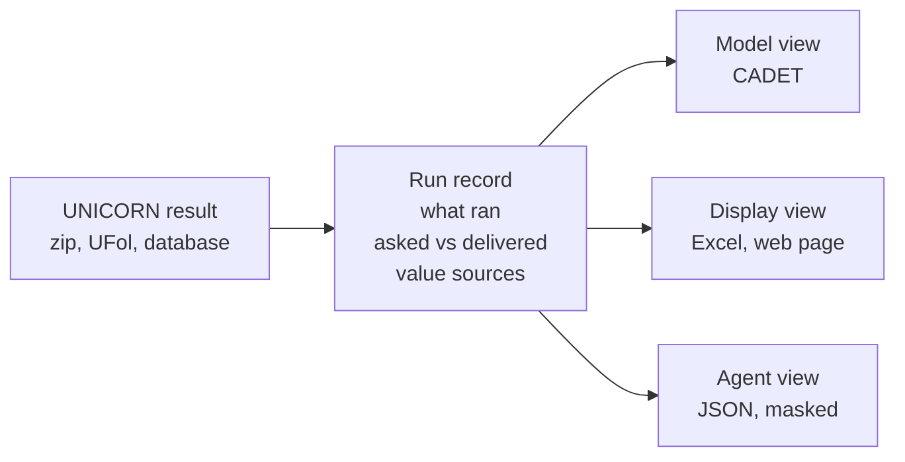
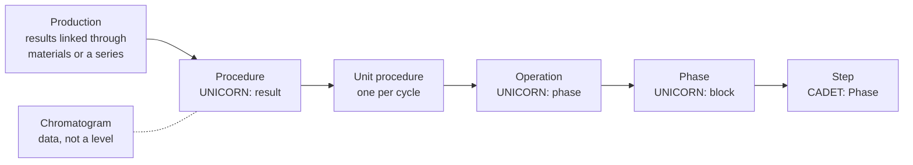
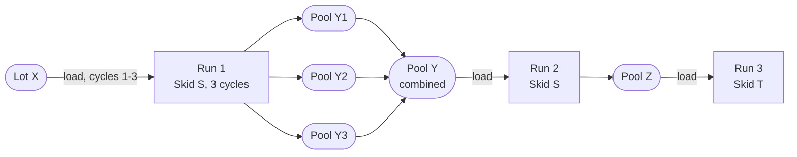
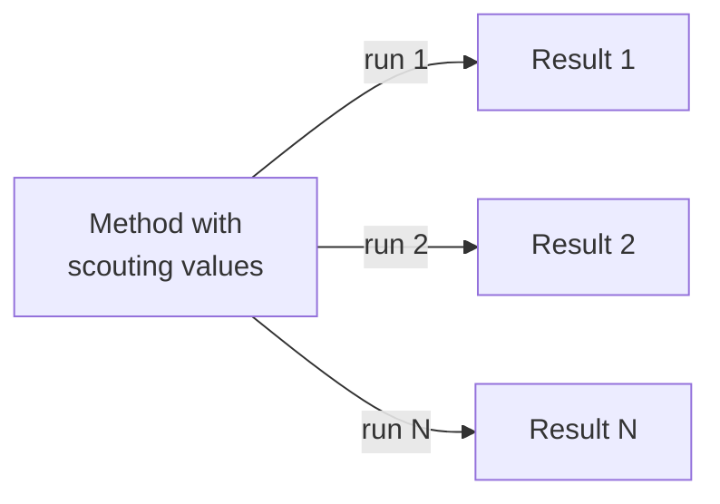
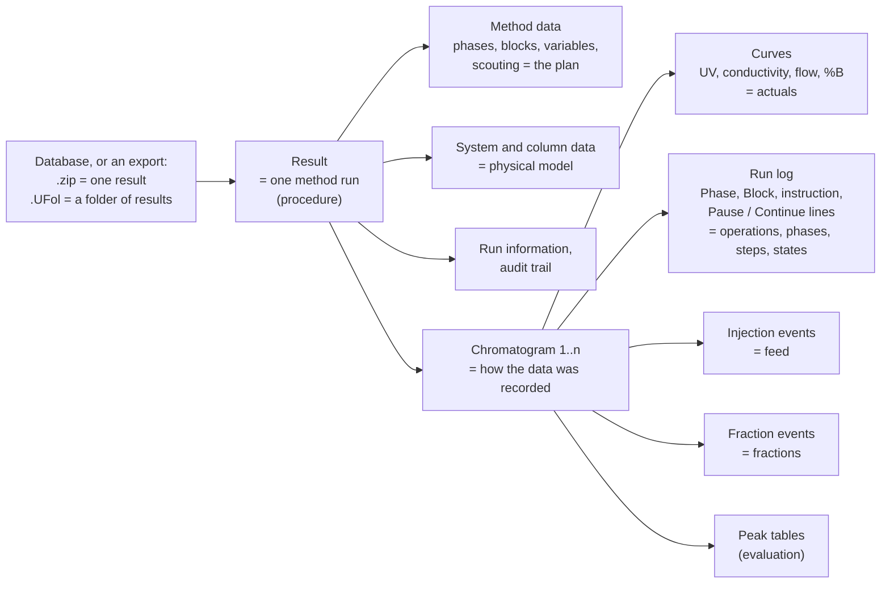
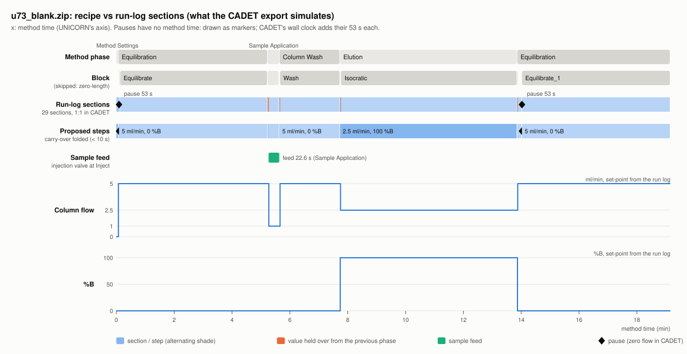
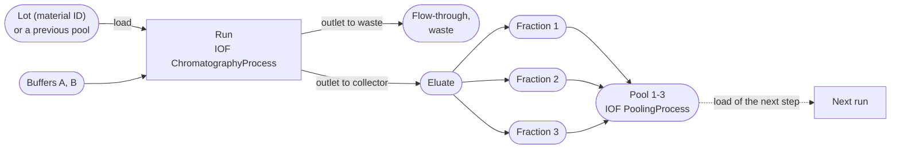
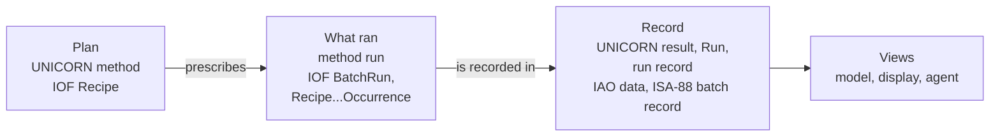

# Run structure: read a run once, describe it for plant and lab (proposal)

Draft for the owner's review, started 2026-11-12, reorganized 2026-11-14. Nothing here is
built.

> **About the diagrams.** Every diagram in this document is synthetic: drawn by Claude (an
> AI assistant) to illustrate the proposal, not taken from UNICORN, CADET or a standard.
> The Mermaid diagrams, the cycles figure and the transient-states figure are schematics
> with made-up examples (names such as "Lot X", "Run 1" or "Phase P1" are placeholders, not
> real data). Figure 7, reused from [`RUN_STRUCTURE_REVIEW.md`](RUN_STRUCTURE_REVIEW.md),
> was also drawn by Claude, from a public example result
> (`samples/u73_blank.zip`). Check them against the text and the sources before relying on
> them.

## 1. In short

**The problem.** PyCORN reads a run's structure (phases, steps, flow, %B, pauses, feed)
separately for every output: the phase tables, the CADET sections, the page's tracks, the
window statistics. Each output re-derives the same facts its own way, so they can drift
apart, and a question such as "what was the flow in the load phase?" has more than one
answer depending on where you look.

**The proposal.** Read each run **once** into a single description, the **run record**, and
let every output take what it needs from it. The record holds three things:

- **what ran, in order**: the phases, steps and pauses the run log shows;
- **what was asked for next to what was delivered**: the method's setting (say 5 ml/min) and
  what the instrument actually did (from the curves and the volume axis);
- **where each value came from**, and how sure it is (logged, measured, inferred, assumed).

**Three views of one record.** Each reader gets the same facts, chosen and worded for them:

| Reader | Gets |
|---|---|
| A modeler (CADET) | what the instrument did where it was measured, else what was asked for; every change kept, nothing smoothed; each value says where it came from |
| A person (Excel, the web page) | the method's settings per phase, as the user wrote them, in UNICORN's words; a short delay at a phase start is folded into the phase with a note |
| A script or agent | the whole record as JSON (versioned, masked by default) |

A view never computes anything the record doesn't hold, so the views can't disagree; where
they show different numbers, the record says why.



**Figure 1.** One run record, three views.

**The vocabulary.** PyCORN's users run the same ÄKTA systems in research labs (method
development, characterization, model calibration) and in process development and
production. So the record reads both ways (section 2): its levels use ISA-88, the
batch-control standard plant systems use, and its runs, studies and measurements map to the
research ontologies (OBI, Allotrope) and to CADET's terms for model calibration; UNICORN's
own words stay beside them. Both sides share one core idea that fits a chromatography run:
the plan (method) asks, the instrument does, and the record keeps both without smoothing
either. Section 12 maps each word.

**What stays open.** Display wording (Decide items in section 11), how UNICORN splits a run
over several chromatograms, and how cycles are marked (section 9 lists every open question
and the samples that would settle it).

## 2. Why both industrial and research standards

The same chromatography run moves between two worlds. In a **research lab** it is a
measurement or an experiment: part of a study, a design point of a DoE, data to calibrate a
model, results going to an ELN or LIMS. In **process development and production** it is a
batch step: run from a recipe on a skid, recorded for a batch record, a historian or an MES.
A run often crosses over: development runs calibrate a model that designs the production
recipe, and production batches become evidence for the next model. PyCORN serves both, so
the record holds one neutral description and maps it to each side's standards, rather than
taking one side's vocabulary:

| | Research (lab measurement, model calibration) | Industrial (process development, production) |
|---|---|---|
| Standards and ontologies | OBI and IAO (investigations, assays, data), Allotrope (AFO, and ASM for LC data), CADET (model inputs, references) | ISA-88 (batch control), ISA-95 / B2MML (materials), BatchML, IOF biopharma |
| Systems that use them | ELN, LIMS, modeling tools | batch systems, historians, MES |
| One result is | a measurement or a run of an experiment | a batch (one execution of a recipe) |
| The method is | a protocol; its variables are factor levels | a recipe; its variables are formula parameters |
| A scouting series is | a study design execution (DoE) | a campaign |
| Setpoint vs actual | planned value vs measured value | commanded vs report parameter |
| Curves are | measurement data; CADET references for calibration | batch record data, historian tags |
| Fractions and pools are | samples for offline assays (whose results feed back into a model) | material lots and sublots |
| The views that serve it | model view (CADET), display view (lab analysis), Allotrope ASM (later) | display view, BatchML batch record (later) |

The record's levels use ISA-88's names because ISA-88 is the only one of these that
structures the *procedure* (the research ontologies describe the run as one planned process
with inputs and outputs, not its inner steps); everything else in the record (values with a
source, measurements, materials, studies) is shared by both sides.

**ISA-88 in plant systems.** Plant batch systems and historians already organize run data
this way. Emerson DeltaV Batch
is built on ISA-88 (procedures, unit procedures, operations, phases) and keeps batch history
from its Batch Executive; AVEVA's PI System batch interfaces, including the one for DeltaV
Batch, build event frames level by level along the same hierarchy. ISA-88 Part 4
(ANSI/ISA-88.00.04-2006) defines the batch production record, and MESA's BatchML is its free
XML form. A run record tagged with ISA-88 levels can therefore sit beside plant batch data
without a new vocabulary. Neither product is known to exchange BatchML, so this is about
structure, not a file format. Sources: "References" at the end.

ISA-88 conformance is not claimed: the record uses the standard's concepts and names as a
frame. Definitions quoted here are from ISA-88.01-1995 (Part 1), the edition whose text was
checked; the 2010 edition (ANSI/ISA-88.00.01-2010, IEC 61512-1) may word them differently.

## 3. From a production process down to one value

This section walks from the largest scale to the smallest. At each level: what UNICORN
stores, what ISA-88 calls it, and what the record keeps.



**Figure 2.** The levels, from a production process down to a step.

### 3.1 Across results: a production process

UNICORN stores one method run per result. Whatever spans several results is a **link between
records**, never one merged record.

Results are linked in two different ways:

- **By the material.** Different methods, often on different days or skids, work on the
  same product: capture, then polishing. The runs are linked only through the material
  between them: what one run puts out (a pool) is what the next run loads. So a **material
  ID** belongs to each portion of material, not to a run: to each load (one run can load
  several materials, by several injections or sample inlets), to each fraction and to each
  pool. Fractions and pools get IDs the record can make itself (the run plus the tube or
  pool name, 3.6). A load's ID, the plant's batch or lot number (here the placeholder "Lot X"), comes
  from the caller; a text variable stored with the run (a sample ID) can be offered as a
  hint, never applied on its own. Which pool became which load is also the caller's to
  say: UNICORN doesn't store it.



**Figure 3.** Runs linked through material: every load, pool and fraction has its own material ID.

  Rounded boxes are material, each with its own ID; square boxes are runs (results), e.g.
  Run 1 a capture step and Runs 2 and 3 polishing steps. Run 1 is one result with three
  cycles (unit procedures, 3.3), each giving its own pool; combining them happens outside
  UNICORN, so the combined pool's ID comes from the caller. All names are placeholders.

  **Batch vs lot.** The word "batch" means two things here. In ISA-88 a batch is the
  material made by one execution of a recipe, and the record of that execution: each
  UNICORN run is one, and UNICORN stores a **Batch ID** per run (a GUID, also a `Batch ID:`
  line in the run log). The plant's numbered batch ("Lot X" above) is material: in ISA-88 terms a **lot**
  ("a unique amount of material having a set of common traits"). So the record keeps the
  run's Batch ID (from UNICORN) on the run, and a material ID on each load, fraction and
  pool.

- **By the method (a series).** One method run N times with stored variations: a scouting
  run, for method development, a designed experiment (DoE) or repeated cycles. UNICORN
  stores this link itself (scouting name, run number). A series may load one material or
  several.



**Figure 4.** Runs linked by method: a scouting series.

| Setup | ISA-88 reading | In the record |
|---|---|---|
| Several chromatography steps of one product (e.g. capture, then polishing), on different days, with different methods, on the same skid | one procedure per result, all on the same unit; the steps of one product batch are linked by the material, not by the procedure | one record per result; linked through the material IDs of their loads and pools (one run's pool is the next one's load); the unit (masked system name) and column say where each ran |
| The same, on different skids | as above, on different units (ISA-88's train: the units "used to make a batch of material") | as above; the unit differs |
| A scouting run: one method run N times with stored variations | N procedures from one recipe | one record per result; a series link (scouting name, run number). Whether the series repeats one process (cycles, 3.3) or varies it (method development, DoE) is the caller's to say |
| Methods run back to back from a queue | separate procedures | separate records, ordered by UTC; linked like production steps |
| Connected processing across skids (one skid's outlet feeds the next, at the same time) | units running concurrently; ISA-88 "does not specifically address" continuous processes, and ISA-106 (Procedure Automation for Continuous Process Operations) covers them | one record per skid, aligned on the UTC axis every record has; which outlet feeds which inlet comes from the caller (UNICORN doesn't store it) |
| Multi-column continuous chromatography on one skid (columns load, wash and elute in a staggered rotation) | one procedure with parallel work on several columns | **not supported**: the record has one sequence of sections per run; it would need a column tag on every section and parallel timelines. Waits for a sample |

The link labels (a lot, a series) come from the caller; ISA-88 defines a lot ("a unique
amount of material having a set of common traits") but says nothing about splitting or
combining batches. Where the labels go in a batch record: section 7.

### 3.2 One result: the procedure

A result is one method run: one recipe executed once. In ISA-88 that is one **procedure**,
on one clock, on one unit (the system). The record is built once per result, from all its
original chromatograms (3.4); the method, the system settings and the other result-level
data are shared by all of them.

What UNICORN stores for one result, in its own words, with this document's term beside each
part:



**Figure 5.** What UNICORN stores for one result, with this document's terms.

The run log is the backbone: its `Phase` lines start operations, `Block` lines phases, and
each executed instruction a step (D13: what ran, not what the method planned).

### 3.3 Inside the procedure: unit procedures and cycles

A **unit procedure** is a complete piece of work on one unit (ISA-88: "a strategy for
carrying out a contiguous process within a unit", made of contiguous operations). A run has
**one** by default.
It has several only when the run repeats a whole process, which chromatographers call
**cycles**: to process enough material, one recipe runs the same sequence (equilibrate, load,
wash, elute, clean) N times on one column. "Cycle" is not an ISA-88 term; the record keeps
the chromatographers' word and maps each cycle to one unit procedure.

The same N cycles can be recorded three ways:

| How the cycles were recorded | ISA-88 reading | In the record |
|---|---|---|
| A scouting run: N results | N procedures from one recipe | one record per result with a series link (3.1); `cycle` = run number when the caller says the series is cycles |
| One result, a new chromatogram at each cycle boundary | one procedure, N unit procedures | each chromatogram a unit procedure with `cycle = n`, when the caller says so; the cuts are checked to fall between operations |
| One result, no new chromatograms (or cuts elsewhere) | one procedure, N unit procedures | `cycle` from the caller (e.g. "a cycle starts at each phase P1", with the phase named as the method names it); a repeat found in the logged phase order is offered as a hint, never applied on its own |

Every segment carries `cycle` (empty when the run doesn't cycle), so the views work the same
whatever the recording: a summary row and window statistics per cycle, the overlay aligned at
each cycle's start (W12), one CADET input per cycle (real cycles differ as the column loads
and ages, so each keeps its own measured reference).


**Figure 6.** Cycles and chromatograms in one result (schematic).

(A synthetic schematic drawn by Claude, generated by `tools/draw_cycles_chromatograms.py`.)

One rule holds the hierarchy together: a unit procedure is made of whole operations, so a
cycle or unit-procedure boundary must fall **between** UNICORN phases. (ISA-88 neither
states nor rules out several unit procedures one after another on one unit; reading each
cycle as one is this proposal's choice.)

### 3.4 Chromatograms: how the data was recorded

A method can start a new chromatogram partway through a run (UNICORN's New Chromatogram
instruction). Some users do this to set one piece of work apart (a by-pass measurement, then
the column run; or one cycle from the next), others don't, so the split is not a reliable
sign of intent. **A chromatogram is not an ISA-88 level**: it is a stretch of the batch
record's data. The record tags every segment, value and curve with the chromatogram it came
from, and joins the chromatograms on one clock.

What is known, and what isn't:

- The owner's statement from memory (2026-11-14), not checked on any example: the new
  chromatogram's time starts at 0 at the instruction; each chromatogram's run log
  (`Logbook`) holds only its own part; collection stops in one and starts in the next, so
  they don't overlap.
- Storage points the same way: in the database a run log (`EventCurve` with
  `EventCurveTypeName = 'Logbook'`, its lines in `Event`) is keyed by `ChromatogramID`, and
  only the chromatogram carries `ResultID`; in a `.zip` the event curves sit in each
  `Chrom.N.Xml`. Likely, but to be verified with an example.
- Not known: how the run log records the instruction itself, and whether settings (flow,
  %B, valves, phase, Pause / Hold state) carry across the cut and are repeated at the start
  of the next run log.

| Thing | In the record |
|---|---|
| Each original chromatogram | a `chromatogram` segment: name, start and end on the procedure clock, its curves |
| The clock | chromatogram 1's own; chromatogram n starts where n-1 ends, checked against its `ChromatogramStartTime` in UTC |
| Settings across the cut | **open test case.** If they carry over unrepeated, the record takes them from the previous chromatogram, which is hard to read and not built until a sample shows it; until then they are `not_known` before the first instruction |
| A UNICORN phase across the cut | open, with the settings: one operation in both segments if the next run log starts inside it |
| The instruction | a step where it ran, if the run log records it |
| What the user meant by the split | never inferred; the caller may make chromatograms unit procedures or cycles (3.3), or map them to an operation |
| Imported and derived chromatograms (W17) | not part of the procedure: an imported one links to its source result, a derived one is analysis; linked, never merged |

Display keeps one table set per chromatogram, as today, noting a phase cut at the boundary;
the model picks a span by chromatogram, cycle or operation on the one clock.

### 3.5 Inside a unit procedure: operations, phases, steps, sections

| ISA-88 | UNICORN | CADET-Process 0.13 | In the record | Row in Figure 7 |
|---|---|---|---|---|
| Operation | a UNICORN **phase** (Equilibration, Sample Application, ...) | none (CADET-GUI: a "Phase ..." run-log marker) | `operation`: number, instance (repeats), logged text, display name | "Method phase" |
| Phase | a UNICORN **block**, and the activities running at once inside a phase (flow and gradient, sample feed, fractionation, watches) | none (activities are flow-sheet units) | `phase`: one per equipment activity, with its equipment module | "Block"; "Sample feed" is one such activity |
| Step | a stretch of constant state: one flow, one %B piece, one feed state, one state; from the executed run-log instructions | **`Phase`** (one flow, linear composition) and `ValveEvent` | `step` (for people and modelers) | "Proposed steps" |
| Section | the same stretches, unfolded, as the model needs them | the model's piecewise inputs | `section` | "Run-log sections" |



**Figure 7.** Operations, phases, steps and sections of one run (`samples/u73_blank.zip`).

(From [`RUN_STRUCTURE_REVIEW.md`](RUN_STRUCTURE_REVIEW.md), one public example run. Its rows,
top to bottom, are the table's levels: "Method phase" = operations, "Block" = ISA-88 phases
("Sample feed" is one of their activities), "Run-log sections" = sections, "Proposed steps"
= steps; the curves below are the actual column flow and %B.)

The word "phase" means three things: a UNICORN phase is an ISA-88 operation, an ISA-88 phase
is closer to a UNICORN block, and a CADET-Process `Phase` is an ISA-88 step. The record uses
ISA-88's words with UNICORN's beside them; display keeps UNICORN's; `Phase` appears only in
CADET objects.

### 3.6 Where it ran and what it did to the material

**Physical model** (where it ran): the unit is the system (CADET: `LCFlowSheet`). Equipment
modules: system pump (CADET: buffer inlets A-D and mixer), sample pump, injection valve
(sample loop, `ValveEvent`), column valve (`bypass_units`, fixed for the run), inlet valves,
outlet valve and fraction collector. Control modules: the UV, conductivity, pH and pressure
monitors (CADET: observation points such as `column.outlet`). Source: the system
configuration stored in the result.

**Process model** (what it did to the material): equilibrate, load, wash, elute, strip,
clean (CADET: the templates `PulseInjection`, `Step`, `StepElution`, `LWE`, `Breakthrough`;
CADET-GUI: experiment types). UNICORN doesn't store this; phase names usually say it, but a
phase named "Wash 2" may elute. The record keeps a `process_action` field that is empty
unless the caller gives a mapping, never guessed.

**Material flow** (what went in and what came out). A run takes material in (the load,
buffers) and gives material out (flow-through and waste, the eluate, collected as fractions;
fractions are later combined into pools). A **lot** is ISA-88's "unique amount of material
having a set of common traits", what a plant calls its batch or lot number. Every material
below carries its own material ID: a load's from the caller, a fraction's and a pool's made
by the record. A pool that becomes the next step's load is how runs of one product are
linked (3.1).



**Figure 8.** Material flow through one run.

What the run itself tells about each material, and how the record would identify it. Masses
and concentrations are never assumed: they come from the caller, or from a UV curve with a
caller-given extinction coefficient and its accuracy note.

| Material | What the run records | Identified in the record as | Ontology terms |
|---|---|---|---|
| Load (feed) | the feed sections: valve and inlet, start and end, volume (derived from the run log, actual from the volume axis, 3.8); not what the material was | one load per feed (injection or sample inlet): the run, the feed section's `path`, its volume, and the caller's material ID for it (a stored sample-ID variable only as a hint) | an input of the run (OBI "has specified input"); ISA-88 lot; ISA-95 `MaterialActual` with its lot ID |
| Buffers | inlet positions and %B per section | inlet line and position; names only from the caller | an input of the run; IOF `BufferSolution` (on a biopharma work branch) |
| Flow-through, waste | outlet valve at waste, with times and volumes | the outlet sections | an output of the run; no class |
| Eluate | the stream reaching the fraction collector; UNICORN stores no separate record of it | the outlet sections at the collector | an output of the run; no class |
| Fraction | one row per tube: tube id, start, end, volume (the `Fraction` event curve) | the run, chromatogram and UNICORN's tube id, with its span | no class for a collected fraction; ISA-95 (B2MML) `MaterialSubLot` is the closest place for one |
| Pool | fractions combined in UNICORN's evaluation (today's `pools` table): name, members, pooled curve | the run and the pool name (`<first>-<last>` tube id) | IOF `PoolingProcess` is the act of pooling; the pool itself has no class; ISA-95 `MaterialLot` when it becomes the next step's load |

What an ontology-aligned record would need beyond this: the IOF pattern of roles (on a
current review branch, filtration has `FiltrateRole` and `RetentateRole`) suggests an
eluate role, a flow-through role and a fraction as gaps to raise with IOF (section 9); the
link from a pool to the next step's load is material genealogy (ISA-95), which only the
caller can give, since UNICORN doesn't store it.

### 3.7 States: running, paused, held, and the transients between

ISA-88's example states for a procedural element are idle, running, complete, pausing,
paused, holding, held, restarting, stopping, stopped, aborting and aborted; the standard
doesn't require them. Each stop has a transient "-ing" state before it, and Held is left
through Restarting. ("Starting" is not among them: it comes from the PackML state model,
ISA-TR88.00.02, for packaging machines.) By analogy: **Paused** is a short stop at the next
safe point, resumed where it stopped; **Held** puts the process "into a known state" for a
long stop, left only by a restart. UNICORN's words cross over:

| UNICORN | ISA-88 state | Pumps | Clock | %B ramp | CADET-Process 0.13 |
|---|---|---|---|---|---|
| running | Running | on | runs | runs | `Phase` with flow > 0 |
| **Pause** | **Held** | stop | stops | stops | `Phase(d, 0.0, {})` |
| **Hold** | **Paused** | run | runs | frozen | `Phase` with `composition_start = composition_end` |

How today's code builds sections around pauses and holds, case by case, is shown in
[`RUN_STRUCTURE_GUIDE.md`](RUN_STRUCTURE_GUIDE.md) (figure "Pauses and holds").

**Flow ramps and the transient states.** Two kinds of ramp meet the states differently:

- A **commanded** ramp (a gradient, a programmed flow change) is the recipe's: it happens in
  Running, as a step whose setpoint has a slope (3.5, 3.8).
- The **instrument's own** ramps are equipment behaviour the run log doesn't record: the
  pump ramps down before a Pause and back up after the Continue; under pressure control a flow increase still takes about 10 s; a valve turn
  briefly stops the flow. The survey (review 3.4) shows them on the volume axis, and the
  decided CADET flow source (Decide 6) already fits them as pieces (stop, linear ramp, set
  flow).

So the record tags the fitted pieces around a stop with ISA-88's transient states, as short
sub-segments, only where the volume axis shows them:

| ISA-88 state | When | Flow setpoint | Flow actual | Logged by UNICORN |
|---|---|---|---|---|
| Running | normal execution | the method's, with any commanded slope | the volume axis; under pressure control or at a valve turn it may lag or dip, still Running | instructions |
| **Holding** | from the Pause to the pump at rest | unchanged | ramps down (fitted) | the Pause time only |
| Held | the pump at rest | unchanged | 0 | the pause's length |
| **Restarting** | from the Continue to the set flow | unchanged | ramps up (fitted) | the Continue time only |
| Pausing, Paused | a Hold | unchanged, can change | the set flow; %B frozen | Hold and Continue |
| **Stopping** | from End (or a manual stop) to rest | unchanged | ramps down (fitted), if the volume axis shows it; not yet seen in the survey | End |

The ramp's length is inferred: UNICORN logs when a Pause, Continue or End was issued, not
when the pump reached rest or the set flow. Each transient carries the actual flow as a
value with source `volume_axis` and quality `fitted`; the setpoint never changes in it.
Display adds "ramped n s" to the phase's note; the model gives each transient its own
section with a linear flow term; an agent sees the state and both flows.


**Figure 9.** Flow ramps and ISA-88 states around a Pause and a Hold (schematic).

(A synthetic schematic drawn by Claude, generated by `tools/draw_transient_states.py`; not
data.)

### 3.8 One value: asked for, delivered, and why they differ

Every value is a small object, not a bare number: the setting the method gave (`setpoint`),
what was measured (`actual`) or what was calculated (`derived`), each with its source and
how sure it is. Method variables are the recipe's parameters; measured lengths, volumes and
statistics are the record's.

Example, the Sample Application phase of `samples/u73_blank.zip`, column flow and feed:

```json
{"s88_level": "operation", "path": "OP2", "display_name": "Sample Application",
 "native": {"level": "phase", "text": "Phase Sample Application"},
 "instance": 1, "state": "running",
 "column_flow": [
   {"value": 1.0, "unit": "mL/min", "kind": "setpoint", "source": "run_log", "quality": "exact"},
   {"value": 5.0, "unit": "mL/min", "kind": "setpoint", "source": "run_log", "quality": "exact",
    "held_over": {"duration_s": 2.4}},
   {"value": 2.5, "unit": "mL/min", "kind": "actual", "source": "volume_axis", "quality": "exact",
    "span_s": [315.7, 316.3]}],
 "feed_volume": [
   {"value": 0.417, "unit": "mL", "kind": "derived", "source": "run_log"},
   {"value": 0.389, "unit": "mL", "kind": "actual", "source": "volume_axis"}]}
```

Display shows `1 ml/min (first 2.4 s at 5)` and `0.42 ml` (which feed volume to show is
still open, Decide 18); the model takes the actual; an agent sees all three and why they
differ.

The same held-over values at the start of every phase of that run are drawn in
[`RUN_STRUCTURE_REVIEW.md`](RUN_STRUCTURE_REVIEW.md) (figure "Phase starts").

## 4. Edge cases and how they are resolved

| Edge case | Resolution |
|---|---|
| A new chromatogram cuts inside a phase | chromatograms stay data segments; making them unit procedures or cycles fails with an error naming the phase that crosses the cut |
| A cycle boundary isn't a phase start (e.g. the next cycle's equilibration is part of the previous regeneration) | the caller's rule names the phase or block that starts a cycle; nothing guessed |
| Work before the first cycle or after the last (system prime, final clean) | `cycle` empty for those segments, shown as "before cycles" / "after cycles" |
| Unequal cycles (a short last load, an aborted or extra cycle) | numbered as they ran; a warning lists the phases that differ from the other cycles; never padded or dropped |
| A pause or hold across a cycle boundary | belongs to the cycle in which it started; the next cycle starts when its first phase starts |
| A transient (holding, restarting) the volume axis doesn't show clearly | no transient segment; the stop is a plain `held` stretch from the logged times, as today |
| An instruction issued during Holding or Restarting | acts at the time it was logged; the transient is split there, its setpoint changes with it |
| The logged phase order repeats ambiguously (e.g. two washes in one cycle) | the detected repeat is a hint only; the caller decides |
| A scouting run that varies settings (method development, DoE) rather than repeating cycles | linked as a series either way; only the caller calls it cycles |
| Scouting runs that each hold several cycles | both levels: the series link between results, `cycle` within each |
| Eluates pooled across cycles | material, outside the record; fraction and pool rows keep their `cycle` tag |
| One run loads several materials (several injections, or sample inlets S1, S2, ...) | one load per feed, each with its own material ID from the caller; which fractions came from which load is not inferred beyond the cycle (or injection) they fall in |
| Pools combined outside UNICORN, then loaded on the next step | a new material whose ID and parents (the pools) come from the caller; the record never joins runs on its own |
| A by-pass measurement split from the column run by a new chromatogram | two operations in one unit procedure (same unit), unless the caller says otherwise |

## 5. The record's fields

**Naming rule.** Keys are vendor-neutral: ISA-88 and IOF words, CADET's valve words, UCUM
units. The source system's own words are values, never keys: the record names its system
once (`"source_system": {"name": "UNICORN", "version": "7.11"}`) and every segment keeps
UNICORN's level and text under `native`. So another system's results (another vendor's
software, another instrument family) fit the same record without a schema change, and the
JSON reads like BatchML and Allotrope, whose keys are vendor-neutral too. Controlled values
follow the same rule: the injection valve as `load` / `inject` / `direct_inject` / `run`
(CADET-Process's `ValveEvent` names) with UNICORN's `Manual load` as the native value; an
inlet as its line (`A`, `B`, `sample`) with the position (`A1`) as the native value; states
as ISA-88's.

Every segment (unit procedure, operation, phase, step, section) carries the same tags:

| Tag | Values | Why |
|---|---|---|
| `s88_level` | `procedure`, `unit_procedure`, `operation`, `phase`, `step`, `section` | the level, in ISA-88 words |
| `path` | `OP3/PH1/ST2` (from `phase_number`, `step_number`); `UP2/OP3/PH1/ST2` only when the run has more than one unit procedure | stable keys across outputs |
| `native` | the source system's `level` (UNICORN: `phase` / `block` / `instruction`), `text` (the logged text) and, for states, `state` (`pause`, `hold`) | the source system's own words, never lost |
| `instance` | 1, 2, ... | a phase run more than once (Equilibration twice) |
| `cycle`, `cycle_source` | 1, 2, ... or empty; `caller`, `chromatogram`, `scouting` | cycles, however they were recorded (3.3) |
| `chromatogram` | the original chromatogram the segment was recorded in | results with several chromatograms (3.4) |
| `state` | `running`, `held`, `paused`, and the transients `holding`, `restarting`, `stopping` (ISA-88; the native state under `native`) | pauses, holds and the instrument's ramps around them (3.7) |
| `start`, `end` | wall s, elapsed s, volume ml, CV, UTC | every axis |
| `equipment_module` | `system_pump`, `injection_valve`, ... | phase level only |

Each value inside a segment:

| Field | Values |
|---|---|
| `value`, `unit` | full precision; the unit as a UCUM code (`mL/min`, `%`, `mL`, `s`; CV as the annotation `{CV}`) |
| `kind` | `setpoint` (asked for), `actual` (measured), `derived` (calculated) |
| `source` | `run_log`, `volume_axis`, `curve`, `system_configuration`, `method_hint`, `caller`, `default`, `not_known` |
| `quality` | `exact`, `inferred` (e.g. an unlogged pause), `fitted` (an actual fitted to the volume axis, e.g. a ramp in a transient state), `assumed` (e.g. `B1 (assumed)`), `folded` (display only, with `held_over`) |

## 6. How it fits CADET-Process 0.13 and CADET-GUI

Read in the code of CADET-Process `dev` (`e11f82e`, 2026-11-13) and CADET-GUI `main`
(`bb5539e`, 2026-10-28). CADET-Process's release notes announce `instruments`,
`calibration` and `characterization` for 0.13.0 (no date); `pycorn[cadet]` is on 0.12 today.
Their API may still change.

CADET-Process asks in its forum whether its vocabulary (phase, valve event) fits how users
see their instrument; the mapping in 3.5 is a ready answer.

CADET's parts, at a simple level, and where the record's views feed in (modules marked
0.13 are announced, not yet released):


**Figure 10.** CADET's parts, and where the run record feeds in.

The record gives CADET what ran (steps, valve events, flow-sheet values such as column
geometry and mixer volume) and what was measured (references, fractions). What the model
is (binding, unit-operation models, their parameters) and fitting stay CADET's (D28).

**Standards.** CADET has no published data standard for measured runs (as of 2026-11-14):
CADET-Process's `ReferenceIO` carries time, values and flow, with no units or metadata, and
CADET-RDM (Lanzrath et al., *Comput. Chem. Eng.* 212 (2026) 109690) versions simulation
inputs and outputs rather than measured data. An unmerged CADET-Process branch adds a
loader for another vendor's files (Knauer), so vendor-neutral input is where this is going.
The record's JSON (neutral keys, UCUM units, a source and quality on every value; section 5)
is a ready proposal for such a standard when one is started.

| Record | CADET-Process 0.13 (`instruments`) | CADET-GUI |
|---|---|---|
| procedure / unit procedure | `PhasedProcess(name, flow_sheet, steps)` | a study / run |
| operation (UNICORN phase) | none (a `Phase` has no name) | markers: "Phase ..." run-log texts, on a volume axis only |
| step / section, running | `Phase` (flow, %B as `{"A": 1-b, "B": b}`, ramp via `composition_end`) | "Phase <i>" spans from the template |
| held (UNICORN Pause) | `Phase(d, 0.0, {})` (allowed: composition is checked only when flow > 0) | not represented (one constant flow) |
| paused (UNICORN Hold) | `Phase` with `composition_start = composition_end` | not represented |
| holding, restarting, stopping (the instrument's ramps, 3.7) | needs a flow at the `Phase`'s end (one flow per `Phase` today); until then each fitted piece is its own constant-flow `Phase` | not represented |
| injection valve setting | `ValveEvent("load" / "inject" / "direct_inject" / "run")` | none |
| equipment modules | `LCFlowSheet`: sample loop, mixer, four tubings, column, `bypass_units` | instrument templates |
| `process_action` | templates `PulseInjection`, `Step`, `StepElution`, `LWE`, `Breakthrough` | experiment types (system pulse, column pulse, LWE, breakthrough, ...) |
| measured curves | `ReferenceIO(time, solution, flow_rate)`, SI by convention, no unit field | `ExperimentalRun` / `Channel`, units dropped |
| feed start | - | `Comparison.injection_marker` (a text prefix) |
| multi-column continuous chromatography (3.1, not supported) | its own builders (`CarouselBuilder`, `SMBBuilder`) | - |

**What the model view would lose today** (gaps to raise with CADET, none to work around in
PyCORN by guessing):

- One flow per `Phase`: UNICORN flow ramps can't be expressed (a flow at phase end would do).
- Duration must be > 0 and two `ValveEvent`s in a row are rejected: zero-length steps are
  dropped, with a warning naming their `path`.
- No name on `Phase`: the `path` and UNICORN's text can't travel with the steps, so the GUI
  can't align on UNICORN's phases. Ask for an optional `name`.
- Buffers A-D are mixer inlets (a quaternary pump), not AKTA's A/B pumps with inlets
  A1-A4/B1-B4; `bypass_units` is fixed, so a column by-pass partway through a run has no
  counterpart.
- `ReferenceIO` has no unit or metadata, and every `calibration` function returns a new one:
  the record's `unit`, `source`, `quality` stay in `experiment.json` beside it.
- CADET-GUI reads `.csv` only, forces a volume axis in mL even for a `min` export, can't save
  a time-axis run with markers, and converts with one typed flow. A record-based import would
  carry time in s, markers from operations, units, and the injection time as a number.

**What the record supplies that CADET doesn't read from a run:** column geometry and Vc,
mixer volume from the stored system configuration, inlet positions (known / assumed / not
known), pauses and holds as states, the executed sections with their source. Loop volume
stays the caller's (D19); `process_action` and the template stay the caller's, even though
CADET's templates are exactly the process model ISA-88 describes.

## 7. Outputs: what changes, what's new

Today `pycorn export` writes 30 tables per chromatogram (CSV, Excel, pickle; listed by
`pycorn schema --json`), plus `index.csv`, `options.json`, `README.txt`, `provenance.json`
and the CADET files; the CLI's `inspect`, `find`, `schema`, `windows` and `bypass-uv` write
JSON; the web page shows the same tables. The proposal touches few of them:

| Proposed (plan step, section 8) | Existing output it touches | Effect |
|---|---|---|
| 1. Run record | none | internal; today's `phases`, `sections` and CADET inputs re-derived from it must come out byte-identical |
| 3. Display view | `phases` table (CSV, Excel, page), `phase_windows`, the page's tracks | **changed values**: a short delay at a phase start folded in with a note column; repeated phases named `Equilibration (2)`; window statistics skip the held-over lead-in, retiring the "interim phase rule" note. Listed first in the CHANGELOG |
| 4. Steps table | between `phases` (one row per phase) and `sections` (1:1 with CADET) | **new table** `steps` (`<c>_steps.csv`, an Excel sheet, a page tab), added to `export_tables.py`; `schema --json` lists it (schema 1, additions only) |
| Keys (Decide 2, 24) | `phases`, `sections`, `phase_windows`, `warnings` | **added columns** `phase_number`, `step_number`, `path`; warnings carry the `path` they belong to. One value per column ("Outputs stay atomic") |
| Cycles, chromatograms | the same tables | a `cycle` column only when cycles are marked; chromatograms already get their own files |
| 5. `pycorn record --json` | `inspect --json` | **new command**, same envelope, schema version and masking as every `--json`. `inspect` stays the summary and gains the operation list; `record` gives the whole structure. Neither holds curve values |
| 6. Model view | CADET files: `experiment.json`, CADET-Process CSVs, CADET-Core input | same files, built from the record; values change with the decided flow source (Decide 6). If the owner agrees (section 11), `experiment.json` becomes `model_view.json` with the section 5 naming; a file name has no alias, so both are written for one release |
| Later: BatchML XML, Allotrope ASM | none | new optional files beside the others |

Unchanged: every table's UNICORN wording (display tables and CSV keep UNICORN's words,
Decide 3), `sections` 1:1 with CADET, `index.csv`, `provenance.json` and every other table.

Formats, in order of value:

1. **The record as JSON with ISA-88 names** (`pycorn record --json`, `schema: 1`, masked by
   default like every `--json`). Element names follow ISA-88 Part 4 / BatchML (procedure,
   unit procedure, operation, phase elements; events; parameters with values and units), so
   a later BatchML XML writer is a mapping, not a redesign. JSON first because the rest of
   PyCORN's machine output is JSON and agents read it directly.
   Identifiers take BatchML's and ISA-95's own fields: the run's UNICORN Batch ID in
   `BatchID`; a series (scouting, a production campaign) in `CampaignID`; each material
   (load, fraction, pool) as an ISA-95 `MaterialActual` with its lot or sublot ID
   (`MaterialLot`, `MaterialSubLot` in B2MML). BatchML's record-level `LotID` is used only
   when a run has a single load material.
2. **Units as UCUM codes** and times as ISO 8601 (UTC instants, durations) in the record and
   its JSON; display keeps today's column names (`_min`, `_ml`).
3. **BatchML XML** (later, optional): only if a user's MES or batch-record system wants it.
4. **Allotrope Simple Model (ASM), liquid chromatography** (later, optional): for chromatogram
   and peak results going to an ELN or LIMS. It covers the measurement, not the procedure, so
   it sits beside the record, not instead of it.
5. CADET keeps its own formats.

Masking and "never print connection values" apply to every format.

## 8. Plan

Each step adds to what exists: today's outputs stay byte-identical until a step says
otherwise.

1. **Record** (`pycorn/run_record.py`): built from `run_log_sections`, the timeline, the
   system configuration and the curves; ISA-88 levels, states, tags, setpoint / actual /
   derived values with source and quality. Tests: today's phase table, sections and CADET
   inputs re-derived from the record equal today's outputs.
2. **Rules** (`pycorn/step_rules.py`): the decided phase-start rule and the other display
   rules as they are decided; one function per view.
3. **Display view**: the phase-start fold and repeat names in the phase table, Excel and the
   page, plus the M22 lead-in skip. A changed output gets a CHANGELOG entry.
4. **Steps table** for modelers, from the record.
5. **`pycorn record --json`** (and `inspect` gains the record's operation list), masked by
   default.
6. **Model view** reads `actual` values (the decided CADET flow source); if the owner agrees
   (section 11), the CADET export's "experiment" names become the model view's here.
7. When CADET-Process 0.13.0 ships: the model view as `PhasedProcess` steps on an
   `LCFlowSheet` (needed for `characterization`, which takes an `LCProcess`), replacing
   PyCORN's own flow sheet and event compiler, after raising the gaps in section 6.
8. Later, on request: cycles and series links (3.1, 3.3) once a sample shows them; BatchML
   XML; Allotrope ASM.

## 9. Open questions and test cases

- **Several chromatograms** (3.4): how the run log records New Chromatogram; whether
  settings carry across the cut; whether storage really splits the run log per
  chromatogram. Needs a short test method with the instruction partway through a phase.
  Today each chromatogram is read from its own run log alone (from the code, not run on an
  example): if settings carry across the cut unlogged, the second chromatogram's tables miss
  them until its first instruction.
- **Cycles** (3.3): how the caller marks them; real multi-cycle runs with and without a new
  chromatogram per cycle, and a scouting series.
- **Production links** (3.1): the label the caller gives for a lot; connected skids;
  multi-column continuous chromatography.
- **Terms** still to check: the 2010 edition of ISA-88 Part 1, and IEC 62264's own
  definitions behind B2MML's material lots. ("Cycle", "campaign" and "series" are this
  proposal's own terms.)
- **Ontology gaps** to raise with the Industrial Ontologies Foundry, as the CADET gaps are
  raised with CADET (section 12): cycle, a collected fraction, a pool, eluate and
  flow-through roles (3.6), chromatogram, gradient and elution, and dynamic binding
  capacity have no IOF class yet.
- The example results that would settle these are listed in
  `samples/SAMPLE_ZIP_CONTENTS.md`, "Coverage and wanted samples".

## 10. Limits

- One procedure per result, on one system; one unit procedure by default, several only when
  the caller marks cycles or chromatograms. Links between results are links, never merged
  records.
- Multi-column continuous chromatography on one skid is not supported.
- `process_action` stays empty without a caller mapping: UNICORN's names are free text.
- The volume axis counts as "actual" only because the survey (review 3.4) shows it is the
  flow the pump delivered; otherwise it would be a derived value and the run log the
  model's source.
- Several chromatograms in one result: built on the owner's statement from memory, not on
  an example.
- CADET-Process's `instruments` and CADET-GUI are unreleased; section 6 is rechecked when
  0.13.0 ships.

## 11. Decisions this builds on, and the open Decide items

This document reworks [`RUN_STRUCTURE_REVIEW.md`](RUN_STRUCTURE_REVIEW.md) (topics
3.1-3.12, Decide 1-26).

**Decisions already made** that the design keeps (ROADMAP "Decisions", the review):

- Sections from what ran in the run log (D13); the method only as hints (D17); each
  instruction holds until the next.
- Column flow by valve position (D14); feed by valve, caller loop and path volumes, never
  assumed (D16-D21, D27); no defaults that mirror CADET parameters (D28).
- Wall clock for the model, pauses as zero-flow stretches (D5, D7); Hold freezes %B.
- Units in column names, SI for the model (review 3.3); x-axis picker and tracks on the page.
- Inlets from the stored system configuration: known / assumed / not known (Decide 22).
- Phase start lag (2026-11-12): display folds flow, %B and %Q within 10 s and 1 % of the
  phase with a `held_over` note; valves and feed never fold; phase start and end never
  move; M22 windows from a phase start skip the held-over seconds; CADET never folds.
- CADET flow source (2026-11-14, Decide 6, review 3.4): run log for structure and timing,
  the method-flow entry for which pump, the volume axis for the amount where it differs by
  more than 0.01 ml and 1 %, a fitted ramp inside such a section, then D14's zeroing.
- Unknowns said in plain words, never guessed; masking rules (Track 9); full values in code,
  rounding at display only.

**Open Decide items the frame settles** (proposed answers; confirm as a set):

| # | Item | Proposed answer |
|---|---|---|
| 1 | steps level | yes: the ISA-88 step (constant state); `chrom.step_table()`, `<c>_steps.csv` |
| 2 | keys | yes: `phase_number`, `step_number`, and the `path` tag |
| 3 | ISA-88 terms in columns | the record's JSON uses ISA-88 and other vendor-neutral keys, UNICORN's words as `native` values (section 5); display tables and CSV keep UNICORN's words only |
| 9, 10 | held-over note; "at the start" | decided 2026-11-12 (display) |
| 11 | pauses in steps | `state = held` rows (UNICORN Pause = ISA-88 Held), native state `pause`; the pump's ramp down before and up after as `holding` and `restarting` rows where the volume axis shows them (3.7) |
| 13 | inferred pauses | same rows, `quality = inferred`; display marks them ("about 40 s, not logged") |
| 14 | holds | `state = paused` (UNICORN Hold), a note per phase in display |
| 16 | by-pass | an equipment state of the column valve module; display note |
| 20 | ramp length | both: `setpoint` (logged length) and `actual` (measured on each axis); display shows the actual |
| 23 | repeats | `instance` numbers; display `Equilibration (2)`; the logged text kept |
| 24 | warnings per phase | warnings carry the `path` they belong to; display puts them on the phase row |

**Display choices still the owner's**: 12 phase length with or without pauses (proposal:
both), 15 which flow users see, 17 feed wording, 18 feed volume shown, 21 the gradient
wording rule, 25 section-lane chart, 26 summary beside or instead of today's sequences.
With pressure control a flow increase still ramps about 10 s after the instruction, longer
than the fold cutoff, so the `held_over` note should also say "ramped n s".

**Tooling gap:** Decide 19, `pycorn export --loop-volume` / `--sample-path-volume` for the
CADET feed (one flag or two).

**New decision for the owner: the word "experiment" in the CADET export.** In OBI, Allotrope
and IOF an experiment is a planned study across runs; PyCORN uses it for one run's data for
CADET (`CadetExperiment`, `build_experiment()`, `ExperimentSection`, `experiment.json`), and
that object's `events` are UNICORN log entries while CADET-Process's events are planned
parameter changes. Proposal: when plan step 6 makes this object the model view, name it so
(`ModelView`, `model_view(run)`, `ModelSection`, `model_view.json`, `logged_events`), with
section 5's vendor-neutral keys in the JSON; keep the old names as aliases (and write both
files) for a release, and list the rename first in the CHANGELOG.

## 12. Words used here, and their ontology terms

What each word means in PyCORN, and the matching term in the ontologies a lab or plant may
already use: IOF (Industrial Ontologies Foundry, biopharma module, `master` at `50a88d4`,
2026-10-15; classes under `https://spec.industrialontologies.org/ontology/construct/`), OBI
and IAO (biomedical investigations, information artifacts) and Allotrope (AFO, and its
liquid chromatography data model ASM). The ontologies keep three things apart that this
plan keeps apart too: the **plan** (the method), the **process** that ran, and the
**record** of it.



**Figure 11.** Plan, what ran, and the record, in ontology terms.

| Word | In PyCORN | Ontology terms |
|---|---|---|
| method | the UNICORN method: the plan, read only as hints | IOF `Recipe`; a method with variables is a `MasterRecipe`, the values one run used its `ControlRecipe`; IAO plan specification |
| run (method run) | one execution of a method on one system | IOF `BatchRun`, `ChromatographyProcess`; OBI planned process |
| result, `Run` | what one run stored, as UNICORN keeps it; the `Run` class holds that data, not the run itself | IAO information content entity; Allotrope experimental data |
| run record | the proposed single description of one run (sections 1, 5) | ISA-88 batch production record (Part 4) |
| procedure, unit procedure, operation, phase (as executed) | the record's levels (3.2-3.5); a UNICORN phase is an ISA-88 operation | IOF `RecipeProcedureOccurrence`, `RecipeUnitProcedureOccurrence`, `RecipeOperationOccurrence`, `RecipePhaseOccurrence`, each prescribed by its `Recipe...` element |
| step, section | constant-state stretches; CADET's piecewise inputs | no ontology class; CADET-Process `Phase` |
| cycle | one pass of the sequence on one column (3.3) | no class in IOF, OBI or Allotrope; the record's own term |
| series, study | linked results (3.1); a designed series (DoE scouting) is a study | OBI study design execution; IOF `StudyDesignRun` per result, `DesignPoint` for its planned factor levels; BatchML `CampaignID` |
| experiment | kept for a planned study across runs, as the ontologies use it; today also, wrongly, the CADET export's object (section 11) | OBI investigation; Allotrope experiment ("a planned process to verify, falsify, or establish the validity of a hypothesis") |
| chromatogram | UNICORN's container of curves and event logs for (part of) a run (3.4) | Allotrope chromatogram = one signal against time or volume, i.e. one PyCORN curve; no IOF class |
| curve, signal | one measured or derived trace | IAO measurement datum; Allotrope chromatogram data cube |
| event | a UNICORN log entry (run log, injection, fraction) | a record of a process boundary; not CADET-Process's events, which are planned parameter changes in a simulation |
| sample | the material loaded onto the column (sample pump, feed) | IOF and OBI `MaterialSample` (for a taken sample); the files in `samples/` are **example results**, not samples |
| load, eluate, flow-through | the material in, and the streams out (3.6) | inputs and outputs of the run (OBI "has specified input / output"); no IOF classes or roles yet |
| fraction, pool | collected eluate (one row per tube) and pooled fractions (3.6) | IOF `PoolingProcess` (the act); no class for a fraction or a pool; ISA-95 `MaterialSubLot` / `MaterialLot` as the places to identify them |
| batch | in ISA-88, one execution of a recipe and the material it made: each UNICORN run is one, with its own UNICORN Batch ID (3.1). Not the plant's numbered batch, which is a lot | ISA-88 batch; BatchML `BatchID`; IOF `BatchRun` |
| lot, material ID | an identified amount of material (the plant's batch or lot number). Every load, fraction and pool carries its own material ID; runs are linked through them (a pool becomes the next load) (3.1, 3.6) | ISA-88 lot; IOF supply-chain `Lot`; ISA-95 `MaterialLot` / `MaterialSubLot` in a `MaterialActual`; BatchML `LotID` only for a run with one load material |
| system, column | the instrument (ISA-88 unit) and the column (3.6) | IOF `PreparativeChromatographySystem` (one that produces fractions for further processing), `ChromatographyColumn`, `PhysicalUnit`, `EquipmentModule` |
| process | four senses: what ran (BFO process), ISA-88's process model, CADET-Process's `Process` (a simulation set-up), a production process | written as "the run", "process model", `Process` (in code font) and "production process" to keep them apart |
| model | the CADET model; the "model view" of the record | not ISA-88's process or physical models, which this plan calls by those full names |
| setpoint, actual, derived | asked for, measured, calculated (3.8) | IOF and IAO measurement information for actuals; the plan side for setpoints |

## References

Read 2026-11-14. The AVEVA pages were seen only as search excerpts (they need a browser);
open them before quoting them outside this draft.

ISA-88, ISA-106 and BatchML:

- ISA-88.01-1995, *Batch Control Part 1: Models and Terminology*: definitions 3.5 (batch),
  3.28 (lot), 3.59 (train), 3.61 (unit procedure); 4.1 (continuous processes not
  specifically addressed); 5.1.2.2 (operations in a single unit); 5.7.2 (example states).
  The 2010 edition (ANSI/ISA-88.00.01-2010) was not checked.
- ISA-TR106.00.01-2013 and ANSI/ISA-106.00.01-2023, *Procedure Automation for Continuous
  Process Operations*: https://www.isa.org/products/isa-tr106-00-01-procedure-automation-for-continuou
- BatchML batch production record schema (`BatchID`, `LotID`, `CampaignID`):
  https://raw.githubusercontent.com/MESAInternational/B2MML-BatchML/master/Schema/BatchML-BatchProductionRecord.xsd
- ANSI/ISA-88.00.04-2006, *Batch Control Part 4: Batch Production Records* (ISA, preview):
  https://www.isa.org/getmedia/4b46d97c-6954-4936-97f5-db672f3fd154/S_880004_preview.pdf
  ("a reference model for batch production records")
- MESA International, B2MML-BatchML (BatchML: "an XML implementation of the ANSI/ISA-88,
  Batch Control, family of standards", IEC 61512):
  https://github.com/MESAInternational/B2MML-BatchML

Ontologies:

- Industrial Ontologies Foundry, `iofoundry/ontology`, branch `master` (`50a88d4`,
  2026-10-15; same classes as `releases/202603`): biopharma module, e.g.
  `RecipeProceduralOccurrenceClassificationUtility.rdf` (the occurrence classes),
  `DesignOfExperiments.rdf` (`StudyDesignRun`), `BiopharmaEquipment.rdf`
  (`PreparativeChromatographySystem`, `ChromatographyColumn`):
  https://github.com/iofoundry/ontology
- OBI, IAO and Allotrope (AFO) terms, looked up on the EBI Ontology Lookup Service:
  https://www.ebi.ac.uk/ols4
- Allotrope Simple Model, liquid chromatography (`liquid-chromatography` schema, REC/2024/03,
  in Benchling's `allotropy`): https://github.com/Benchling-Open-Source/allotropy

CADET-Process multi-column builders (`CarouselBuilder`, `SMBBuilder`):
https://github.com/fau-advanced-separations/CADET-Process/blob/dev/CADETProcess/modelBuilder/carouselBuilder.py

Emerson DeltaV:

- *DeltaV Batch Control and Operations* ("based on ISA88 Batch Standard"):
  https://www.emerson.com/en-us/automation/control-and-safety-systems/distributed-control-systems-dcs/deltav-distributed-control-system/deltav-batch-control-and-operations
- *Recipe Exchange*, product data sheet ("procedures, unit procedures, operations, and
  formulas"; Emerson's own XML, not BatchML):
  https://www.emerson.com/is/content/emerson/pt/systems-and-software/deltav-distributed-control-system-dcs/product-data-sheets/documents/deltav-recipe-exchange.pdf
- *Batch Executive*, product data sheet ("detailed batch historical records"):
  https://www.emerson.com/is/content/emerson/en/corporate/industries/life-sciences/documents/batch-executive.pdf

AVEVA PI System (search excerpts only):

- PI Interface for Emerson DeltaV Batch (event frames from the DeltaV Batch Historian):
  https://docs.aveva.com/bundle/pi-interface-for-emerson-deltav-batch/page/1269356.html
- PI Interface for Siemens SIMATIC Batch ("one template for each level in the standard s88
  batch hierarchy"): https://docs.aveva.com/bundle/pi-interface-for-siemens-simatic-batch/page/1010973.html
- PI Event Frames Generator ("batches that contain unit procedures, operations, and phases"):
  https://docs.aveva.com/bundle/pi-event-frames-generator/page/1011413.html
