# Run structure: read a run once, describe it for plant and lab (proposal)

Draft for the owner's review, started 2026-11-12, reorganized 2026-11-14. Nothing in this
proposal is built.

> **About the diagrams.** Every diagram in this document is synthetic: drawn by Claude (an
> AI assistant) to illustrate the proposal, not taken from UNICORN, CADET or a standard.
> The Mermaid diagrams, the cycles figure and the transient-states figure are schematics
> with made-up examples (names such as "Lot X", "Run 1" or "Phase P1" are placeholders, not
> real data). [Figure 7](#figure-7) was also drawn by Claude, from a public example result
> (`samples/u73_blank.zip`), and Figures [8a](#figure-8a) and [8b](#figure-8b) from Cytiva's public instrument
> documents. Check them against the text and the sources before relying on them.

## 1. In short

**The problem.** A UNICORN result records a run in UNICORN's own terms: the method, the run
log and the curves. Three groups read it, each with its own terms and expectations:

- **scientists** expect the method as simplified phases, with inlets and flow rates (in UNICORN's words);
- **industrial standards** (ISA-88 and the batch systems built on it) expect a batch history:
  procedural levels, states, set points next to actual values, entries reflecting what
  actually happened;
- **modeling tools** (CADET) expect what the instrument did, to the second: every change of
  flow, composition and valve, the flow actually delivered.

Translating UNICORN's terms into each group's terms requires self-consistent interpretations (§3.5, §3.7 and §3.8 give examples). And a
process rarely runs on one system: the chromatography step sits beside other equipment run
by other automation vendors' software (DeltaV, SIMATIC BATCH, AVEVA, other instrument
makers), each recording runs in its own terms. So the description uses vendor-neutral terms,
not UNICORN's, and batch data from those systems can be compared alongside it. PyCORN reads
UNICORN results only. It does not read other vendors' batch data.

**The proposal.** PyCORN reads each UNICORN result **once**, consistently, into a single
description of the run: the **PyCORN batch history**, one run as PyCORN interprets it from
the UNICORN result, laid out as ISA-88's batch history (ISA-88.01 5.5.3). The UNICORN result
stays the source. Each group gets a view of the PyCORN batch history in its own terms. (In
ISA-88 a batch is one run, not the plant's lot number: see "Batch vs lot", §3.1.) The
PyCORN batch history holds three things:

- **what ran, in order**: the phases, instructions and pauses the run log shows;
- **set point next to actual**: the method's setting (say 5 ml/min) and what the instrument
  actually did (from the curves and the volume axis);
- **where each value came from**, and how sure it is (logged, measured, inferred, assumed).

**Three views of one PyCORN batch history.** Each reader gets the same facts, chosen and worded for them
([Table 1](#table-1)).

<a id="table-1"></a>**Table 1.** The three views: one row per reader.

| Reader | Gets |
|---|---|
| A modeler (CADET) | The actual value where it was measured, else the set point. Every change is kept, nothing smoothed. Each value says where it came from. |
| A person (Excel, the web page) | The method's settings per phase, as the user wrote them, in UNICORN's words. A short delay at a phase start is folded into the phase with a note. |
| A script or agent | the whole PyCORN batch history as JSON (versioned, masked by default) |

A view never computes anything the PyCORN batch history doesn't hold, so the views can't disagree. Where
they show different numbers, the PyCORN batch history says why.

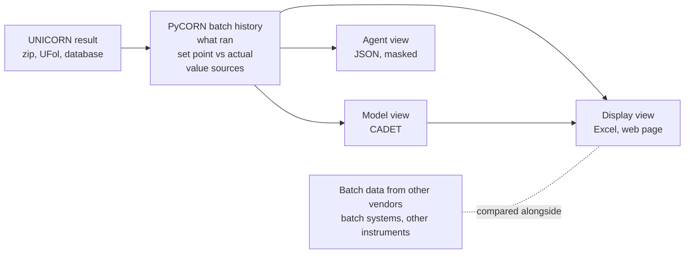

<a id="figure-1"></a>**Figure 1.** One PyCORN batch history, three views. Dashed: batch data from other systems, which the
vendor-neutral format lets a reader compare alongside the PyCORN batch history. PyCORN
doesn't read it.

**The vocabulary.** The PyCORN batch history's levels use ISA-88's names, and its runs, studies and
measurements map to the research ontologies (OBI, Allotrope) and to CADET. UNICORN's own
words stay beside them. §2 says why both, §12 maps each word.

**What stays open.** Display wording (Decide items in §11), how UNICORN splits a run
over several chromatograms, and how cycles are marked (§9 lists every open question
and the samples that would settle it).

## 2. Why both industrial and research standards

The same chromatography run moves between two worlds. In a **research lab** it is a
measurement or an experiment: part of a study, a design point of a DoE, data to calibrate a
model, results going to an ELN or LIMS. In **process development and production** it is a
batch step: run from a recipe on a skid, recorded for a batch record, a historian or an MES.
A run often crosses over: development runs calibrate a model that designs the production
recipe, and production batches become evidence for the next model. PyCORN serves both, so
the PyCORN batch history holds one neutral description and maps it to each side's standards, rather than
taking one side's vocabulary ([Table 2](#table-2)).

<a id="table-2"></a>**Table 2.** One run read in research and in industrial terms: each row is one thing, as each side names it.

| | Research (lab measurement, model calibration) | Industrial (process development, production) |
|---|---|---|
| Standards and ontologies | OBI and IAO (investigations, assays, data), Allotrope (AFO, and ASM for LC data), CADET (model inputs, references) | ISA-88 (batch control), ISA-95 / B2MML (materials), BatchML, IOF biopharma |
| Systems that use them | ELN, LIMS, modeling tools | batch systems, historians, MES |
| One result is | a measurement or a run of an experiment | a batch (made by executing one control recipe) |
| The method is | a protocol, whose variables are factor levels | a master recipe, whose variables are process parameters of the formula |
| A scouting series is | a study design execution (DoE) | a campaign |
| Set point vs actual | planned value vs measured value | set point vs actual value |
| Curves are | measurement data and CADET references for calibration | continuous data in the batch history, historian tags |
| Fractions and pools are | samples for offline assays (whose results feed back into a model) | material lots and sublots |
| The views that serve it | model view (CADET), display view (lab analysis), Allotrope ASM (later) | display view, BatchML batch record (later) |

ISA-88 names the levels because it is the only one of these that structures the
*procedure*. The research ontologies describe the run as one planned process with inputs
and outputs, not its inner steps. Everything else in the PyCORN batch history (values with a
source, measurements, materials, studies) is shared by both sides.

**ISA-88 in plant systems.** Plant batch systems and historians already organize run data
this way:

- **Emerson DeltaV Batch** is built on ISA-88 (procedures, unit procedures, operations,
  phases) and keeps batch history from its Batch Executive.
- **Siemens SIMATIC BATCH** with SIMATIC PCS 7 covers the ISA-88.01 models: the procedural
  model in SIMATIC BATCH, the physical model in PCS 7 engineering.
- **AVEVA Batch Management** (formerly Wonderware InBatch) follows ISA-88, writes batch
  history to a SQL Server database, and passes batch execution data to AVEVA Historian and
  MES.
- **AVEVA's PI System** batch interfaces, including those for DeltaV Batch and SIMATIC
  BATCH, build event frames level by level along the same hierarchy.

ISA-88 Part 4 (ANSI/ISA-88.00.04-2006) defines the batch production record, and MESA's
BatchML is its free XML form. A PyCORN batch history tagged with ISA-88 levels can therefore sit beside
plant batch data without a new vocabulary. None of these products is known to exchange
BatchML, so this is about structure, not a file format. Sources: "References" at the end.

PyCORN does not claim ISA-88 conformance: the PyCORN batch history uses the standard's concepts and names as a
frame. Every ISA-88 statement in this document was checked against the full text of ANSI/ISA-S88.01-1995
(Part 1), cited as "ISA-88.01" and the clause number (ISA-88.01 5.1.2.4). This document's
own parts are cited as §3.5. Part 4 is cited as ISA-88.00.04. The 2010 edition (ANSI/ISA-88.00.01-2010, IEC 61512-1) may
word them differently.

> **In ISA-88's own terms**, the PyCORN batch history is a **batch history**: "all recorded information
> pertaining to a batch", associated "with the actual execution of the appropriate procedural
> elements" (ISA-88.01 5.5.3). Each view (model, display, agent) is a **batch report**: an extraction of
> that data, ordered for its recipient (ISA-88.01 5.5.4, 6.4.3).

## 3. From linked runs down to one value

This section walks from the largest scale to the smallest. At each level: what UNICORN
stores, what ISA-88 calls it, and what the PyCORN batch history keeps.

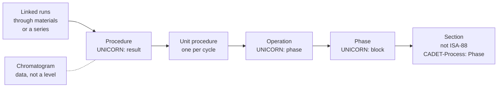

<a id="figure-2"></a>**Figure 2.** The levels, from linked runs down to a section.

### 3.1 Across results: linked runs

UNICORN stores one method run per result. Whatever spans several results is a **link between
PyCORN batch histories**, never one merged PyCORN batch history.

Results are linked in two different ways:

- **By the material.** Different methods, often on different days or skids, work on the
  same product: capture, then polishing. The runs are linked only through the material
  between them: what one run puts out (a pool) is what the next run loads. So a **material
  ID** belongs to each portion of material, not to a run: to each load (one run can load
  several materials, by several injections or sample inlets), to each fraction and to each
  pool. Fractions and pools get IDs the PyCORN batch history can make itself (the run plus the tube or
  pool name, §3.6.3). A load's ID, the plant's batch or lot number ("Lot X" in the diagram below, a placeholder), comes
  from the caller. A text variable stored with the run (a sample ID) can be offered as a
  hint, never applied on its own. Which pool became which load is also the caller's to
  say: UNICORN doesn't store it.


<a id="figure-3"></a>**Figure 3.** Runs linked through material: every load, pool and fraction has its own material ID.

  Rounded boxes are material, each with its own ID. Square boxes are runs (results), e.g.
  Run 1 a capture step and Runs 2 and 3 polishing steps. Run 1 is one result with three
  cycles (unit procedures, §3.3), each giving its own pool. Combining them happens outside
  UNICORN, so the combined pool's ID comes from the caller. All names are placeholders.

> **Batch vs lot.** The word "batch" means two things: the ISA-88 batch and the plant's numbered batch. In ISA-88 a batch is "the
> material that is being produced or that has been produced by a single execution of a batch
> process", and also "an entity that represents the production of a material" (ISA-88.01 3.5). Each
> UNICORN run is one, and UNICORN stores a **Batch ID** per run (a GUID, also a `Batch ID:`
> line in the run log). The plant's numbered batch ("Lot X" above) is material: in ISA-88 terms a **lot**
> ("a unique amount of material having a set of common traits", ISA-88.01 3.28). So the PyCORN batch history keeps the
> run's Batch ID (from UNICORN) on the run, and a material ID on each load, fraction and
> pool.

- **By the method (a series).** One method run N times with stored variations: a scouting
  run, for method development, a designed experiment (DoE) or repeated cycles. UNICORN
  stores this link itself (scouting name, run number). A series may load one material or
  several.

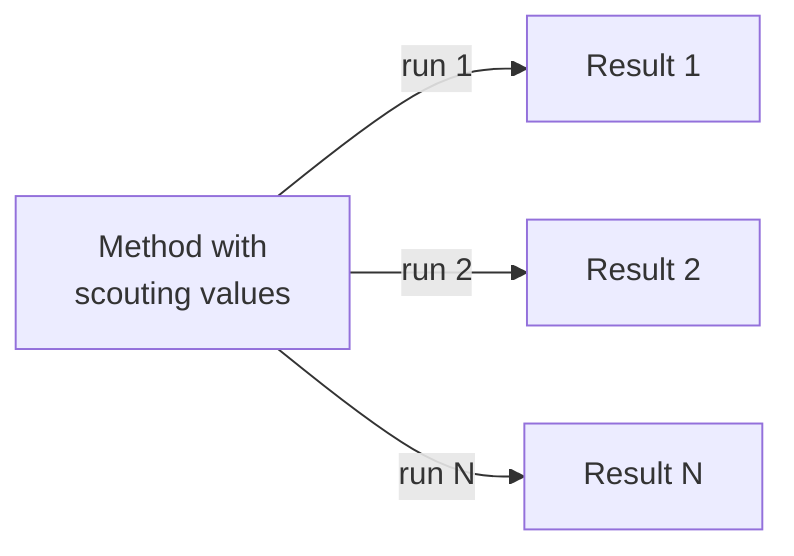

<a id="figure-4"></a>**Figure 4.** Runs linked by method: a scouting series.

<a id="table-3"></a>**Table 3.** Setups that span several results: how ISA-88 reads each, and how the PyCORN batch history links the results.

| Setup | ISA-88 reading | In the PyCORN batch history |
|---|---|---|
| Several chromatography steps of one product (e.g. capture, then polishing), on the same or different skids | **Process stages** (ISA-88.01 4.1.3.1), strictly unit procedures of one procedure (ISA-88.01 5.1.2.1). No system stores that procedure, so each result is read as its own procedure (a divergence from ISA-88). | One PyCORN batch history per result, linked by material ID (one run's pool is the next one's load). Unit and column say where each ran. |
| A scouting run: one method run N times with stored variations | N batches from one master recipe, each from its own control recipe (the method with that run's values, ISA-88.01 5.3.1.4) | One PyCORN batch history per result, with a series link (scouting name, run number). Whether the series repeats one process (cycles, §3.3) or varies it (method development, DoE) is the caller's to say. |
| Methods run back to back from a queue | Separate procedures | Separate PyCORN batch histories, ordered by UTC and linked through material, as above |
| Connected processing across skids (one skid's outlet feeds the next, at the same time) | Units running concurrently. ISA-88 "does not specifically address" continuous processes (ISA-88.01 4.1). ISA-106 (Procedure Automation for Continuous Process Operations) covers them. | One PyCORN batch history per skid, aligned on the UTC axis every PyCORN batch history has. Which outlet feeds which inlet comes from the caller (UNICORN doesn't store it). |
| Multi-column continuous chromatography on one skid (columns load, wash and elute in a staggered rotation) | One procedure with parallel work on several columns | **Not supported.** The PyCORN batch history has one sequence of sections per run. It would need a column tag on every section and parallel timelines. Waits for a sample. |

The link labels (a lot, a series) come from the caller. ISA-88 asks for exactly these links:
"batch tracking information", meaning links between batch histories "ranging from the use of
one batch as raw material to another, to the splitting or combining of batch histories due
to splitting or combining of batches" (ISA-88.01 6.4.2), so that a product can be traced back to its
materials and forward to every product a material went into (ISA-88.01 6.4.1.3). Where the labels go
in a batch record: §7.

### 3.2 One result: the procedure

A result is one method run. In ISA-88 terms the UNICORN method is a **master recipe**
(ISA-88.01 5.3.1.3). The method with the values this run used (variables, scouting values) is
the **control recipe**, which "defines the manufacture of a single batch" (ISA-88.01 3.11,
5.3.1.4). The run is that **batch**. Its **procedure** (ISA-88.01 3.37: "the strategy for
carrying out a process") runs on one clock, on one unit (the system). The PyCORN batch history
is built once per result, from all its original chromatograms (§3.4). The method, the system
settings and the other result-level data are shared by all of them.

What UNICORN stores for one result, in its own words, with this document's term beside each
part:

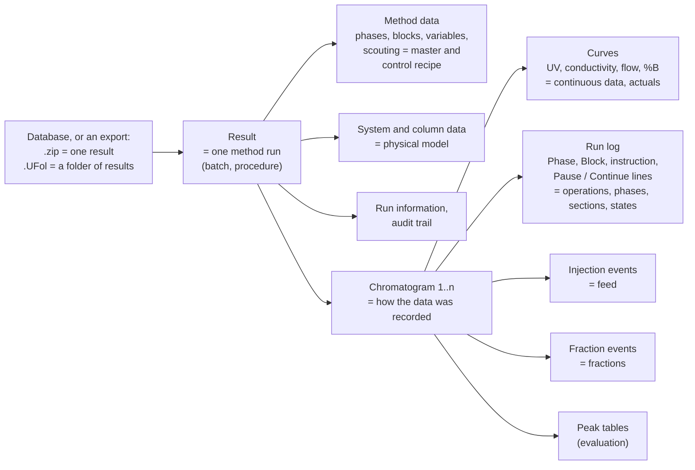

<a id="figure-5"></a>**Figure 5.** What UNICORN stores for one result, with this document's terms.

The run log is the backbone: its `Phase` lines start operations, `Block` lines phases, and
each executed instruction a section (D13: what ran, not what the method planned). ISA-88
asks the same of a batch history: entries "should, to the largest possible extent, reflect
the actual physical/chemical events that influence the batch, not only what was anticipated
in the recipe" (ISA-88.01 6.4.1.2).

### 3.3 Inside the procedure: unit procedures and cycles

A **unit procedure** is a complete piece of work on one unit (ISA-88: "a strategy for
carrying out a contiguous process within a unit", made of contiguous operations, ISA-88.01 3.61). A run has
**one** by default.
It has several only when the run repeats a whole process, which chromatographers call
**cycles**: to process enough material, one recipe runs the same sequence (equilibrate, load,
wash, elute, clean) N times on one column. "Cycle" is not an ISA-88 term. The PyCORN batch history maps
each cycle to one unit procedure. Segments carry no `cycle` field. The chromatographers'
word comes back as the caller's label for the unit procedure (e.g. "Cycle 2"), and the rules
below say how cycles are marked and used.

A cycling run often also does work that is not part of any cycle: a system prime or a
column wash before the first cycle, or a final clean or storage after the last. That work
gets its own unit procedure before or after the cycles, not counted as a cycle. A unit
procedure is any contiguous set of operations on the unit (ISA-88.01 3.61), so this needs no
exception. Which operations it holds comes from the caller's rule, like the cycle
boundaries.

<a id="table-4"></a>**Table 4.** Three ways UNICORN can record the same cycles, and how the PyCORN batch history marks each.

| How the cycles were recorded | ISA-88 reading | In the PyCORN batch history |
|---|---|---|
| A scouting run: N results | N batches from one master recipe | One PyCORN batch history per result with a series link (§3.1). The series link's run number gives the order. Whether the series counts as cycles is the caller's to say. |
| One result, a new chromatogram at each cycle boundary | One procedure, N unit procedures | Each chromatogram is a unit procedure, when the caller says so. The cuts are checked to fall between operations. |
| One result, no new chromatograms (or cuts elsewhere) | One procedure, N unit procedures | The unit procedure boundaries come from the caller (e.g. "a cycle starts at each phase P1", with the phase named as the method names it). A repeat found in the logged phase order is offered as a hint, never applied on its own. |

Within one result, each segment's `element_id` starts with its unit procedure (`UP2/OP3/...`).
Across results, the series link orders the runs. So the views work the same whatever the
recording. They give a summary row and window statistics per cycle, and the
overlay aligned at each cycle's start (W12). ISA-88's multi-batch trend likewise "must be with
relative time-axis" (ISA-88.01 6.4.3.2). The model view gives one CADET input per cycle. Real
cycles differ as the column loads and ages, so each keeps its own measured reference.

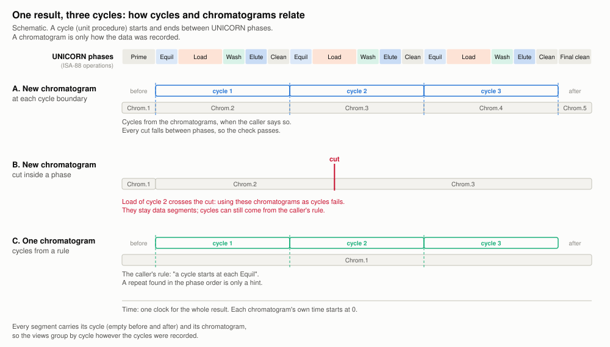

<a id="figure-6"></a>**Figure 6.** Cycles and chromatograms in one result (schematic).

(A synthetic schematic drawn by Claude, generated by `tools/draw_cycles_chromatograms.py`.)

One rule holds the hierarchy together: a unit procedure is made of whole operations, so a
cycle or unit-procedure boundary must fall **between** UNICORN phases. A procedure is "an
ordered set of unit procedures" (ISA-88.01 5.1.2.1), and several may run at once in different
units (ISA-88.01 5.1.2.2). ISA-88 neither states nor rules out several one after another on one
unit, so reading each cycle as one is this proposal's choice.

**How cycles are handled (proposed).** Cycles are never found on their own. The caller marks
them, and PyCORN applies the marking the same way every time:

1. **Marking.** The caller gives one of three rules (a CLI flag and an options JSON key, name
   open):
   - **By chromatogram:** each chromatogram is one cycle.
   - **By phase:** the UNICORN phase that starts each cycle, as the method names it (e.g.
     "Equilibration"). Optionally also the phase that ends each cycle (e.g. "CIP").
   - **By series:** across results, the scouting series counts as cycles.
2. **Cutting.** Within one result, each occurrence of the start phase begins a new cycle. A
   cycle runs up to the next start, or to the end of its end phase when one is given.
   Operations before the first cycle form one unit procedure. So do operations after the
   last cycle, when an end phase is given. Without one, the last cycle runs to the end of the
   run.
3. **Labels and order.** Each unit procedure keeps the caller's label as given ("Cycle 1",
   "Prime", "Lot X, pass 3"), with source `caller` (§3.9). PyCORN adds only its position in
   run order. Without labels, the default names apply ("Cycle n", [Table 15](#table-15)).
   Across results, the series run number gives the order.
4. **Checks.** A chromatogram cut inside a phase fails with an error naming the phase.
   Cycles whose phase order differs from the others get a warning that lists the phases.
   Unequal cycles are kept as they ran, never padded or dropped ([Table 16](#table-16)).
5. **Hints, without a rule.** The run is one unit procedure. A repeat in the logged phase
   order is offered as a suggested rule (start phase and count), never applied on its own.
6. **Outputs.** Display gets a `cycle` column with the caller's labels, a summary row and
   window statistics per cycle, and the overlay aligned at each cycle's start. The model view
   gives one CADET input per cycle. The JSON holds the unit procedures with their `label` and
   `boundary_source` ([Table 17](#table-17)).
7. **Across runs.** A column's use count is counted across linked runs, through the column's
   ID (§3.6.1.2), not stored in one run.

### 3.4 Chromatograms: how the data was recorded

A method can start a new chromatogram partway through a run (UNICORN's New Chromatogram
instruction). Some users do this to set one piece of work apart, such as a by-pass measurement before
the column run, or one cycle from the next. Others don't, so the split is not a reliable
sign of intent. **A chromatogram is not an ISA-88 level**: it is a stretch of the batch
history's data (ISA-88.01 5.5.3). The PyCORN batch history tags every segment, value and curve with the chromatogram it came
from, and joins the chromatograms on one clock.

What is known, and what isn't:

- The owner's statement from memory (2026-11-14), not checked on any example: the new
  chromatogram's time starts at 0 at the instruction. Each chromatogram's run log
  (`Logbook`) holds only its own part. Collection stops in one and starts in the next, so
  they don't overlap.
- Storage points the same way. In the database a run log (`EventCurve` with
  `EventCurveTypeName = 'Logbook'`, its lines in `Event`) is keyed by `ChromatogramID`, and
  only the chromatogram carries `ResultID`. In a `.zip` the event curves sit in each
  `Chrom.N.Xml`. Likely, but to be verified with an example.
- Not known: how the run log records the instruction itself, and whether settings (flow,
  %B, valves, phase, Pause / Hold state) carry across the cut and are repeated at the start
  of the next run log.

<a id="table-5"></a>**Table 5.** How the PyCORN batch history treats a run split over several chromatograms. Open items are marked.

| Thing | In the PyCORN batch history |
|---|---|
| Each original chromatogram | a `chromatogram` segment: name, start and end on the procedure clock, its curves |
| The clock | Chromatogram 1's own. Chromatogram n starts where n-1 ends, checked against its `ChromatogramStartTime` in UTC. |
| Settings across the cut | **Open test case.** If they carry over unrepeated, the PyCORN batch history takes them from the previous chromatogram. That is hard to read and not built until a sample shows it. Until then they are `not_known` before the first instruction. |
| A UNICORN phase across the cut | open, with the settings: one operation in both segments if the next run log starts inside it |
| The instruction | a section boundary where it ran, if the run log records it |
| What the user meant by the split | Never inferred. The caller may make chromatograms unit procedures or cycles (§3.3), or map them to an operation. |
| Imported and derived chromatograms (W17) | Not part of the procedure. An imported one links to its source result. A derived one is analysis. They are linked, never merged. |

Display keeps one table set per chromatogram, as today, noting a phase cut at the boundary.
The model picks a span by chromatogram, cycle or operation on the one clock.

### 3.5 Inside a unit procedure: operations, phases, sections

ISA-88's procedural levels end at the **phase**: "The smallest element of procedural control
that can accomplish a process-oriented task is a phase. A phase may be subdivided into
smaller parts", and "the logic or set of steps that make up a phase are equipment specific"
(ISA-88.01 5.1.2.4). So below the phase the PyCORN batch history uses no ISA-88 level: it cuts the
run into **sections**, the word CADET-Core uses for the stretches of its input
(`SECTION_TIMES`), from the instructions UNICORN logged as executed.

> **Why "section".** The word was chosen for consistency with CADET. Other words for the same
> stretch would do, such as step or interval ("step" has a fixed meaning in IEC 60848, section
> 11). With no equipment constraints, a section would look the same as a CADET-Process
> `Phase`: one flow and a linear composition over a stretch of time. They differ where the
> equipment adds what a `Phase` doesn't hold: a valve switch (a `ValveEvent`), the pump's
> flow ramps around a pause or hold (§3.7), a column by-pass partway through the run (§6).

> **What an instruction is, in ISA-88 terms.** A phase "can issue one or more commands", such
> as "specifying their set points" to basic control (ISA-88.01 5.1.2.4). A UNICORN instruction (`Flow`,
> `Gradient`, `Injection valve`) is such a command. Basic control then keeps the equipment in
> that state (ISA-88.01 5.1.1: "establishing and maintaining a specific state of equipment") until the
> next command changes it. That is why a set point carries across a phase boundary until the
> new phase's own instruction replaces it.

<a id="table-6"></a>**Table 6.** The levels inside a unit procedure: UNICORN's and CADET-Process's counterpart of each, and the PyCORN batch history's field.

| Level | UNICORN | CADET-Process 0.13 | In the PyCORN batch history | Row in [Figure 7](#figure-7) |
|---|---|---|---|---|
| Operation (ISA-88.01 5.1.2.3: "a major processing sequence that takes the material being processed from one state to another") | a UNICORN **phase** (Equilibration, Sample Application, ...) | none (CADET-GUI: a "Phase ..." run-log marker) | `operation`: number, instance (repeats, each occurrence identified, as ISA-88.01 5.3.3.2 asks), logged text, display name | "Operation" |
| Phase (ISA-88.01 3.34: "the lowest level of procedural element") | a UNICORN **block**, and the activities running at once inside a phase (flow and gradient, sample feed, fractionation, watches) | none (activities are flow-sheet units) | `phase`: one per equipment activity, with the equipment module that carries it out | "Phase", and "Phase activity" shows one activity, the sample feed |
| Section (not ISA-88, CADET-Core's word) | the stretch from one executed instruction to the next: the settings (flow, %B or its ramp, valves, feed, state) don't change inside it | **`Phase`** (one flow, linear composition) and `ValveEvent` | `section`: the PyCORN batch history's lowest level, as the model gets it | "Section" |

**Display: sections joined (proposed).** People don't need 29 sections for one run. The
display view joins neighbouring sections whose flow, %B, feed and state are equal, and folds
the previous phase's set points into the phase when the phase's own instruction replaces them
within 10 s, with a note (decided 2026-11-12). This is computed from the sections each time
and isn't stored in the PyCORN batch history. In `u73_blank.zip` the 29 sections become 12 such rows. What
to call them is open (§11: "the words below the phase"). This draft calls them
**display steps**.

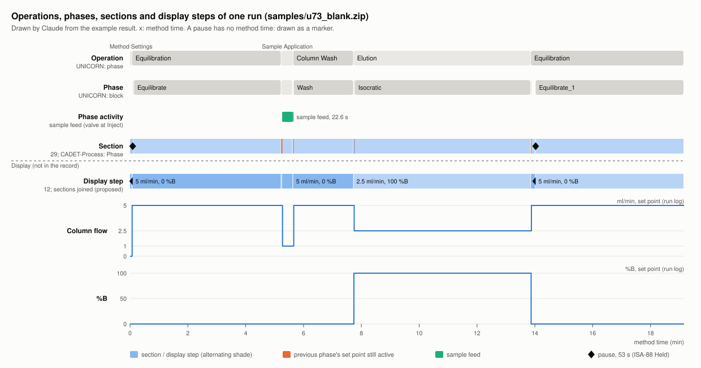

<a id="figure-7"></a>**Figure 7.** Operations, phases, sections and display steps of one run (`samples/u73_blank.zip`).

(Drawn by Claude from the example result, generated by `tools/draw_run_levels.py`. Top to
bottom: the PyCORN batch history's levels, then the display steps (proposed). The curves below are the
column flow and %B set points from the run log.)

> **Three kinds of "phase".** A UNICORN phase is an ISA-88 operation, an ISA-88 phase
> is closer to a UNICORN block, and a CADET-Process `Phase` is a section. The PyCORN batch history uses
> ISA-88's words with UNICORN's beside them. Display keeps UNICORN's. `Phase` appears only in
> CADET objects.

### 3.6 Where it ran and what it did to the material

#### 3.6.1 Physical model: where it ran

The physical model (ISA-88.01 4.2) describes the equipment. The unit is the system (CADET: `LCFlowSheet`).
ISA-88 draws the line between the two lower levels by what the equipment does. A collection
that "executes one or more equipment phases" is an **equipment module** (ISA-88.01 5.2.3.3).
A **control module** only carries out basic control, such as "an on/off automatic block valve
with position feedback switches" (ISA-88.01 4.2.7). "Control modules do not perform procedural
control" (ISA-88.01 5.2.2.4.2). So:

- Equipment modules: the system pump with its mixer (flow and gradient), the sample feed
  (sample pump, or injection valve with sample loop) and the fraction collector
  (fractionation). In CADET the pump and mixer are buffer inlets A-D and a mixer, and the
  injection valve is a `ValveEvent`.
- Control modules: each valve on its own (inlet valves, column valve, outlet valve) and the
  UV, conductivity, pH and pressure monitors. In CADET the column valve is `bypass_units`,
  fixed for the run, and a monitor is an observation point such as `column.outlet`.

Source: the system configuration stored in the result.

#### 3.6.1.1 The flow path inside the unit

The flow path is the order of the unit's own equipment. It is not ISA-88's path, which is
the order of units a batch passes through in a process cell (ISA-88.01 3.32, 4.2.4).

[Figure 8a](#figure-8a) follows the order of the high-pressure tubing in Cytiva's
public documents for ÄKTA avant 25 and ÄKTA pure. [Figure 8b](#figure-8b) follows the flowchart of ÄKTA
ready, a single-use process-scale system (References). Solid lines are the path the documents
show. Dashed boxes and lines depend on the system and its installed modules. ÄKTA pure's manual
says "the configuration of the system is defined by the user", and ÄKTA avant 25's
documentation lists standard and optional modules. Other process-scale systems (ÄKTA
process, ÄKTA pilot, ÄKTA ready XL) are not covered: no document was read for them.

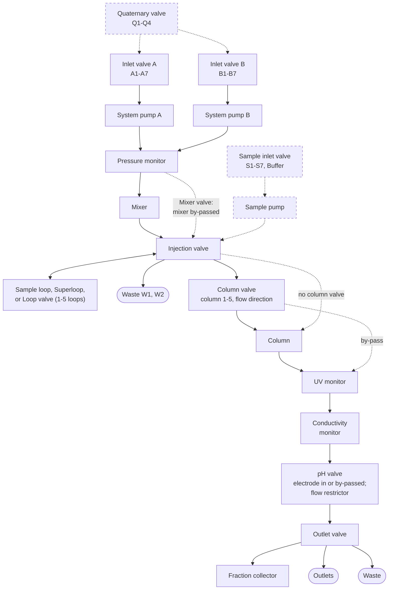

<a id="figure-8a"></a>**Figure 8a.** The liquid flow path of an ÄKTA lab system, from Cytiva's public documents
(schematic). Dashed: depends on the system's modules. The column's outlet returns through
the column valve before the UV monitor.

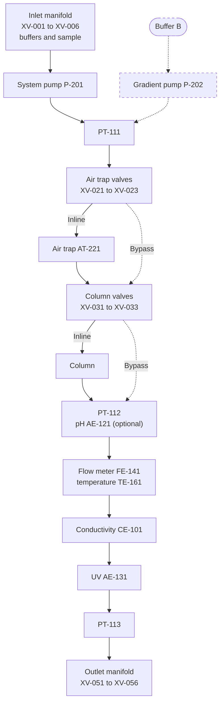

<a id="figure-8b"></a>**Figure 8b.** The liquid flow path of ÄKTA ready, from its Operating Instructions
(28960345 AH, 3.3-3.5; schematic). Dashed: the gradient flow section, only on systems with
the optional gradient pump. All 19 valves are pinch valves on single-use tubing. There is no
injection valve, loop or mixer. Sample enters through an inlet of the manifold and the
system pump. The sensors after PT-112 are drawn in the order of the flow kit's parts list.
The flowchart drawing was not read as an image, so check it there.

What differs for the PyCORN batch history on ÄKTA ready:

- The feed is an inlet position, not an injection valve setting (no `ValveEvent`, no loop
  volume).
- The flow is the pumps' (peristaltic), with flow meter FE-141 as a measured actual.
- The air trap's volume is on the path when it is `Inline`.
- Buffer B has no inlet valve.

In [Table 7](#table-7) the positions are UNICORN's words (kept under `original`). The set-up comes from
the system configuration (`system_configuration.py` reads the inlet valves, sample inlet
valve, sample pump and quaternary valve today), never from Figures [8a](#figure-8a) and [8b](#figure-8b).

<a id="table-7"></a>**Table 7.** Valves on the flow path: their positions, what the PyCORN batch history takes from each, and where the position comes from.

| Valve | Positions (UNICORN's words) | What the PyCORN batch history takes from it | Source |
|---|---|---|---|
| Inlet valves A, B, quaternary valve | inlet ports (`A1` ...), quaternary mix | the buffer line and position per section (Decide 22: known / assumed / not known) | run log, with the set-up from the system configuration |
| Mixer valve (ÄKTA pure, optional) | via the mixer, or by-passing it | whether the mixer volume lies on the path | run log, with the set-up from the system configuration |
| Injection valve | `Manual load`, `Inject`, `System pump waste`, `Direct inject`, `Sample pump load`, `Sample pump waste` | the feed sections and the column flow (D14, D16-D21), as CADET's `ValveEvent` | run log |
| Sample inlet valve, sample pump | sample ports (`S1` ...), `Buffer` | which load a feed section takes (§3.1) | run log, with the set-up from the system configuration |
| Loop valve (optional) | loop 1-5 | which loop fed, with its volume from the caller (D19) | run log, with the volume from the caller |
| Column valve | column position, flow direction, by-pass | column flow zero at by-pass (D14, Decide 16), and which column (Vc) | run log, with the column from the result |
| pH valve | electrode in the path or by-passed | whether a pH curve was measured in the flow | run log |
| Outlet valve | fraction collector, outlet ports, waste | flow-through and waste vs eluate ([Figure 9](#figure-9)) | run log |
| ÄKTA ready: inlet manifold XV-001 to XV-006 | one open inlet | buffer and sample per section. A feed section is an open sample inlet, as the caller names it. | run log, with the sample inlet named by the caller |
| ÄKTA ready: air trap valves XV-021 to XV-023 | `Inline` (XV-022 + XV-023 open), `Bypass` (XV-021) | whether the air trap's volume is on the path | run log |
| ÄKTA ready: column valves XV-031 to XV-033 | `Inline` (XV-032 + XV-033 open), `Bypass` (XV-031) | column flow zero at `Bypass`, as the lab systems' column valve | run log |
| ÄKTA ready: outlet manifold XV-051 to XV-056 | one open outlet | flow-through and waste vs eluate, by the caller's naming of the outlets (no fraction collector) | run log, with outlet use from the caller |

The volumes along the path (loop, sample flow path, mixer, the tubing between injection
valve, column and monitors) are values like any other: from the stored system configuration
(the mixer), or from the caller, each with its source. The tubing lengths a document lists
as delivered are not used as defaults (D28): a site's tubing differs.

#### 3.6.1.2 The column (proposed)

What a result stores about the column today (read by `column_volume.py` and
`column_geometry.py`):

- The column UNICORN named at run time (`ColumnInformation`, `usedColumns`). `Any` means no
  column type was chosen.
- The result's own copy of that column type (`ColumnTypeData`), only when the run named one:
  bed height, inner diameter, particle diameter, media, technique, hardware, article number,
  total liquid volume and void volume.
- The individual column (`ColumnIndividualData`). It is often empty, and what it holds when
  filled is not known yet.
- The column volume Vc, from up to ten sources by priority. A column record is never a source
  of Vc. Its geometry is only checked against Vc (owner, 2026-11-08).
- The column valve positions over time, from the run log: in line or by-pass, which column
  port, which flow direction.

The database's column library is linked to results by name only and holds today's values,
not those at run time, so it is not read.

**The column is equipment.** In ISA-88 terms it is "other process equipment" of the unit
(ISA-88.01 3.60). It is not material: it is used again run after run and is not consumed into
the product, so it is not a process input (§3.6.3). It is not a level either. The resin is
part of the column, so the resin lot is a property of the column.

**Two identities, kept apart.** B2MML separates the place a piece of equipment fills from the
physical item that fills it:

- **Equipment** (`EquipmentID`): the column's place on the unit, e.g. column valve port 2.
- **Physical asset** (`PhysicalAssetID`, with `VendorID` and `FixedAssetID`): the packed
  column itself.
- `EquipmentAssetMapping` links the two, with a start and end time. Per batch, B2MML's
  operations performance records the `EquipmentActual` and `PhysicalAssetActual` used, beside
  each `MaterialActual`.

So the PyCORN batch history holds one column entry per column the run used. Each entry has
the column type (from UNICORN), the individual column's ID (from UNICORN when stored, else
from the caller), the column valve port, and the spans in which the column was in line (from
the run log). A run that switches between ports has one entry per column.

**Values, like any other value.** Vc, bed height, inner diameter and particle diameter are
values with a source (§5). Vc's source is the one `column_volume.py` picked. Geometry comes
from the column type record or the caller. Geometry the caller gives is a source of Vc only as
a last resort (D26). Total liquid volume and void volume stay hints: no porosity is computed
from them. Nothing is looked up by name, in the library, or from a volume in the column name.

**Across runs, through the column's ID.** Runs on the same packed column are linked by its
physical asset ID, as runs of one product are linked by material ID (§3.1). Anything about
the column's life belongs to the column, not to one run: how often it has been used, and its
performance tests (plate count, asymmetry). A use count across runs is computed from the
linked PyCORN batch histories, never stored in one. This is also why real cycles differ as
the column ages (§3.3).

**For CADET.** The model view gets the column geometry and Vc. Porosities, binding and every
other model parameter stay the caller's (D28).

Open: what `ColumnIndividualData` holds when filled, and whether UNICORN stores an individual
column ID anywhere else (needs an example result from a system that tracks individual
columns). Until then, the individual column's ID comes from the caller.

#### 3.6.2 Process model: what it did to the material

ISA-88's process model (ISA-88.01 4.1.3) describes a process without equipment, in three levels ([Table 8](#table-8)).

<a id="table-8"></a>**Table 8.** ISA-88's process model levels and their counterparts in a chromatography run (-: none).

| ISA-88 level | In chromatography | Counterpart in the run |
|---|---|---|
| process stage | capture, polishing | - |
| process operation | equilibrate, load, wash, elute, strip, clean | an operation (UNICORN phase) (ISA-88.01 5.2.1, Figure 7) |
| process action | - | - |

CADET's templates (`PulseInjection`, `Step`, `StepElution`, `LWE`, `Breakthrough`) and
CADET-GUI's experiment types are equipment-free in the same way.

UNICORN doesn't store the process operation. Phase names usually say it, but a phase named
"Wash 2" may elute. So the PyCORN batch history keeps a `process_operation` field on each operation,
empty unless the caller gives a mapping, never guessed.

#### 3.6.3 Process inputs and outputs: what went in and what came out

ISA-88's formula names the materials a recipe takes in and gives out: **process inputs** and
**process outputs**, each an identification and a quantity (ISA-88.01 3.42, 3.45, 5.3.2.2).
The formula holds what is planned. The PyCORN batch history holds what the run actually took
in and gave out.

A run takes material in (the load, buffers) and gives material out (flow-through and waste, and the eluate, collected as fractions).
Fractions are later combined into pools. A **lot** is ISA-88's "unique amount of material
having a set of common traits", what a plant calls its batch or lot number. Every material
below carries its own material ID: a load's from the caller, a fraction's and a pool's made
by the PyCORN batch history. A pool that becomes the next step's load is how runs of one product are
linked (§3.1).


<a id="figure-9"></a>**Figure 9.** Material flow through one run.

Masses and concentrations in [Table 9](#table-9) are never assumed: they come from the caller, or from a UV curve with a
caller-given extinction coefficient and its accuracy note.

<a id="table-9"></a>**Table 9.** Materials going into and out of a run: what UNICORN records, how the PyCORN batch history identifies each, and its ontology terms.

| Material | What the run records | Identified in the PyCORN batch history as | Ontology terms |
|---|---|---|---|
| Load (feed) | the feed sections: valve and inlet, start and end, volume (calculated from the run log, actual from the volume axis, §3.8). Not what the material was. | one load per feed (injection or sample inlet): the run, the feed section's `element_id`, its volume, and the caller's material ID for it (a stored sample-ID variable only as a hint) | an input of the run (OBI "has specified input"), an ISA-88 lot, and an ISA-95 `MaterialActual` with its lot ID |
| Buffers | inlet positions and %B per section | inlet line and position, with names and the buffer lot's material ID only from the caller (§3.6.3.2) | an input of the run, and IOF `BufferSolution` |
| Flow-through, waste | outlet valve at waste, with times and volumes | the outlet sections | an output of the run, with no class |
| Eluate | the stream reaching the fraction collector. UNICORN stores no separate record of it. | the outlet sections at the collector | an output of the run, with no class |
| Fraction | one row per tube: tube id, start, end, volume (the `Fraction` event curve) | the run, chromatogram and UNICORN's tube id, with its span | No class for a collected fraction. ISA-95 (B2MML) `MaterialSubLot` is the closest place for one. |
| Pool | fractions combined in UNICORN's evaluation (today's `pools` table): name, members, pooled curve | the run and the pool name (`<first>-<last>` tube id) | IOF `PoolingProcess` is the act of pooling. The pool itself has no class. It is an ISA-95 `MaterialLot` when it becomes the next step's load. |

An ontology-aligned PyCORN batch history would need two things beyond this:

- IOF's pattern of roles suggests an eluate role, a flow-through role and a fraction as gaps
  to raise with IOF (§9). On a current review branch, filtration has `FiltrateRole` and
  `RetentateRole`.
- The link from a pool to the next step's load is material genealogy (ISA-95). Only the
  caller can give it, since UNICORN doesn't store it.

#### 3.6.3.1 Composition: what each stream held

The run records which inlet fed the pumps and at
what %B (or %Q), and it measures conductivity, pH and UV. It doesn't record what the buffers
or the load contain. That comes from the caller, per inlet position or line, as the CADET
export takes it today (`buffers=`, `feed=`, see [`CADET_GUIDE.md`](CADET_GUIDE.md)).

<a id="table-10"></a>**Table 10.** Composition as set point, actual and calculated values (the kinds of §3.8, with their
ontology terms in [Table 25](#table-25)), with where each comes from (-: not available).

| Quantity | Set point | Actual | Calculated |
|---|---|---|---|
| Buffer, per section | inlet position and %B or %Q (run log, known / assumed / not known, Decide 22) | - | per component, mol/m^3: the caller's buffer contents mixed by the executed %B or %Q |
| Load, per feed | the feed section: valve or inlet (run log) | its volume (volume axis) | per component amount: the caller's concentration x the actual volume |
| Buffer conductivity and pH | - | read where the column is by-passed, checked against the outlet (D22) | - |
| Salt | - | the conductivity curve | mol/m^3, only through the caller's calibration (the by-pass readings give its points) |
| Protein at the outlet | - | the UV curve, AU/cm | mg/ml, only with the caller's extinction coefficient, with its accuracy note |

Salt can then have two calculated values: from the caller's buffers mixed by %B, and from
the conductivity curve. The PyCORN batch history keeps both, each with its source. A difference shows a
wrong buffer entry, an inlet position that was assumed, or the delay through mixer and
column.

Which value each output uses:

- **Excel and the web page (visualization):** the inlet as the run log names it (`A1`,
  `B1 (assumed)`), the caller's buffer name beside it when given, %B as set, and the
  measured conductivity, pH and UV. Concentrations only when the caller gave the inputs,
  marked as calculated.
- **CADET (modeling):** a concentration per component for every inlet, the buffer mix per
  section (`Phase` composition, with a ramp's start and end, §6), the feed's concentrations
  on the feed sections, and the measured curves as references. Components and contents are
  the caller's (D28). A component left out of a buffer is 0, as the CADET export does today.
- **Scripts and agents:** all of them, each with its kind and source.

#### 3.6.3.2 Buffer provenance: recipe, preparation, lot and measurement (proposed)

This part lays out what CADET and other modeling tools need to know about a buffer, and
where each piece sits in the standards. Which pieces PyCORN holds, and which stay in a LIMS,
ELN or MES and are only linked by ID, is still open (§9).

A buffer on an inlet has four layers of information: recipe, preparation, lot and
measurement ([Figure 9a](#figure-9a), [Table 10a](#table-10a)). UNICORN stores none of them,
only the inlet position and the %B or %Q (§3.6.3.1). They come from the caller.

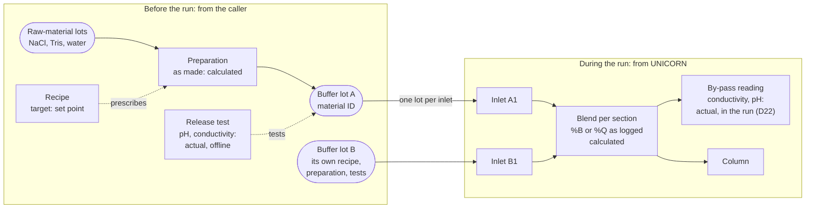

<a id="figure-9a"></a>**Figure 9a.** A buffer's provenance, from raw materials to the column, with the kind of
value (§3.8) each step gives. The blend is prepared inside the run and has no lot of its
own. The same layers apply to the load.

<a id="table-10a"></a>**Table 10a.** The four layers of a buffer's provenance, their terms in each standard, and the
kind of value each gives (§3.8). IOF terms are from the biopharma module's `master`.

| Layer | What it holds | ISA-88 | ISA-95 / B2MML | IOF | Kind of value |
|---|---|---|---|---|---|
| Recipe | Target composition (components and concentrations), target pH and conductivity, a version | The buffer preparation's master recipe. Its formula lists the process inputs (raw materials and quantities) and the process output, the buffer (ISA-88.01 5.3.2). | `MaterialDefinition` with its properties. A `TestSpecification` holds the acceptance limits. | `InputSpecification`. `BufferSolution`, a `Solution` whose constituents have `SoluteRole` or `SolventRole`. `MolarConcentration`, `MassConcentration`. | set point |
| Preparation | One making of the buffer: amounts weighed or dispensed, raw-material and stock lots used, final volume, when | A batch in its own right, with its own batch history. Its control recipe "may have been modified to account for actual raw material qualities" (ISA-88.01 5.3.1.4). | The genealogy from raw-material lots to the buffer lot (`AssemblyLot`, `AssemblyRelationship`) | `SolutionPreparationProcess`, a planned process whose output is a `Solution`. `StockSolutionRole`, `WorkingSolutionRole`. | calculated (as made) |
| Lot | The prepared buffer as one identified amount: ID, quantity, status, expiry | Lot (ISA-88.01 3.28) | `MaterialLot`: `Status`, `Disposition`, `Quantity`, `StorageLocation`. The expiry is on its `TestResult`. | No lot class | material ID |
| Measurement | Tests of the prepared lot: pH, conductivity, osmolality, a titration | Quality control information, common to batches rather than part of one (ISA-88.01 5.5.2) | `TestResult` with `PropertyMeasurement`, checked against the `TestSpecification` | `MeasurementProcess`, whose output is a `MeasurementInformationContentEntity` | actual (offline) |

**As made and measured are different kinds of value.** As made is calculated from the
preparation record: 5.844 g NaCl made up to 1.000 L gives 100.0 mM. It gives a
concentration per component, with every weighing and volume error in it. Measured comes
from an instrument applied to the finished buffer: a pH meter, a conductivity meter, an
osmometer. It reads a property of the whole solution, mostly not one component's
concentration. Conductivity gives salt only through a calibration (§3.6.3.1). So CADET's
inlet concentrations (mol/m^3 per component) come from the recipe or the as-made record.
Measured properties check them.

**Four values side by side.** One buffer's salt can have a recipe target, an as-made value,
a release test (through a calibration) and the by-pass reading in the run (D22). Each keeps
its kind and source. A difference points at a wrong entry, a lot past its expiry, or the
wrong bottle on the inlet.

**One lot per inlet.** An inlet holds one lot for the whole run. A bottle swapped during the
run is a note on the inlet, not a second lot.

**Blends are prepared during the run.** Any mix of inlets is one: an A/B mix at a %B, a
quaternary-valve blend at its %Q, an in-line dilution, BufferPro. The logged %B or %Q are
the set points of that preparation, and the mix per section is calculated from them
(§3.6.3.1). A blend has no container and no ID, so it is never a lot. BufferPro also stores
a recipe in the method, read as hints only (D3).

**The load** has the same layers: its lot (§3.1), how it was made (a previous step's pool,
a harvest), and its assays (titer, purity). The assays give CADET the feed concentrations.

**Which value CADET uses (proposed).** The caller's inlet concentrations, each with its
kind: as made where given, else the recipe's target. Measured properties are compared with
them and the difference reported. They never replace them silently.

#### 3.6.3.3 Components: what a buffer, a solution or a load is made of (proposed)

A component name alone ("salt") can mean a different thing in the recipe, in the as-made
calculation and in the model. Then the values of [Table 10a](#table-10a) can't be compared.
So each component the caller names carries a few fields. There are two kinds of component,
with different fields.

**Prepared constituents** are defined by their chemistry: NaCl, Tris, acetate, urea
([Table 10b](#table-10b)).

<a id="table-10b"></a>**Table 10b.** Fields of a prepared constituent, all from the caller.

| Field | Why |
|---|---|
| Name, and an identifier (a ChEBI ID or CAS number) | Ties one substance together across recipe, as-made record and model. Never checked against a closed list. |
| Form as weighed: anhydrous or a hydrate, salt form, purity or assay % | The as-made calculation is wrong without it: Na2HPO4 x 2 H2O is not Na2HPO4. |
| Molecular weight of that form | Converts g/L to mM |
| Concentration basis: molar or mass, per litre of final solution or per kg of solvent | A recipe in % w/v and a model in mol/m^3 convert without ambiguity |
| Role: buffering agent, salt, modifier, solvent | Which component carries the pH and which the ionic strength. IOF `BufferingAgentRole`, `SoluteRole`, `SolventRole`. |
| Model component it feeds | NaCl as one `salt` component or as Na+ and Cl-: the caller's choice. The PyCORN batch history keeps the mapping, not a choice of its own. |

**Assayed components** are defined by the assay method, not by chemistry: product, HMW
(high-molecular-weight species) by SEC, HCP (host cell protein) by ELISA, DNA by qPCR
([Table 10c](#table-10c)).

<a id="table-10c"></a>**Table 10c.** Fields of an assayed component, all from the caller.

| Field | Why |
|---|---|
| Assay method and its version | HMW from two SEC methods is not the same component |
| Unit and basis: g/L, % of total, ppm of product | A percentage needs its reference amount before a model can use it |
| Limit of quantification, and how a value below it is reported | "< LOQ" is not 0 |
| Molecular weight, extinction coefficient | For mol/m^3 and for UV (issue #1). Never a default. |
| Model component it feeds | Several assays can feed one model component, or one assay several |

**Properties of the whole solution** are not components: density, viscosity, and the
temperature at which pH and conductivity were measured. They sit beside the components, as
values with kind and source. Density converts a measured mass into a volume (§3.8).
Viscosity and temperature matter for back-pressure and for reading conductivity.

**In scope, out of scope (proposed).** [Figure 9b](#figure-9b) shows the split.

- **To be decided:** what identifies a component and converts its amounts. That is the fields
  of Tables 10b and 10c, the solution properties, and the mapping to model components.
- **Out of scope:** physicochemical constants of a component or of its interactions. These
  are pKa, charge, diffusion and activity coefficients, binding parameters, and their
  temperature dependence. They are model parameters and depend on the model chosen (D28).

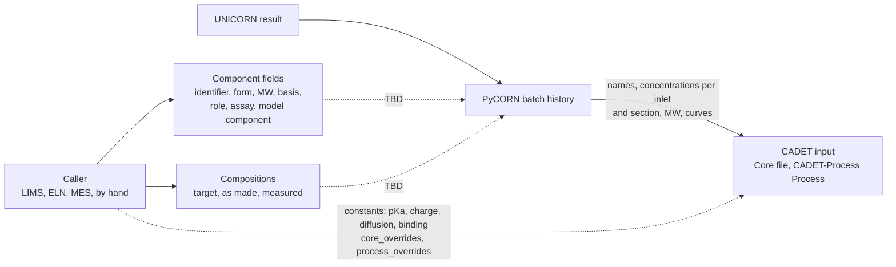

<a id="figure-9b"></a>**Figure 9b.** How component data reaches the model. Solid: in scope, held in the PyCORN batch
history. Dashed: TBD or out of scope, set by the caller in CADET's own terms and passed through
unchanged (`core_overrides`, `process_overrides`, or CADET-Process's own API on the returned
`Process`, see [`CADET_GUIDE.md`](CADET_GUIDE.md)). PyCORN lists the paths set.

### 3.7 States: running, paused, held, and the transients between

ISA-88's example states for a procedural element are idle, running, complete, pausing,
paused, holding, held, restarting, stopping, stopped, aborting and aborted. The standard
"does not require these states or preclude additional states" (ISA-88.01 5.7.2). The states ending in
"-ing", Running included, are **transient**: the element is executing logic, and when that
logic completes it moves on by itself (ISA-88.01 Table 2, note). Idle, Paused and Held wait for a
command. Complete, Stopped and Aborted are final (ISA-88.01 Figure 18). A phase that ends
normally goes from Running to Complete. No state lies between two phases.

**Paused** stops "at the next defined safe or stable stop location" and "is usually used for
short-term stops". Resume continues from there. **Held** follows Holding logic that puts the
element "into a known state", is "usually used for a long-term stop", and is left only by a
Restart (ISA-88.01 5.7.2.1, 5.7.2.2). So the names swap: UNICORN's Pause is ISA-88's Held, UNICORN's
Hold is ISA-88's Paused, and UNICORN's Continue is a Restart after a Pause and a Resume
after a Hold ([Table 11](#table-11)).

<a id="table-11"></a>**Table 11.** UNICORN's Pause and Hold as ISA-88 states: what the pumps, the clock and a %B ramp do, and how CADET-Process expresses each.

| UNICORN | ISA-88 state | Pumps | Clock | %B ramp | CADET-Process 0.13 |
|---|---|---|---|---|---|
| running | Running | on | runs | runs | `Phase` with flow > 0 |
| **Pause** | **Held** (left by Restart) | stop | stops | stops | `Phase(d, 0.0, {})` |
| **Hold** | **Paused** (left by Resume) | run | runs | frozen | `Phase` with `composition_start = composition_end` |

How today's code builds sections around pauses and holds, case by case, is shown in
[`RUN_STRUCTURE_GUIDE.md`](RUN_STRUCTURE_GUIDE.md) (figure "Pauses and holds").

**Flow ramps and the transient states.** Two kinds of ramp meet the states differently:

- A **commanded** ramp (a gradient, a programmed flow change) is the recipe's: it happens in
  Running, as a section whose set point has a slope (§3.5, §3.8).
- The **instrument's own** ramps are equipment behaviour the run log doesn't record. The
  pump ramps down before a Pause and back up after the Continue. Under pressure control a
  flow increase still takes about 10 s. A valve turn briefly stops the flow. The survey (review 3.4) shows them on the volume axis, and the
  decided CADET flow source (Decide 6) already fits them as pieces (stop, linear ramp, set
  flow).

So the PyCORN batch history tags the fitted pieces around a stop with ISA-88's "-ing" states, as short
sub-segments, only where the volume axis shows them ([Table 12](#table-12)).

<a id="table-12"></a>**Table 12.** ISA-88 states around a stop: when each applies, the flow set point and actual in it, and what UNICORN logs.

| ISA-88 state | When | Flow set point | Flow actual | Logged by UNICORN |
|---|---|---|---|---|
| Running | normal execution | the method's, with any commanded slope | The volume axis. Under pressure control or at a valve turn it may lag or dip, and the state is still Running. | instructions |
| **Holding** | from the Pause to the pump at rest | unchanged | ramps down (fitted) | the Pause time only |
| Held | the pump at rest | unchanged | 0 | the pause's length |
| **Restarting** | from the Continue to the set flow | unchanged | ramps up (fitted) | the Continue time only |
| Pausing, Paused | a Hold | unchanged, can change | the set flow, with %B frozen | Hold and Continue |
| **Stopping** | a manual End before the method ends (ISA-88's Stop: "a controlled normal stop"), to rest | unchanged | Ramps down (fitted), if the volume axis shows it. Not yet seen in the survey. | End |
| Complete | the method's own End | | any ramp down belongs to Running | End |

The ramp's length is inferred: UNICORN logs when a Pause, Continue or End was issued, not
when the pump reached rest or the set flow. Each transient carries the actual flow as a
value with source `volume_axis` and quality `fitted`. The set point never changes in it.
Display adds "ramped n s" to the phase's note. The model gives each transient its own
section with a linear flow term. An agent sees the state and both flows.


<a id="figure-10"></a>**Figure 10.** Flow ramps and ISA-88 states around a Pause and a Hold (schematic).

(A synthetic schematic drawn by Claude, generated by `tools/draw_transient_states.py`. Not
data.)

### 3.8 Set point, actual and calculated values

The PyCORN batch history stores a value such as a flow or a volume with up to three numbers:

- **set point**: the value set in the method, as the run log shows it;
- **actual**: the value measured during the run (for flow and volume: UNICORN's volume axis);
- **calculated**: a value PyCORN computes from other values, such as set point flow x time.

They can differ, so the PyCORN batch history keeps all three, each with its source.

**Volumes measured offline.** A collected fraction, pool or flow-through can be measured
after the run, by volume or by mass. That is another actual value, with source `caller`.
For now the volume UNICORN reports on its volume axis is the number every calculation and
every display uses (owner, 2026-11-15). A measured mass may later take precedence over it,
converted with the caller's density. Such a measurement is rare.

Method variables are what ISA-88 calls **process parameters**, part of the recipe's formula
(ISA-88.01 3.46, 5.3.2.2): they belong to the method, and one may be "used as set points, comparison
values, or in conditional logic". Phase lengths, volumes and statistics measured from the
run are actual or calculated values: they belong to the PyCORN batch history.

Example: the Sample Application phase of `samples/u73_blank.zip`. UNICORN runs a phase's
first instructions one after another, so the previous phase's flow set point stays active
for the first 2.4 s of the new phase ([Table 13](#table-13)).

<a id="table-13"></a>**Table 13.** Column flow and sample volume at that phase start: set point, calculated and
actual (empty: not applicable).

| | Column flow | Sample volume |
|---|---|---|
| Set point (run log) | 1 ml/min, after 5 ml/min (previous phase) for the first 2.4 s | |
| Calculated (set point flow x time) | | 0.417 ml |
| Actual (volume axis) | about 2.5 ml/min during the 0.6 s in which the injection valve is already at Inject and the flow set point is still 5 ml/min | 0.389 ml |

The two sample volumes differ because of those 0.6 s: the set point was 5 ml/min, the actual
flow about 2.5 ml/min.

Which value each output uses:

- **Excel and the web page:** the set point flow with a note, `1 ml/min (first 2.4 s at 5)`,
  and the actual sample volume, `0.39 ml` (Decide 18, settled 2026-11-15: the volume axis).
- **CADET:** the actual value (0.389 ml).
- **Scripts and agents:** all three, each with its source.

For scripts, the same values as JSON. Each value has a `kind` (`set_point`, `actual` or
`calculated`), a `source`, and a `quality` (how certain it is):

```json
{"level": "operation", "element_id": "OP2", "display_name": "Sample Application",
 "original": {"level": "phase", "text": "Phase Sample Application"},
 "instance": 1, "state": "running",
 "column_flow": [
   {"value": 1.0, "unit": "mL/min", "kind": "set_point", "source": "run_log", "quality": "exact"},
   {"value": 5.0, "unit": "mL/min", "kind": "set_point", "source": "run_log", "quality": "exact",
    "held_over": {"duration_s": 2.4}},
   {"value": 2.5, "unit": "mL/min", "kind": "actual", "source": "volume_axis", "quality": "exact",
    "span_s": [315.7, 316.3]}],
 "feed_volume": [
   {"value": 0.417, "unit": "mL", "kind": "calculated", "source": "run_log"},
   {"value": 0.389, "unit": "mL", "kind": "actual", "source": "volume_axis"}]}
```

The previous phase's set points at the start of every phase of that run are drawn in
[`RUN_STRUCTURE_REVIEW.md`](RUN_STRUCTURE_REVIEW.md) (figure "Phase starts").

### 3.9 What the caller supplies

Much of what a reader needs is not in a UNICORN result, and plant systems don't store it in
one consistent way either: what the material was, where cycles start, what a buffer holds.
PyCORN doesn't interpret or guess it. The caller supplies it, mostly as text. Three rules
apply to every input in [Table 14](#table-14):

- A value the caller gives is stored as given, with source `caller` (§5). It is never checked
  against a closed list, just as curve names aren't.
- Without it, the item gets the default in [Table 15](#table-15): a name and number built
  from what the run stores, and a value that reads not known unless the table says
  otherwise. Whatever needs a missing value is skipped with a note.
- A value stored in the run can be offered as a hint (a sample-ID variable, a repeat in the
  phase order). It is never applied on its own.

<a id="table-14"></a>**Table 14.** What the caller supplies: where each input is used, its form, and what happens without it.

| Input | Used in | Form | Without it |
|---|---|---|---|
| Cycle rule and unit procedure labels | §3.3 | a rule (by chromatogram, by start and end phase, or by series) and a text label per unit procedure | One unit procedure, no cycles |
| Material ID of each load and of a combined pool | §3.1, §3.6.3 | text | A default ID ([Table 15](#table-15)). Runs aren't linked through that material. |
| Which pool became which load, and a combined pool's parents | §3.1 | pairs of material IDs | Runs aren't linked |
| Link labels (a lot, a series), and whether a series counts as cycles | §3.1, §3.3 | text | Only UNICORN's own scouting link, not counted as cycles |
| Which outlet feeds which inlet (connected skids) | §3.1 | pairs of outlet and inlet | Skids are only aligned on UTC |
| Individual column ID | §3.6.1.2 | text | Column type only. Runs aren't linked by column. |
| Column geometry | §3.6.1.2 | numbers with units | Geometry from the column type record, if the run names one, else none |
| Process operation per UNICORN phase | §3.6.2 | a mapping from phase name to text | `process_operation` empty |
| Which inlet holds sample, what each outlet is for (systems without an injection valve or fraction collector) | §3.6.1.1 | text per inlet or outlet | Feed sections and eluate not identified |
| Loop and path volumes | §3.6.1.1 (D19) | numbers with units | Not known |
| Buffer and load contents | §3.6.3.1, §3.6.3.2 | component names and concentrations with units, each marked as the recipe's target or as made | No calculated composition |
| Component fields: identifier, form, molecular weight, basis, role, assay method, model component | §3.6.3.3 | text and numbers with units, per component | A component is its name only. Amounts aren't converted between bases. |
| Solution properties: density, viscosity, measurement temperature | §3.6.3.3 | numbers with units, per lot | Not known. A measured mass isn't converted to a volume. |
| Buffer lot, recipe and their measurements, one lot per inlet | §3.6.3.2 | the lot's material ID and the recipe's ID and version as text, measured properties (pH, conductivity, ...) with units | Inlet position only. No lot, nothing to compare the in-run readings with. |
| Volume or mass measured offline (fractions, pools, flow-through) | §3.8 | numbers with units, and a density for a mass | UNICORN's volume axis |
| Calibrations (conductivity to salt) and extinction coefficient | §3.6.3.1 | numbers with units | Measured curves only, no concentrations |
| Assay results for fractions, pools and loads | §5 (BatchML samples) | results linked by material ID | None |
| Model parameters (porosities, binding, ...) | §6 (D28) | CADET's own names | Not set by PyCORN |

**Defaults when not called (proposed).** Every item still needs a name, a number and a value
to be shown and linked. The defaults follow four rules:

- They are built only from what the run stores, plus a position in run order. Nothing is
  interpreted, so the same result gives the same defaults every time.
- Each carries source `default` (§5), so it is never mistaken for the caller's.
- Numbers start at 1, in run order, within their parent (operations within the run, phases
  within an operation, and so on).
- A value defaults to not known. The few exceptions are stated in the table. A default never
  stands in for a setting or a measurement (D28).

Masking replaces names that can identify people or projects, as every output does today
(`Run1`, `Folder1`, ...).

<a id="table-15"></a>**Table 15.** Defaults when the caller doesn't call an item: how it is named, numbered and valued (-: none).

| Item | Named | Numbered | Valued |
|---|---|---|---|
| Run | the result name as UNICORN stores it | none: the key is UNICORN's Batch ID (§5) | - |
| Unit procedure | No label when the run has one. When cycles are marked: "Cycle n", "Before cycles", "After cycles". By chromatogram: the chromatogram's name. | `UP1`, `UP2`, ... when there is more than one. Cycles 1 to N count cycles only. | - |
| Operation | the UNICORN phase name as logged | `OP1`, `OP2`, ... A repeat shows as `Equilibration (2)` (`instance`, Decide 23). | - |
| Phase | the equipment module (`system_pump`, `sample_feed`, ...) | `PH1`, `PH2`, ... within the operation | - |
| Section | none: its `element_id` | `SE1`, `SE2`, ... within the phase | - |
| Chromatogram | UNICORN's name | UNICORN's order | - |
| Load | "Load n", with its feed in brackets: `Load 1 (S1)`, `Load 2 (Inject)` | in run order of the feed sections | Material ID: the run's Batch ID and the load number. Contents: not known. |
| Fraction | UNICORN's tube id | UNICORN's order | Material ID: the run's Batch ID and the tube id |
| Pool | UNICORN's pool name (`<first>-<last>` tube id) | UNICORN's order | Material ID: the run's Batch ID and the pool name |
| Combined pool (declared by the caller without a name) | "Combined pool n" | in the order the caller declares them | Material ID: the parents' IDs joined by `+` |
| Series | UNICORN's scouting name | the scouting run number | - |
| Lot, links between runs | none | - | No link |
| Column | UNICORN's column type name. When it is `Any` or missing: "Column". | the column valve port, when the run log has one | Individual ID: not known. Geometry: from the column type record, else not known. Vc: as `column_volume.py` picks it, else not known. |
| Buffer | the inlet position as UNICORN names it (`A1`), marked `(assumed)` when assumed (Decide 22) | - | Lot and contents: not known. No composition is calculated. |
| Component | none: components exist only when the caller names them | - | A component left out of a buffer is 0, as the CADET export does today |
| Process operation | - | - | empty |
| Loop and path volumes | - | - | not known |
| Calibration, extinction coefficient | - | - | none. No concentration is calculated. |

## 4. Edge cases and how they are resolved

<a id="table-16"></a>**Table 16.** Chromatogram cuts, cycles, transients, series and materials that don't fit the
plain case, and what the PyCORN batch history does with each.

| Edge case | Resolution |
|---|---|
| A new chromatogram cuts inside a phase | Chromatograms stay data segments. Making them unit procedures or cycles fails with an error naming the phase that crosses the cut. |
| A cycle boundary isn't a phase start (e.g. the next cycle's equilibration is part of the previous regeneration) | The caller's rule names the phase or block that starts a cycle. Nothing is guessed. |
| Work before the first cycle or after the last (system prime, final clean) | Its own unit procedure before or after the cycles, not counted as a cycle (§3.3). It carries the caller's label (e.g. "Prime", "Final clean"). |
| Unequal cycles (a short last load, an aborted or extra cycle) | Numbered as they ran. A warning lists the phases that differ from the other cycles. Never padded or dropped. |
| A pause or hold across a cycle boundary | Belongs to the cycle in which it started. The next cycle starts when its first phase starts. |
| A Holding or Restarting stretch the volume axis doesn't show clearly | No transient segment. The stop is a plain `held` stretch from the logged times, as today. |
| An instruction issued during Holding or Restarting | Acts at the time it was logged. The transient is split there, and its set point changes with it. |
| The logged phase order repeats ambiguously (e.g. two washes in one cycle) | The detected repeat is a hint only. The caller decides. |
| A scouting run that varies settings (method development, DoE) rather than repeating cycles | Linked as a series either way. Only the caller calls it cycles. |
| Scouting runs that each hold several cycles | Both levels: the series link between results, and unit procedures within each. |
| Eluates pooled across cycles | Material, outside the PyCORN batch history. Fraction and pool rows carry the `element_id` of the unit procedure they fall in. |
| One run loads several materials (several injections, or sample inlets S1, S2, ...) | One load per feed, each with its own material ID from the caller. Which fractions came from which load is not inferred beyond the cycle (or injection) they fall in. |
| Pools combined outside UNICORN, then loaded on the next step | A new material whose ID and parents (the pools) come from the caller. The PyCORN batch history never joins runs on its own. |
| A by-pass measurement split from the column run by a new chromatogram | Two operations in one unit procedure (same unit), unless the caller says otherwise. |

## 5. The PyCORN batch history's fields

This section lists what the PyCORN batch history holds when it is written out as JSON, the file format
scripts and agents read.

> **Key and value.** A JSON object is a set of named fields: the field's name is its
> **key** (`"unit"`), followed by its **value** (`"mL/min"`).

Each PyCORN batch history is identified by the run's UNICORN Batch ID (§3.1), the one key
that is unique per run. The run name is for display only, since names can repeat (a copied
result, the same name in another folder).

The PyCORN batch history is built from **segments**. A segment is one stretch of the run at one level: a
unit procedure, an operation or a phase (ISA-88), or a section below them (§3.2-3.5).
Segments nest: an operation holds its phases, a phase its sections. Each segment carries the same set
of fields, and each number in it (a flow, a volume, a %B) is stored as a value with its
set point, actual and calculated numbers (§3.8).

"Segment" is not a level of its own: it is the word for any of these stretches, and its
`level` field says which. One operation, as segments (schematic):

```
segment  level=unit_procedure  UP1
  segment  level=operation     OP2           "Sample Application" (a UNICORN phase)
    segment  level=phase       OP2/PH1       sample feed (an ISA-88 phase)
      segment  level=section   OP2/PH1/SE1   flow 5 ml/min (the previous phase's set point)
      segment  level=section   OP2/PH1/SE2   flow 1 ml/min
```

**Naming rule: general words as keys, UNICORN's words as values.** The keys use words that
don't belong to one vendor: ISA-88 and IOF (the Industrial Ontologies Foundry, §12)
for levels and states, CADET-Process's names for valve positions, and UCUM (the Unified
Code for Units of Measure, a standard list of unit codes such as `mL/min`) for units.
UNICORN's own words are never lost. They are kept as values under the key `original`: the
source system's words for the item. (`original` is not a value before a correction. That is
BatchML's `PrechangeData` on a change.) The PyCORN batch history names its source system
once (`"source_system": {"name": "UNICORN", "version": "7.11"}`).

Why: batch data from another vendor's software or another instrument family, described in
the same vendor-neutral terms, can then be compared alongside the PyCORN batch history field
by field. PyCORN doesn't read such data. The format only keeps the comparison possible.
BatchML (the ISA-88 batch record format) and Allotrope (the lab data format) follow the same
rule. ISA-88 asks it of batch history too: "entries are identified in generic, batch-related
terms and not in equipment-specific tags" (ISA-88.01 6.4.3).

Fields with a fixed list of allowed values follow it too:

- the injection valve as `load`, `inject`, `direct_inject` or `run` (CADET-Process's
  `ValveEvent` names), with UNICORN's text, such as `Manual load`, under `original`;
- an inlet as its line (`A`, `B`, `sample`), with UNICORN's position (`A1`) under `original`;
- states as ISA-88's (§3.7).

<a id="table-17"></a>**Table 17.** Fields on every segment: where each name comes from, its values, and what it is for.

| Field | Name from | Values | What it is for |
|---|---|---|---|
| `level` | Key: a plain word. Values: ISA-88's procedural levels (ISA-88.01 5.1.2), and `section` from CADET-Core (§3.5). | `procedure`, `unit_procedure`, `operation`, `phase` (ISA-88's levels), `section` (below them) | the segment's level |
| `element_id` | ISA-88's "procedural element" (ISA-88.01 6.4.1.1), shortened. The `OP3/PH1/SE2` form is PyCORN's own. | e.g. `OP3/PH1/SE2`: operation 3, its phase 1, that phase's section 2. `UP2/OP3/PH1/SE2` when the run has more than one unit procedure. | A key that names the same segment in every output (tables, CADET, JSON), so they can be joined. ISA-88 asks for the "identification of procedural elements with which the data is associated" (ISA-88.01 6.4.1.1). Not called `path`: in ISA-88 a path is "the order of equipment ... used ... in the production of a specific batch" (ISA-88.01 3.32) |
| `original` | Key: PyCORN's own. Values: UNICORN's words. | UNICORN's `level` (`phase`, `block` or `instruction`), its `text` (the run-log text), and for a pause or hold its `state` (`pause`, `hold`) | UNICORN's own words for the segment |
| `instance` | PyCORN's own word, for ISA-88's rule that each occurrence is identified (ISA-88.01 5.3.3.2) | 1, 2, ... | which repeat this is, when a UNICORN phase runs more than once (Equilibration twice) |
| `label`, `boundary_source` | PyCORN's own. `chromatogram` is UNICORN's word. | `label`: the caller's text as given (e.g. "Cycle 2", "Prime"), or empty. `boundary_source`: `caller` (the user's rule) or `chromatogram` (one chromatogram per unit procedure). | Unit procedures only, when a run has more than one: their names and how their boundaries were set, e.g. for cycles (§3.3, §3.9) |
| `chromatogram` | UNICORN's word (Allotrope uses it for one signal, §12) | the chromatogram the segment was recorded in | results with several chromatograms (§3.4) |
| `state` | ISA-88: key and values are its example procedural states (ISA-88.01 5.7.2.1, Table 2) | `running`, `held`, `paused`, `holding`, `restarting`, `stopping` | pauses, holds and the pump's ramps around them (§3.7) |
| `start`, `end` | Plain words. The axes are PyCORN's (`axes.py`). Method time is UNICORN's axis. | the segment's start and end on every axis: wall clock (s from method start, pauses included), method time (s, pauses excluded), volume (ml), column volumes (CV), and date and time (UTC) | placing the segment on any axis a reader uses |
| `equipment_module` | ISA-88.01 5.2.3.3, with PyCORN's names as values | `system_pump`, `sample_feed`, `fraction_collector`, ... | phases only: the equipment module that carries out the phase (single valves and monitors are control modules, §3.6.1) |

<a id="table-18"></a>**Table 18.** Fields on every value: where each name comes from, and its values.

| Field | Name from | Values |
|---|---|---|
| `value`, `unit` | plain words, with unit codes from UCUM | The number at full precision (rounding happens only in display), and its UCUM unit code: `mL/min`, `%`, `mL`, `s`. Column volumes are `{CV}` (UCUM writes a unit it doesn't define in braces). |
| `kind` | Key: PyCORN's own. Values: ISA-88's words (set points ISA-88.01 5.3.2.2, actual values ISA-88.01 6.4.3.1, calculations ISA-88.01 6.4.2, §12). | `set_point` (set in the method), `actual` (measured), `calculated` (computed from other values) (§3.8) |
| `source` | PyCORN's own. `run_log` and `volume_axis` name UNICORN's run log and volume axis. `caller` is the user. | Where the number came from: `run_log`, `volume_axis`, `curve` (a measured curve, such as UV), `system_configuration` (the instrument set-up stored with the result, such as the installed valves), `method_hint` (the method, used only as a hint, never as what ran), `caller` (given by the user), `default` (a stated default) or `not_known`. |
| `quality` | PyCORN's own. Not the good / bad / uncertain quality of OPC and process historians (rename to `basis` proposed, §11). | How certain it is: `exact` (logged or measured as is), `inferred` (worked out from other evidence, e.g. a pause the run log doesn't show), `fitted` (an actual fitted to the volume axis, e.g. a pump ramp around a pause), `assumed` (shown as such, e.g. `B1 (assumed)` for an inlet position not stored) or `folded` (display only: the previous phase's set point folded into the phase, with its length under `held_over`). |

**Taken from BatchML (proposed).** BatchML's batch production record already has a place
for several things PyCORN reads from a result. The PyCORN batch history uses BatchML's structure for them
([Table 19](#table-19)), under §5's naming rule (BatchML's names in snake case, UNICORN's words under
`original`), so a later BatchML writer (§7) is a mapping. Every BatchML record entry
carries `EntryID`, `ObjectType`, `TimeStamp` and `Description`. The PyCORN batch history's entries do too.

<a id="table-19"></a>**Table 19.** Parts of the PyCORN batch history that take BatchML's structure: the BatchML elements, the PyCORN batch history's entries, and where UNICORN stores the data.

| Record part | BatchML (`BatchML-BatchProductionRecord.xsd`) | In the PyCORN batch history | From UNICORN |
|---|---|---|---|
| Changes logged during the run | `Event`: `EventType` (Alarm, Equipment, General, Material, Message, Operator, Procedural Execution, ...), `EventSubType` (State Command, State Change, Mode Change, Parameter Data, Process Data, Property Value Change, Prompt, Prompt Response, Consume, Produce, ...), `Value`, `PreviousValue`, `MessageText`, `ProceduralElementReference`, `AssociatedEventID`, `PersonID`, `ComputerID` | one entry per run-log line: type and subtype from BatchML's lists, the run-log text under `original`, `value` and `previous_value` for a set point change (`5 -> 1` in today's tables), `element_id` for the segment it acts in, `associated_event_id` from a command to the state it caused (a Pause to Held, §3.7) | the run log and event curves, with `PersonID` and `ComputerID` masked like every people field |
| Curves | `DataSet` with `StartTime`, `EndTime`, `TimeSpecification` (`Relative`, `OffsetTime`) and one `TagSpecification` per series: `DataType`, `UnitOfMeasure`, `DataSource`, `Alias`, `EquipmentID`, `ProceduralElementReference`, `SignificantDigits`, `SamplingType`, `Deadband`, `DataCompression` | One entry per curve. Its role (`curve_roles.py`) is the key, with UNICORN's curve name under `original` and other names a system uses under `alias` (curve names vary by instrument). `significant_digits` comes from UNICORN's display specification, for display only (values stay at full precision). Time is relative to the method start and as UTC (§3.4). | the chromatogram's curves, and what UNICORN stores about sampling and compression, where it stores it |
| Samples for testing | `Sample` (`SampleSourceID`, `SampleSize`, `SamplePullReason`, `ProceduralElementReference`), `SampleTest`, `SampleTestResult` (`Results`, `ExpectedResults`, `AnalysisUsed`) | an aliquot taken from a fraction, pool or load for an assay, and its result, linked by material ID (§3.6.3). A fraction itself stays a material sublot (§3.6.3), not a sample | Nothing in a result today. Filled by the caller or a later import of assay results. |
| Corrections and notes | `Change` (`RecordReference`, `PrechangeData`, `Reason`), `Comment` (`RecordReference`, `CommentText`, `PersonID`), and `RecordStatus` and `Version` on the BatchML record | The result's audit trail as changes and its notes as comments, each pointing to what it is about. Also the PyCORN batch history's own version and the PyCORN version that wrote it. | the audit trail and run information (§3.2), with people masked |
| Method | `MasterRecipeRecord`, `ControlRecipeRecord`, `RecipeElementRecord` | the method as the master recipe and the method with the run's variable values as the control recipe (§3.2), both as hints only (D17) | the method data stored with the result |

## 6. How it fits CADET-Process 0.13 and CADET-GUI

Read in the code of CADET-Process `dev` (`e11f82e`, 2026-11-13) and CADET-GUI `main`
(`bb5539e`, 2026-10-28). CADET-Process's release notes announce `instruments`,
`calibration` and `characterization` for 0.13.0 (no date). `pycorn[cadet]` is on 0.12 today.
Their API may still change.

CADET-Process asks in its forum whether its vocabulary (phase, valve event) fits how users
see their instrument. The mapping in §3.5 is a ready answer.

CADET's parts, at a simple level, and where the PyCORN batch history's views feed in (modules marked
0.13 are announced, not yet released):

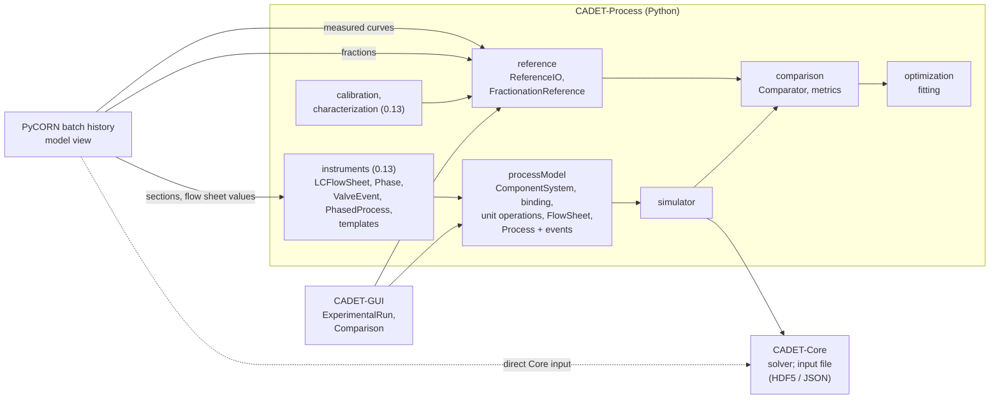

<a id="figure-11"></a>**Figure 11.** CADET's parts, and where the PyCORN batch history feeds in.

The PyCORN batch history gives CADET what ran (sections, valve events, flow-sheet values such as column
geometry and mixer volume) and what was measured (references, fractions). What the model
is (binding, unit-operation models, their parameters) and fitting stay CADET's (D28).

**Standards.** CADET has no published data standard for measured runs (as of 2026-11-14).
CADET-Process's `ReferenceIO` carries time, values and flow, with no units or metadata.
CADET-RDM (Lanzrath et al., *Comput. Chem. Eng.* 212 (2026) 109690) versions simulation
inputs and outputs rather than measured data. An unmerged CADET-Process branch adds a
loader for another vendor's files (Knauer), so vendor-neutral input is where this is going.
The PyCORN batch history's JSON (neutral keys, UCUM units, a source and quality on every value, §5)
is a ready proposal for such a standard when one is started.

<a id="table-20"></a>**Table 20.** The PyCORN batch history's parts and their counterparts in CADET-Process 0.13 and CADET-GUI (none or -: no counterpart).

| PyCORN batch history | CADET-Process 0.13 (`instruments`) | CADET-GUI |
|---|---|---|
| procedure / unit procedure | `PhasedProcess(name, flow_sheet, steps)` | a study / run |
| operation (UNICORN phase) | none (a `Phase` has no name) | markers: "Phase ..." run-log texts, on a volume axis only |
| section, running | `Phase` (flow, %B as `{"A": 1-b, "B": b}`, ramp via `composition_end`) | "Phase <i>" spans from the template |
| held (UNICORN Pause) | `Phase(d, 0.0, {})` (allowed: composition is checked only when flow > 0) | not represented (one constant flow) |
| paused (UNICORN Hold) | `Phase` with `composition_start = composition_end` | not represented |
| holding, restarting, stopping (the instrument's ramps, §3.7) | Needs a flow at the `Phase`'s end (one flow per `Phase` today). Until then each fitted piece is its own constant-flow `Phase`. | not represented |
| injection valve setting | `ValveEvent("load" / "inject" / "direct_inject" / "run")` | none |
| equipment modules | `LCFlowSheet`: sample loop, mixer, four tubings, column, `bypass_units` | instrument templates |
| `process_operation` | templates `PulseInjection`, `Step`, `StepElution`, `LWE`, `Breakthrough` | experiment types (system pulse, column pulse, LWE, breakthrough, ...) |
| measured curves | `ReferenceIO(time, solution, flow_rate)`, SI by convention, no unit field | `ExperimentalRun` / `Channel`, units dropped |
| feed start | - | `Comparison.injection_marker` (a text prefix) |
| multi-column continuous chromatography (§3.1, not supported) | its own builders (`CarouselBuilder`, `SMBBuilder`) | - |

**What the model view would lose today** (gaps to raise with CADET, none to work around in
PyCORN by guessing):

- One flow per `Phase`: UNICORN flow ramps can't be expressed (a flow at phase end would do).
- Duration must be > 0 and two `ValveEvent`s in a row are rejected: zero-length sections are
  dropped, with a warning naming their `element_id`.
- No name on `Phase`: the `element_id` and UNICORN's text can't travel with the sections, so the GUI
  can't align on UNICORN's phases. Ask for an optional `name`.
- Buffers A-D are mixer inlets (a quaternary pump), not AKTA's A/B pumps with inlets
  A1-A4/B1-B4. `bypass_units` is fixed, so a column by-pass partway through a run has no
  counterpart.
- `ReferenceIO` has no unit or metadata, and every `calibration` function returns a new one:
  the PyCORN batch history's `unit`, `source`, `quality` stay in `experiment.json` beside it.
- CADET-GUI reads `.csv` only, forces a volume axis in mL even for a `min` export, can't save
  a time-axis run with markers, and converts with one typed flow. An import built on the PyCORN batch history would
  carry time in s, markers from operations, units, and the injection time as a number.

**What the PyCORN batch history supplies that CADET doesn't read from a run:** column geometry and Vc,
mixer volume from the stored system configuration, inlet positions (known / assumed / not
known), pauses and holds as states, the executed sections with their source. Loop volume
stays the caller's (D19). `process_operation` and the template stay the caller's, even though
CADET's templates describe the process as ISA-88's process model does (§3.6.2).

## 7. Outputs: what changes, what's new

Today `pycorn export` writes 30 tables per chromatogram (CSV, Excel, pickle, listed by
`pycorn schema --json`), plus `index.csv`, `options.json`, `README.txt`, `provenance.json`
and the CADET files. The CLI's `inspect`, `find`, `schema`, `windows` and `bypass-uv` write
JSON. The web page shows the same tables. The proposal touches few of them ([Table 21](#table-21)).

<a id="table-21"></a>**Table 21.** Proposed plan steps and the existing outputs each changes.

| Proposed (plan step, §8) | Existing output it touches | Effect |
|---|---|---|
| 1. PyCORN batch history | none | Internal. Today's `phases`, `sections` and CADET inputs re-derived from it must come out byte-identical. |
| 3. Display view | `phases` table (CSV, Excel, page), `phase_windows`, the page's tracks | **Changed values.** A short delay at a phase start is folded in, with a note column. Repeated phases are named `Equilibration (2)`. Window statistics skip the held-over lead-in, retiring the "interim phase rule" note. Listed first in the CHANGELOG. |
| 4. Display steps table (name open, §11) | between `phases` (one row per phase) and `sections` (1:1 with CADET) | **New table** (e.g. `<c>_steps.csv`, an Excel sheet, a page tab), added to `export_tables.py`. `schema --json` lists it (schema 1, additions only). |
| Keys (Decide 2, 24) | `phases`, `sections`, `phase_windows`, `warnings` | **Added columns** `phase_number`, `section_number`, `element_id`. Warnings carry the `element_id` they belong to. One value per column ("Outputs stay atomic"). |
| Cycles, chromatograms | the same tables | A `cycle` column (the caller's labels, §3.3) only when the caller marks cycles. Chromatograms already get their own files. |
| 5. `pycorn record --json` | `inspect --json` | **New command**, same envelope, schema version and masking as every `--json`. `inspect` stays the summary and gains the operation list. `record` gives the whole structure. Neither holds curve values. |
| 6. Model view | CADET files: `experiment.json`, CADET-Process CSVs, CADET-Core input | Same files, built from the PyCORN batch history. Values change with the decided flow source (Decide 6). If the owner agrees (§11), `experiment.json` becomes `model_view.json` with the §5 naming. A file name has no alias, so both are written for one release. |
| Later: BatchML XML, Allotrope ASM | none | New optional files beside the others |

Unchanged: every table's UNICORN wording (display tables and CSV keep UNICORN's words,
Decide 3), `sections` 1:1 with CADET, `index.csv`, `provenance.json` and every other table.

Formats, in order of value:

1. **The PyCORN batch history as JSON with ISA-88 names** (`pycorn record --json`, `schema: 1`, masked by
   default like every `--json`). Element names follow ISA-88 Part 4 / BatchML (procedure,
   unit procedure, operation, phase elements; events; parameters with values and units), so
   a later BatchML XML writer is a mapping, not a redesign. JSON first because the rest of
   PyCORN's machine output is JSON and agents read it directly.
   Identifiers take BatchML's and ISA-95's own fields:
   - `BatchID`: the run's UNICORN Batch ID.
   - `CampaignID`: a series (scouting, a production campaign).
   - Each material (load, fraction, pool) is an ISA-95 `MaterialActual` with its lot or
     sublot ID (`MaterialLot`, `MaterialSubLot` in B2MML).
   - BatchML's record-level `LotID` is used only when a run has a single load material.
2. **Units as UCUM codes** and times as ISO 8601 (UTC instants, durations) in the PyCORN batch history and
   its JSON. Display keeps today's column names (`_min`, `_ml`).
3. **BatchML XML** (later, optional): only if a user's MES or batch-record system wants it.
4. **Allotrope Simple Model (ASM), liquid chromatography** (later, optional): for chromatogram
   and peak results going to an ELN or LIMS. It covers the measurement, not the procedure, so
   it sits beside the PyCORN batch history, not instead of it.
5. CADET keeps its own formats.

Masking and "never print connection values" apply to every format.

## 8. Plan

Each step adds to what exists: today's outputs stay byte-identical until a step says
otherwise.

1. **PyCORN batch history** (`pycorn/run_record.py`): built from `run_log_sections`, the timeline, the
   system configuration and the curves. It holds ISA-88 levels, states, tags, and set point /
   actual / calculated values with source and quality. Tests: today's phase table, sections and CADET
   inputs re-derived from the PyCORN batch history equal today's outputs.
2. **Rules** (`pycorn/display_rules.py`): the decided phase-start rule and the other display
   rules as they are decided. One function per view.
3. **Display view**: the phase-start fold and repeat names in the phase table, Excel and the
   page, plus the M22 lead-in skip. A changed output gets a CHANGELOG entry.
4. **Display steps table** for people (§3.5, name open), from the PyCORN batch history's sections.
5. **`pycorn record --json`** (and `inspect` gains the PyCORN batch history's operation list), masked by
   default.
6. **Model view** reads `actual` values (the decided CADET flow source). If the owner agrees
   (§11), the CADET export's "experiment" names become the model view's names.
7. When CADET-Process 0.13.0 ships: the model view as `PhasedProcess` steps on an
   `LCFlowSheet` (needed for `characterization`, which takes an `LCProcess`), replacing
   PyCORN's own flow sheet and event compiler, after raising the gaps in §6.
8. Later, on request: cycles and series links (§3.1, §3.3) once a sample shows them, BatchML
   XML, and Allotrope ASM.

## 9. Open questions and test cases

- **Several chromatograms** (§3.4): how the run log records New Chromatogram, whether
  settings carry across the cut, and whether storage really splits the run log per
  chromatogram. Needs a short test method with the instruction partway through a phase.
  Today each chromatogram is read from its own run log alone (from the code, not run on an
  example). If settings carry across the cut unlogged, the second chromatogram's tables miss
  them until its first instruction.
- **Cycles** (§3.3): how the caller marks them. Needs real multi-cycle runs with and without
  a new chromatogram per cycle, and a scouting series.
- **Links between runs** (§3.1): the label the caller gives for a lot, connected skids, and
  multi-column continuous chromatography.
- **Terms** still to check: the 2010 edition of ISA-88 Part 1, and IEC 62264's own
  definitions behind B2MML's material lots. ("Cycle", "campaign" and "series" are this
  proposal's own terms.)
- **Ontology gaps** to raise with the Industrial Ontologies Foundry, as the CADET gaps are
  raised with CADET (§12): cycle, a collected fraction, a pool, eluate and
  flow-through roles (§3.6.3), chromatogram, gradient and elution, and dynamic binding
  capacity have no IOF class yet.
- **The individual column** (§3.6.1.2): what `ColumnIndividualData` holds when filled, and
  whether UNICORN stores an individual column ID elsewhere. Needs an example result from a
  system that tracks individual columns.
- **Composition** (§3.6.3.1): no ontology has a class for the buffer mix per section (a %B
  and the contents it mixes). Allotrope's liquid chromatography ASM (REC/2024/03) has no
  mobile-phase, buffer or gradient field, only detector data. (Its tabular schema was
  searched as text. The shared schemas it references were not read.) The PyCORN batch history's per-section
  composition, with its source and quality, would be the proposal to raise with both.
- **Buffer provenance** (§3.6.3.2): where PyCORN's scope stops. It could hold IDs only (lot,
  recipe), IDs with the values a model needs (composition with its kind, measured
  properties), or the whole chain (raw-material lots, preparation records, test results with
  their limits), which a LIMS, ELN or MES already holds. Also whether CADET takes as made
  before the recipe's target by a fixed order or by the caller's choice per run.
- **Offline volumes** (§3.8): when a measured volume or mass takes precedence over the
  volume axis, and whether that applies to display as well as to calculations.
- The example results that would settle these are listed in
  `samples/SAMPLE_ZIP_CONTENTS.md`, "Coverage and wanted samples".

## 10. Limits

- One procedure per result, on one system. One unit procedure by default, several only when
  the caller marks cycles or chromatograms. Links between results are links, never merged
  PyCORN batch histories.
- Multi-column continuous chromatography on one skid is not supported.
- `process_operation` stays empty without a caller mapping: UNICORN's names are free text.
- The volume axis counts as "actual" only because the survey (review 3.4) shows it is the
  flow the pump delivered. Otherwise it would be a calculated value and the run log the
  model's source.
- Several chromatograms in one result: built on the owner's statement from memory, not on
  an example.
- CADET-Process's `instruments` and CADET-GUI are unreleased. §6 is rechecked when
  0.13.0 ships.

## 11. Decisions this builds on, and the open Decide items

This document reworks [`RUN_STRUCTURE_REVIEW.md`](RUN_STRUCTURE_REVIEW.md) (topics
3.1-3.12, Decide 1-26).

**Decisions already made** that the design keeps (ROADMAP "Decisions", the review):

- Sections from what ran in the run log (D13). The method only as hints (D17). Each
  instruction holds until the next.
- Column flow by valve position (D14). Feed by valve, caller loop and path volumes, never
  assumed (D16-D21, D27). No defaults that mirror CADET parameters (D28).
- Wall clock for the model, pauses as zero-flow stretches (D5, D7). Hold freezes %B.
- Units in column names, SI for the model (review 3.3). X-axis picker and tracks on the page.
- Inlets from the stored system configuration: known / assumed / not known (Decide 22).
- Phase start lag (2026-11-12): display folds flow, %B and %Q within 10 s and 1 % of the
  phase, with a `held_over` note. Valves and feed never fold. Phase start and end never
  move. M22 windows from a phase start skip the held-over seconds. CADET never folds.
- CADET flow source (2026-11-14, Decide 6, review 3.4): run log for structure and timing,
  the method-flow entry for which pump, the volume axis for the amount where it differs by
  more than 0.01 ml and 1 %, a fitted ramp inside such a section, then D14's zeroing.
- Volumes (2026-11-15, Decide 18): the volume UNICORN reports on its volume axis is the
  number for every calculation and every display, the feed volume included. A volume or
  mass measured offline may later take precedence (§3.8).
- Unknowns said in plain words, never guessed. Masking rules (Track 9). Full values in code,
  rounding at display only.

**Open Decide items the frame settles**: [Table 22](#table-22), to confirm as a set.

<a id="table-22"></a>**Table 22.** Open Decide items (numbered as in the review) and the proposed answer to each.

| # | Item | Proposed answer |
|---|---|---|
| 1 | steps level | Not a level of the PyCORN batch history: ISA-88 ends at the phase (ISA-88.01 5.1.2.4). The PyCORN batch history goes down to sections. People get a table of display steps (sections joined, previous-phase set points folded), `<c>_steps.csv` or as named (below). |
| 2 | keys | Yes: `phase_number`, `section_number`, and the `element_id` tag |
| 3 | ISA-88 terms in columns | The PyCORN batch history's JSON uses ISA-88 and other vendor-neutral keys, with UNICORN's words as `original` values (§5). Display tables and CSV keep UNICORN's words only. |
| 9, 10 | held-over note, "at the start" | Decided 2026-11-12 (display) |
| 11 | pauses in steps | `state = held` rows (UNICORN Pause = ISA-88 Held), with original state `pause`. The pump's ramps down before and up after are `holding` and `restarting` rows, where the volume axis shows them (§3.7). |
| 13 | inferred pauses | Same rows, with `quality = inferred`. Display marks them ("about 40 s, not logged"). |
| 14 | holds | `state = paused` (UNICORN Hold), with a note per phase in display |
| 16 | by-pass | An equipment state of the column valve module, with a note in display |
| 20 | ramp length | Both: `set_point` (logged length) and `actual` (measured on each axis). Display shows the actual. |
| 23 | repeats | `instance` numbers. Display shows `Equilibration (2)`. The logged text is kept. |
| 24 | warnings per phase | Warnings carry the `element_id` they belong to. Display puts them on the phase row. |

**Display choices still the owner's**: 12 phase length with or without pauses (proposal:
both), 15 which flow users see, 17 feed wording, 21 the gradient
wording rule, 25 section-lane chart, 26 summary beside or instead of today's sequences.
With pressure control a flow increase still ramps about 10 s after the instruction, longer
than the fold cutoff, so the `held_over` note should also say "ramped n s".

**Tooling gap:** Decide 19, `pycorn export --loop-volume` / `--sample-path-volume` for the
CADET feed (one flag or two).

**New decision for the owner: the word "experiment" in the CADET export.** In OBI, Allotrope
and IOF an experiment is a planned study across runs. PyCORN uses the word for one run's
data for CADET (`CadetExperiment`, `build_experiment()`, `ExperimentSection`,
`experiment.json`). That object's `events` are UNICORN log entries, while CADET-Process's
events are planned parameter changes. Proposal: when plan step 6 makes this object the model
view, name it so (`ModelView`, `model_view(run)`, `ModelSection`, `model_view.json`,
`logged_events`), with §5's vendor-neutral keys in the JSON. Keep the old names as aliases
(and write both files) for a release, and list the rename first in the CHANGELOG.

**New decision for the owner: the words below the phase.** ISA-88 points to "the steps and
transitions as described in IEC 848: 1988" as "one method of defining subdivisions of a
phase" (ISA-88.01 5.1.2.4). IEC 848 became IEC 60848 (GRAFCET), and IEC 61131-3's
sequential function chart (SFC) uses the same idea. There a **step** is a state of the
control logic, active or inactive. A **transition** with a condition ends it. **Actions**
are attached to steps. A stored action sets a value that stays after its step ends, until
another action changes it. Read on UNICORN:

- An instruction is a stored action: it sets a value that holds until the next instruction
  changes it (D13). In ISA-88's words, it is a command the phase issues to basic control,
  which maintains the state it sets (§3.5).
- A breakpoint (a time or volume in the block) or a watch is a transition's condition.
- So an IEC step is the wait between two breakpoints of a block. The instructions at one
  breakpoint belong to one step, but UNICORN executes them about 0.2 s apart, and each one
  starts a section.

Neither word in this draft is an IEC step. A section is finer (one per executed
instruction). A display step is cut where the values change, not where the method's
logic moves on. The options are in [Table 23](#table-23).

<a id="table-23"></a>**Table 23.** Options for the words below the phase, in the PyCORN batch history and in display.

| | PyCORN batch history, below the phase | Display rows (§3.5) |
|---|---|---|
| A | sections | "steps", with a note that they are not IEC steps |
| B | sections | another word, the owner's choice |
| C | IEC steps (the instructions at one breakpoint grouped), then sections inside them | as A or B |

C matches the standard best, but the run log may not say which instructions share a
breakpoint. Grouping them by time would be a guess, so C waits for a check of the method
against the run log on the example results. BatchML uses "step" a third way: a `Step` in
its procedure logic invokes a recipe element (a unit procedure, operation or phase). So a
display row called "step" would match neither standard.

**New decision for the owner: renames before anything is built.** This document defines the
names for all later work, so words that clash with a standard the PyCORN batch history maps to are renamed
now, while only this document uses most of them. The names were checked against the BatchML
schemas (`BatchML-BatchProductionRecord.xsd`, `BatchML-BatchInformation.xsd`,
`B2MML-Common.xsd`, see References). The proposals are in [Table 24](#table-24).

<a id="table-24"></a>**Table 24.** Proposed renames: the current and proposed name, why, and where the current
name is used today.

| # | Now | Proposed | Why | Where it is used today |
|---|---|---|---|---|
| R1 | `quality` (on a value) | `basis` | In OPC, process historians and BatchML (`DataValue/Quality`), quality is whether a reading can be trusted (good, bad, uncertain). In PyCORN's export it says how the number was obtained. Values: `exact` becomes `logged` or `measured` (a measurement isn't exact). `folded` goes, since display steps are not stored in the PyCORN batch history (§3.5) and folding is a display note. | The `pauses` table column `quality`, and `timeline_quality` in the export's run-level table (a renamed output: CHANGELOG first). The timeline's `ambiguous` and `unresolved` describe the whole timeline, not one value, and get their own field. |
| R2 | `segment` | `element` | ISA-95 / B2MML, which §7 maps materials to, has the **process segment** (`SegmentRequirement`, `SegmentResponse`), a different thing. The PyCORN batch history already has `element_id`, after ISA-88's "procedural element" (ISA-88.01 3.36). Batch history entries identify it (ISA-88.01 6.4.1.1), and BatchML references it from events and data series as `ProceduralElementReference`. BatchML never uses "element" alone (`RecipeElement`, `EquipmentElement`, `EquipmentProceduralElement`), so the PyCORN batch history defines `element` once as the procedural element. A chromatogram is then a field (`chromatogram`), not "a `chromatogram` segment" (§3.4): it is no level | This document, and a local variable in `run_log_sections.py` (not an output) |
| R3 | `unit` (on a value) | `unit_of_measure` | In ISA-88 a unit is the system (ISA-88.01 3.60), and the PyCORN batch history names it. BatchML keeps the two apart as `UnitOfMeasure` and an `EquipmentID` at `EquipmentElementLevel` `Unit`. The values stay UCUM codes (BatchML's `UnitOfMeasure` is a free code) | this document |
| R4 | `held_over` | `start_lag` | `held` is now the ISA-88 state of a UNICORN Pause (§3.7). The note is about the previous phase's set points lasting a few seconds into a phase (§3.5), not about Held. ISA-88 has no term for this. Not `carried_over`: in chromatography carryover is sample from an earlier injection in a later run, and in GMP cleaning validation it is residue from one batch in the next. `start_lag` is the name the decision already has ("phase start lag", review 3.4). Defined as set points logged after the phase start, not the gradient delay (dwell volume) between mixer and column, nor a process-control first-order lag | this document, the phase start decision of 2026-11-12, `ROADMAP.md`, `RUN_STRUCTURE_REVIEW.md` |
| R5 | "tag" in the text ("tags every segment", "the `element_id` tag") | "marks", "key" | In historians, OPC and BatchML (`TagSpecification` in a `DataSet`) a tag is one recorded data series, which is a curve in UNICORN and PyCORN. ISA-88 says "not in equipment-specific tags" (ISA-88.01 6.4.3) | this document |
| R6 | `source` beside `origin` and `source_system` | keep, defined together | Three provenance words: `origin` per table and column (UNICORN or PyCORN, already in every export), `source` per value (where the number came from), `basis` per value (how it was obtained). `not_known` moves from `source` to `basis`. §5 says this in one sentence. Both match BatchML: `Origin` in a list header (where a list came from), `DataSource` per data series (`TagSpecification`) | `origin` in `export_tables.py` and `pycorn schema`, and `source` in the `pauses` table |
| R7 | `kind: calculated` beside `basis` | to decide | `kind` is PyCORN's key. Its values are ISA-88's words (set points ISA-88.01 5.3.2.2, actual values ISA-88.01 6.4.3.1, calculations ISA-88.01 6.4.2), but ISA-88 defines no such category. ISA-88.01 6.4.2 lists calculations as a function on batch history, and BatchML's `DataSet` has no set point / actual field either. `basis` is how the number was obtained. A fitted ramp is `kind: actual`, `basis: fitted`. A calculated volume is `kind: calculated`, and its basis would be `calculated` too. Either keep both (one value in two fields), or limit `kind` to set point and actual and make `calculated` a basis only. | this document |
| R8 | "section N" for this document's own parts | "§N" (decided 2026-11-15), with ISA-88 clauses as "ISA-88.01 5.1.2.4" | `section` is the PyCORN batch history's lowest level. "Section 6" next to "a section" reads both ways. | this document |
| R9 | `native` | `original` (decided 2026-11-15) | In protein chromatography "native" is a protein's folded state (native conditions, native PAGE, native MS). Not `as_recorded`: historians call stored measurements recorded values. Not `vendor_terms`: a run-log line is a text, not a term. `original` can be read as the value before a correction (BatchML's `PrechangeData`). §5 defines it once. | this document |

Kept as they are: `display_name` (the same meaning as OPC UA's DisplayName),
`instance`, `state`, `level`. "Event" and "experiment" have their own proposals above.

## 12. Words used in this document, and their ontology terms

[Table 25](#table-25) maps the words to the ontologies a lab or plant may already use: IOF (Industrial Ontologies Foundry, biopharma module, `master` at `50a88d4`,
2026-10-15; classes under `https://spec.industrialontologies.org/ontology/construct/`), OBI
and IAO (biomedical investigations, information artifacts), Allotrope (AFO, and its
liquid chromatography data model ASM), and for composition ChEBI (substances), CHMO
(chemical methods), PATO (qualities) and UO (units). The ontologies keep three things apart that this
plan keeps apart too: the **plan** (the method), the **process** that ran, and the
**record** of it.

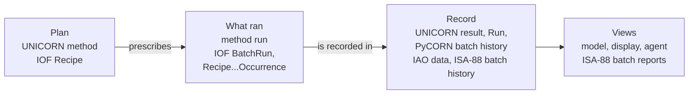

<a id="figure-12"></a>**Figure 12.** Plan, what ran, and the record, in ontology terms.

<a id="table-25"></a>**Table 25.** Each word, what it means in PyCORN, and its ISA-88 and ontology terms.

| Word | In PyCORN | Ontology terms |
|---|---|---|
| method | the UNICORN method: the plan, read only as hints | ISA-88 master recipe (ISA-88.01 5.3.1.3); with the values one run used, its control recipe (ISA-88.01 5.3.1.4); IOF `Recipe`, `MasterRecipe`, `ControlRecipe`; IAO plan specification |
| method variable | a value the method lets the user set (flow, volumes, ...) | ISA-88 process parameter, part of the formula (ISA-88.01 3.46, 5.3.2.2) |
| instruction | one UNICORN method instruction (`Flow`, `Gradient`, `Injection valve`), as logged when executed | a command a phase issues to basic control (ISA-88.01 5.1.2.4) |
| run (method run) | one execution of a method on one system | IOF `BatchRun`, `ChromatographyProcess`; OBI planned process |
| result, `Run` | What one run stored, as UNICORN keeps it. The `Run` class holds that data, not the run itself. | IAO information content entity; Allotrope experimental data |
| PyCORN batch history | one run as PyCORN interprets it from the UNICORN result: what ran, set point next to actual, where each value came from. Proposed, not built (§1, §5). | ISA-88 batch history (ISA-88.01 5.5.3); batch production record (ISA-88.00.04) |
| view (model, display, agent) | what one reader gets from the PyCORN batch history (§1) | ISA-88 batch report: "the extraction of data related to one or more batches", ordered for its recipient (ISA-88.01 5.5.4, 6.4.3) |
| procedure, unit procedure, operation, phase (as executed) | The PyCORN batch history's levels (§3.2-3.5). A UNICORN phase is an ISA-88 operation. | ISA-88's procedural control model (ISA-88.01 5.1.2); IOF `RecipeProcedureOccurrence`, `RecipeUnitProcedureOccurrence`, `RecipeOperationOccurrence`, `RecipePhaseOccurrence`, each prescribed by its `Recipe...` element |
| section | the PyCORN batch history's lowest level: the stretch from one executed instruction to the next, settings constant inside it (§3.5). Each is one CADET section. | Not an ISA-88 level (a phase "may be subdivided", ISA-88.01 5.1.2.4). The word is CADET-Core's (`SECTION_TIMES`). CADET-Process calls it a `Phase`. No ontology class. |
| display step (name open) | Sections joined for people, previous-phase set points folded with a note (§3.5). Not stored in the PyCORN batch history. | None. Not an IEC 60848 / IEC 61131-3 step (§11). |
| cycle | One pass of the sequence on one column (§3.3). Held as a unit procedure, named by the caller's label, not as a field. | PyCORN's own term, with no class in IOF, OBI or Allotrope |
| series, study | Linked results (§3.1). A designed series (DoE scouting) is a study. | OBI study design execution; IOF `StudyDesignRun` per result, `DesignPoint` for its planned factor levels; BatchML `CampaignID` |
| experiment | Kept for a planned study across runs, as the ontologies use it. Today also, wrongly, the CADET export's object (§11). | OBI investigation; Allotrope experiment ("a planned process to verify, falsify, or establish the validity of a hypothesis") |
| chromatogram | UNICORN's container of curves and event logs for (part of) a run (§3.4) | Allotrope chromatogram = one signal against time or volume, i.e. one PyCORN curve. No IOF class. |
| curve, signal | one measured or calculated trace | ISA-88 continuous data (ISA-88.01 5.5.1); IAO measurement datum; Allotrope chromatogram data cube |
| event | a UNICORN log entry (run log, injection, fraction) | ISA-88 event data, e.g. "start and stop times of procedural elements" (ISA-88.01 5.5.1). Not CADET-Process's events, which are planned parameter changes in a simulation. |
| sample | the material loaded onto the column (sample pump, feed) | IOF and OBI `MaterialSample` (for a taken sample). The files in `samples/` are **example results**, not samples |
| load, eluate, flow-through | the material in, and the streams out (§3.6.3) | inputs and outputs of the run (OBI "has specified input / output"). No IOF classes or roles yet. |
| fraction, pool | collected eluate (one row per tube) and pooled fractions (§3.6.3) | IOF `PoolingProcess` (the act). No class for a fraction or a pool. ISA-95 `MaterialSubLot` / `MaterialLot` are the places to identify them. |
| batch | in ISA-88, the material made by one execution of a batch process, and the entity that represents its production (ISA-88.01 3.5): each UNICORN run is one, with its own UNICORN Batch ID (§3.1). Not the plant's numbered batch, which is a lot | ISA-88 batch; BatchML `BatchID`; IOF `BatchRun` |
| lot, material ID | an identified amount of material (the plant's batch or lot number). Every load, fraction and pool carries its own material ID. Runs are linked through them (a pool becomes the next load) (§3.1, §3.6.3) | ISA-88 lot; IOF supply-chain `Lot`; ISA-95 `MaterialLot` / `MaterialSubLot` in a `MaterialActual`; BatchML `LotID` only for a run with one load material |
| system, column | The instrument (an ISA-88 unit, ISA-88.01 3.60) and the column (§3.6.1, §3.6.1.2). The pumps and fraction collector are equipment modules, the valves and monitors control modules. The column is equipment of the unit, identified as a physical asset. | IOF `PreparativeChromatographySystem` (one that produces fractions for further processing), `ChromatographyColumn`, `PhysicalUnit`, `EquipmentModule`; ISA-95 (B2MML) `Equipment` for the column's place and `PhysicalAsset` for the packed column |
| process | Three senses: what ran (BFO process, and ISA-88.01 3.38: "a sequence of chemical, physical, or biological activities for the conversion, transport, or storage of material or energy"), ISA-88's process model (process stage, process operation, process action, ISA-88.01 4.1.3), and CADET-Process's `Process` (a simulation set-up) | written as "the run", "process model" and `Process` (in code font) to keep them apart |
| model | the CADET model, and the "model view" of the PyCORN batch history | not ISA-88's process or physical models, which this plan calls by those full names |
| buffer | The liquid on one inlet. What it contains comes from the caller (§3.6.3.1, §3.6.3.2). | CHMO `buffer solution` (CHMO:0001462); AFO `buffer solution role`, `mobile phase` (a role); IOF `BufferSolution`; in ISA-88's formula, a process input (ISA-88.01 5.3.2.2) |
| buffer recipe, preparation, lot | What the buffer should be, one making of it, and the identified amount on the inlet (§3.6.3.2). From the caller. | Recipe: the preparation's master recipe and formula (ISA-88.01 5.3.2), ISA-95 `MaterialDefinition`, IOF `InputSpecification`. Preparation: IOF `SolutionPreparationProcess`, ISA-95 `AssemblyLot` for its inputs. Lot: ISA-88.01 3.28, ISA-95 `MaterialLot`. Its tests: ISA-95 `TestResult`, IOF `MeasurementProcess`. |
| as made | A buffer's composition calculated from its preparation record (amounts weighed, final volume), as distinct from the recipe's target and from a measured property (§3.6.3.2) | `calculated` kind (§3.8) |
| component, composition | a species the caller names (salt, protein, impurity) and how much of it is in a buffer, a load or a section (§3.6.3.1). CADET-Process calls the set a `ComponentSystem`. | ChEBI for the substance when the caller names one (e.g. `sodium chloride`, CHEBI:26710); ChEBI `mixture` (CHEBI:60004) for a buffer as a whole; AFO `component role`, `has ingredient`. No class for a mix that changes section by section: CHMO `gradient elution` (CHMO:0002877) names the method, not the mix |
| concentration | per component, in mol/m^3 or kg/m^3 (UCUM `mol/m3`, `kg/m3`) | CHMO `amount concentration` (CHMO:0002822), `mass concentration` (CHMO:0002821); AFO `molar concentration`, `mass concentration` (results); PATO `concentration of` (PATO:0000033) |
| conductivity, pH, UV | measured curves, found by role (`curve_roles.py`) | PATO `electrical conductivity` (PATO:0001757); AFO `electric conductivity` (a result), `electrolytic conductivity measurement`; CHMO `pH measurement` (CHMO:0002354); UO `pH` (UO:0000196); AFO `absorbance` (a result) |
| extinction coefficient | given by the caller, to turn UV into a concentration (§3.6.3.1) | AFO `molar attenuation coefficient` (AFR_0002767), `protein attenuation coefficient` (AFR_0002766) |
| set point, actual, calculated | set in the method, measured, calculated by PyCORN (§3.8) | ISA-88's words: a process parameter "may be used as set points" (ISA-88.01 5.3.2.2), "actual values" (ISA-88.01 6.4.3.1), "calculations ... creating new batch data" (ISA-88.01 6.4.2); IOF and IAO measurement information for actuals |

## References

Read 2026-11-14 (Siemens and AVEVA Batch Management 2026-11-15). Sources marked "search
excerpts only" were not opened (they need a browser or a PDF reader). Open them before
quoting them outside this draft.

ISA-88, ISA-106 and BatchML:

- ANSI/ISA-S88.01-1995, *Batch Control Part 1: Models and Terminology*, checked against
  its full text: definitions 3.5 (batch), 3.11 (control recipe), 3.28 (lot), 3.32 (path),
  3.34 (phase), 3.37 (procedure), 3.38 (process), 3.42 (process input), 3.45 (process output), 3.46 (process parameter),
  3.60 (unit), 3.61 (unit procedure); 4.1 (continuous processes not specifically
  addressed); 4.1.3 (process model); 4.2.4 (process cell, train and path); 4.2.7 (control module examples); 5.1.1 (basic
  control); 5.1.2.1-5.1.2.4 (procedure, unit procedure, operation, phase: the smallest
  element, subdivided by IEC 848 steps and transitions); 5.2.1 and Figure 7 (procedural,
  physical and process models mapped); 5.2.2.4.2 and 5.2.3.3 (control vs equipment
  module); 5.3.1.3, 5.3.1.4 (master and control recipe); 5.3.2.2 (formula); 5.3.3.2 (each
  occurrence identified); 5.5.1, 5.5.3, 5.5.4 (batch-specific information, batch history,
  batch reports); 5.7.2, 5.7.2.1, 5.7.2.2, Table 2, Figure 18 (example states and
  commands); 6.4.1.1-6.4.1.3, 6.4.2, 6.4.3, 6.4.3.2 (batch history entries, tracing,
  batch tracking, reports, trends). The 2010 edition (ANSI/ISA-88.00.01-2010) was not
  checked.
- ISA-TR106.00.01-2013 and ANSI/ISA-106.00.01-2023, *Procedure Automation for Continuous
  Process Operations*: https://www.isa.org/products/isa-tr106-00-01-procedure-automation-for-continuou
- BatchML batch production record schema (`BatchID`, `LotID`, `CampaignID`; `DataSet`,
  `TimeSpecification`, `TagSpecification`, `DataValue/Quality`; `Event` types and subtypes;
  `Sample`, `SampleTest`, `SampleTestResult`; `Change`, `Comment`; recipe records):
  https://raw.githubusercontent.com/MESAInternational/B2MML-BatchML/master/Schema/BatchML-BatchProductionRecord.xsd
- BatchML batch information and common schemas (read 2026-11-15: `BatchListEntry`,
  `BatchStatus`, `BatchParameter` types, `ProcedureLogic` steps, `UnitOfMeasure`,
  `EquipmentLevel`): `BatchML-BatchInformation.xsd` and `B2MML-Common.xsd` in the same
  folder
- B2MML equipment and physical asset schemas (read 2026-11-15: `PhysicalAsset` with
  `VendorID`, `FixedAssetID` and `TestSpecificationID`, `EquipmentAssetMapping` with start and
  end time, `EquipmentActual` and `PhysicalAssetActual`): `B2MML-PhysicalAsset.xsd`,
  `B2MML-Equipment.xsd`, `B2MML-Common.xsd` and `B2MML-OperationsPerformanceTypes.xsd` in the
  same folder
- ANSI/ISA-88.00.04-2006, *Batch Control Part 4: Batch Production Records* (ISA, preview):
  https://www.isa.org/getmedia/4b46d97c-6954-4936-97f5-db672f3fd154/S_880004_preview.pdf
  ("a reference model for batch production records")
- MESA International, B2MML-BatchML (BatchML: "an XML implementation of the ANSI/ISA-88,
  Batch Control, family of standards", IEC 61512):
  https://github.com/MESAInternational/B2MML-BatchML (schemas read at `master` `65cc665`,
  2023-07-11)

Steps and transitions (§11, "the words below the phase"). The standards themselves were not
read, only the sources below:

- IEC 60848:2013 (edition 3), *GRAFCET specification language for sequential function
  charts* (IEC preview): https://webstore.ansi.org/preview-pages/IEC/preview_iec60848%7Bed3.0%7Db.pdf
- *Unambiguous Interpretation of IEC 60848 GRAFCET based on a
  Literature Review* (steps, transitions, stored actions): https://arxiv.org/abs/2307.11556
- IEC 61131-3 SFC action qualifiers (N, S, R, ...), as vendors document them, e.g. Beckhoff:
  https://infosys.beckhoff.com/content/1033/tc3_plc_intro/2528356235.html
- ISA-88 Part 2's procedure function chart and its relation to SFC (Yokogawa):
  https://yokogawa.com/library/resources/media-publications/what-does-a-procedure-look-like-the-isa-s8802-recipe-representation-format

Ontologies:

- Industrial Ontologies Foundry, `iofoundry/ontology`, branch `master` (`50a88d4`,
  2026-10-15; same classes as `releases/202603`): biopharma module, e.g.
  `RecipeProceduralOccurrenceClassificationUtility.rdf` (the occurrence classes),
  `DesignOfExperiments.rdf` (`StudyDesignRun`), `BiopharmaEquipment.rdf`
  (`PreparativeChromatographySystem`, `ChromatographyColumn`):
  https://github.com/iofoundry/ontology
- OBI, IAO and Allotrope (AFO) terms, looked up on the EBI Ontology Lookup Service (the
  composition terms, ChEBI, CHMO, PATO, UO and AFO, on 2026-11-15):
  https://www.ebi.ac.uk/ols4
- Allotrope Simple Model, liquid chromatography (`liquid-chromatography` schema, REC/2024/03,
  in Benchling's `allotropy`): https://github.com/Benchling-Open-Source/allotropy

CADET-Process multi-column builders (`CarouselBuilder`, `SMBBuilder`):
https://github.com/fau-advanced-separations/CADET-Process/blob/dev/CADETProcess/modelBuilder/carouselBuilder.py

Emerson DeltaV:

- *DeltaV Batch Control and Operations* ("based on ISA88 Batch Standard"):
  https://www.emerson.com/en-us/automation/control-and-safety-systems/distributed-control-systems-dcs/deltav-distributed-control-system/deltav-batch-control-and-operations
- *Recipe Exchange*, product data sheet ("procedures, unit procedures, operations, and
  formulas"; Emerson's own XML, not BatchML):
  https://www.emerson.com/is/content/emerson/pt/systems-and-software/deltav-distributed-control-system-dcs/product-data-sheets/documents/deltav-recipe-exchange.pdf
- *Batch Executive*, product data sheet ("detailed batch historical records"):
  https://www.emerson.com/is/content/emerson/en/corporate/industries/life-sciences/documents/batch-executive.pdf

Siemens SIMATIC BATCH (search excerpts only, the PDF was not read as text):

- SIMATIC BATCH brochure (SIMATIC BATCH and SIMATIC PCS 7 "fully cover the models described
  in the ISA-88.01 standard"; "The procedural model is implemented in SIMATIC BATCH"):
  https://support.industry.siemens.com/cs/attachments/109772829/E20001-A233-P280-X-7600_EN.pdf

AVEVA Batch Management (formerly Wonderware InBatch):

- Product page ("Adhering to the ISA-88 standards for batch control"; "making batch
  execution information directly available to AVEVA Historian, MES, and other
  applications"): https://www.aveva.com/en/products/batch-management/
- Documentation (search excerpts only: InBatch is now AVEVA Batch Management; Microsoft
  SQL Server as the history database): https://docs.aveva.com/bundle/batch-management/page/303424.html

AVEVA PI System (search excerpts only):

- PI Interface for Emerson DeltaV Batch (event frames from the DeltaV Batch Historian):
  https://docs.aveva.com/bundle/pi-interface-for-emerson-deltav-batch/page/1269356.html
- PI Interface for Siemens SIMATIC Batch ("one template for each level in the standard s88
  batch hierarchy"): https://docs.aveva.com/bundle/pi-interface-for-siemens-simatic-batch/page/1010973.html
- PI Event Frames Generator ("batches that contain unit procedures, operations, and phases"):
  https://docs.aveva.com/bundle/pi-event-frames-generator/page/1011413.html

Cytiva ÄKTA instruments (read 2026-11-15 as text extracted from the PDFs, for Figures [8a](#figure-8a) and [8b](#figure-8b)):

- *ÄKTA ready Operating Instructions* 28960345 AH: 3.3.2 pumps (P-201 isocratic, P-202
  for gradients), 3.3.3 valves (19 pinch valves; air trap and column valves `Bypass` /
  `Inline`), 3.4 flowchart (labels, colours, pressure zones), 3.5 flow kits (parts in
  order, sensors): https://d3.cytivalifesciences.com/prod/IFU/28960345.pdf

- *ÄKTA avant 25 Product Documentation* 28991000 AH: 1.1 standard and optional modules,
  1.2 liquid flow path (tubing from pump to fraction collector, in order):
  https://b3p.it.helsinki.fi/manuals/AVANT/Content/PDF/28991000AH.pdf
- *ÄKTA pure User Manual* 29119969 AC: 2.2 liquid flow path ("a typical system
  configuration"; "the configuration of the system is defined by the user"), 2.4.4 inlet
  valves, 2.4.6 injection valve positions, 2.1 mixer, column, pH and outlet valves:
  https://dnas.dukekunshan.edu.cn/wp-content/uploads/2024/06/AKTA_pure_user_manual.pdf
