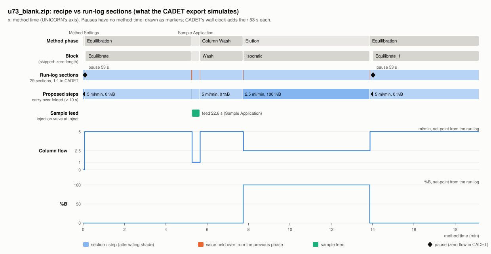
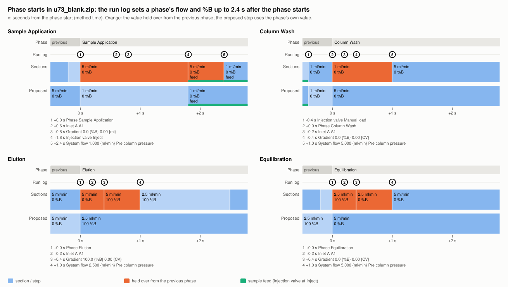

# Run structure: instrument, model and user views

Expert review (started 2026-11-09). Its purpose: decide, topic by topic, how each audience
gets a run's data and how it is shown to them. For each topic it puts side by side:

- **Instrument:** what UNICORN does and records. This is the evidence.
- **PyCORN today:** what the code does with it.
- **Model:** what CADET, CADET-Process and modelers' scripts should receive.
- **User:** what a general user wants to see in Excel and on the web page.

Each topic ends with **Decide**: the choices still open, with a proposal. Decided items move to
[`docs/ROADMAP.md`](ROADMAP.md) ("Run structure"). New users: read
[`docs/RUN_STRUCTURE_GUIDE.md`](RUN_STRUCTURE_GUIDE.md) instead,
which explains today's behaviour in plain terms, with the logic figures.

The evidence run was tested against a lab environment. Figures use `samples/u73_blank.zip`,
which runs the same method (same phases, blocks and instruction order) and can be shared;
`samples/u711_proa_day12.zip` is the run itself, sanitized.

## 1. The three audiences

| | Instrument (UNICORN) | Model (CADET, scripts) | User (Excel, web page) |
|---|---|---|---|
| Unit of thought | Method phases and blocks; the run log line by line | Sections: piecewise constant or linear inputs on one time axis | Phases: "what did each step of my run do?" |
| Time | Stored method time, which stops during a pause | Wall clock in s from method start, pauses included, SI units | Same as UNICORN's chart (volume or method time), so pictures match; clock times as dates |
| Detail | Every instruction, 0.2 s apart | Every second that changes mass flow (feed, flow, %B) | One value per setting per phase; oddities as short notes |
| Rows | Hundreds of log lines | Tens of sections; groups them in code | 4-8 phase rows |
| Unknowns | Not logged (loop volume, tubing, inlet B) | Must be given by the caller, or the output flags them | Said in plain words, never guessed |
| Names | Method's names, `Phase ` / `Block ` prefixes | Stable keys (`phase_number`, `step_number`) next to the names | Method's names, without the prefixes |

## 2. Overview

| # | Topic | Instrument | PyCORN today | Model | User | Status |
|---|---|---|---|---|---|---|
| 3.1 | Levels | phase, block, instruction | phase table, sections | sections, grouped by keys | phase rows | open: steps level, keys |
| 3.2 | Time axes | stored time stops in pauses | time, volume, CV, UTC; CADET wall clock | wall clock, s | volume / method time; UTC dates | **decided** for the page: axis picker, tracks |
| 3.3 | Units and names | per run | stored units, `time_unit` column | SI | min, ml, CV in column names | **decided** |
| 3.4 | Phase start lag | 0.4-2.4 s of old values | every value listed (`5 -> 1`) | exact | phase's own value + note | open: carry-over rule |
| 3.5 | Pauses | pumps and clock stop; some not logged | zero-flow section; inferred pauses | zero-flow section | count and length per phase | open: lengths with or without |
| 3.6 | Holds | flow runs, %B frozen | `held` on sections only | `held` flag, %B frozen | note per phase | open |
| 3.7 | Flow and valves | valve positions logged | column flow by valve (D14) | column flow, m^3/s | one flow per phase | open: which flow shown |
| 3.8 | Sample and feed | valve logged; loop and path volume not | `sample_use`; CADET cuts with caller volumes | exact feed windows + source | sample in words + volume | open: wording, volume |
| 3.9 | Gradients | step or ramp on time / volume / CV | ramps exact, joined in tables | slope per section | step / ramp / "see steps" | partly decided |
| 3.10 | Inlets | `Inlet A` logged, `Inlet B` often not | last set position | per section | lines pumping | **decided**, B position too (2026-11-11) |
| 3.11 | Names and repeats | method names, repeated phases | `Phase X` as logged | keys + names | plain names, numbered repeats | open |
| 3.12 | Unknowns and checks | some settings never logged | curve fill, warnings | flags per value | plain warnings | open: where shown |

## 3. Topics

### 3.1 Levels: phase, block, instruction

| View | |
|---|---|
| Instrument | Method = phases -> blocks -> instructions. The run log records phase and block starts and ends, and each instruction with its status (`Issued`, `Processing`, `Completed`). What ran can differ from the method (manual changes, breakpoints, skipped blocks). |
| PyCORN today | Phase table: one row per `Phase` start, blocks listed in the row. Sections from the run log (D13): 29 in u73. The method is a hint only (D17). |
| Model | Sections, many per phase. Code groups them, so each row needs stable keys. |
| User | One row per phase. Blocks only as names in the row. |

**ISA-88 reading.** ISA-88 (batch control) is a check on this design, not an output format.
These notes come from the standard's concepts; they weren't checked against its text.

| ISA-88 level | Meaning | UNICORN / PyCORN |
|---|---|---|
| Procedure / unit procedure | The batch; everything done on one unit | The method run on one system and column |
| **Operation** | A major processing step that changes the material's state | **UNICORN phase** |
| **Phase** | Smallest recipe element, one equipment module, one task | **UNICORN block**; and the activities running at once inside a UNICORN phase (gradient/flow pump, sample feed, fractionation, watches). A *step* (below) is one run of the gradient/flow phase. |
| Steps of phase logic | Equipment control, not recipe | Run-log instructions and **sections** |

The names collide: a UNICORN "phase" is an ISA-88 *operation*. Method variables are ISA-88
formula parameters. Measured lengths and volumes are report parameters.

**Decide:**

1. A **steps** level between phase and section: one row per stretch with one flow, one %B
   piece, one feed state and one state (`running`, `paused`, `held`). u73: 29 sections ->
   12 steps (section 5). *Proposal:* yes, for modelers (`chrom.step_table()`,
   `<c>_steps.csv`, a "Steps" sheet).
2. Keys `phase_number` and `step_number` on steps and sections. *Proposal:* yes.
3. ISA-88 terms: in the docs only (proposal), or also in column names. *Proposal:* docs
   only. Never put UNICORN phase names in a column called `operation`.

### 3.2 Time axes

| View | |
|---|---|
| Instrument | Stored time is elapsed method time: it stops during a Pause, not during a Hold. Volume is what the system pump delivered. UNICORN charts use either one. No wall clock per data point; date stamps only in some log texts. |
| PyCORN today | Every curve and event gets time, volume, CV and UTC (`add_axes`). UTC is rebuilt from the date stamps (`timeline.py`). CADET uses the wall clock from method start, pauses included (D5, D7). The Excel chart plots against volume (time if a curve has no volume), with injection and fraction marks. The web page lets the user pick the x axis (clock time, method time, volume, CV; volume by default) and draws phase, fraction and pause tracks above the curves (decided 2026-11-09, below). |
| Model | Wall clock in s, so pauses are zero-flow stretches and the signals stay aligned. Optional zero at the first injection (`time_zero='injection'`). |
| User | The axis UNICORN shows, so the pictures match. Clock times as dates. |

**Decided and built for the web page** (owner, 2026-11-09; the Excel chart stays as it is
for now):

4. The user picks the x axis: clock time (the instrument's local time, pauses included),
   method time, volume or CV. Volume by default, as the Excel chart; the page remembers the
   pick. An axis is offered only when every curve drawn has it (no CV without a Vc).
5. Tracks above the curves, as Figure 1: phases and fractions as bars from start to end,
   pauses on a row of their own. On method time, volume and CV a pause is a mark with a
   dotted line through the curves (it has no length there); on the clock it is a span as
   long as the pause. The cursor label names the phase, fraction and pause at every x.

### 3.3 Units and column names: decided (owner, 2026-11-09)

- Time and volume columns carry fixed units in their names, with values converted:
  `start_time_min`, `end_volume_ml`, `length_time_min`, ... in every table and export
  (Python, CSV, Excel, web page). The stored units stay as `original_time_unit` and
  `original_volume_unit`. CV and UTC columns keep their names.
- Gradient length in the three units: `gradient_length_min`, `gradient_length_ml`,
  `gradient_length_cv`.
- Model: SI throughout (unchanged).
- Not built yet. Code that reads `row["time_unit"]`: `event_tables.with_details`,
  `cadet/experiment.py` (`_fractions`, `_events`), `excel_export._units` / `with_units`.

### 3.4 Phase starts: values held over from the previous phase

| View | |
|---|---|
| Instrument | UNICORN logs the phase start, then runs the phase's opening instructions about 0.2 s apart (`Inlet A`, `Gradient`, `Injection valve`, `System flow`). Until each runs, the previous value holds (Figure 2). |
| PyCORN today | Nothing is dropped. Sections and CADET keep every held-over second. Tables list every value (`5 -> 1`). |
| Model | Exact. In u73's Sample Application the valve is at Inject 0.6 s before the flow drops from 5 to 1 ml/min: the feed is 0.417 ml exact, or 0.377 ml with the old flow folded, 10 % less. With a fixed loop volume (D19) the loop caps it. |
| User | The phase's own value ("1 ml/min"), with a note ("first 2.4 s at 5 ml/min"). |

| Phase (u73) | Held over | For | Volume at the old value |
|---|---|---|---|
| Sample Application | 5 ml/min (phase sets 1) | 2.4 s, 0.6 s of it at Inject | 0.20 ml (0.05 ml feed) |
| Column Wash | 1 ml/min (phase sets 5) | 1.0 s | 0.017 ml |
| Elution | 0 %B (sets 100); 5 ml/min (sets 2.5) | 0.4 s; 1.0 s | 0.083 ml |
| Equilibration (2nd) | 100 %B (sets 0); 2.5 ml/min (sets 5) | 0.4 s; 1.0 s | 0.042 ml |

`u711_proa_day12.zip` shows the same pattern.

ISA-88 reading: the procedure starts the phase at once; the equipment catches up. A batch
record keeps both times and folds neither. So the model takes the actuals, and the summary
reports the recipe value and says what it folded.

Decided: one configuration block and one helper decide this for every output.

```python
# pycorn/step_rules.py (proposal)
CARRY_OVER = {
    "max_s": 10.0,          # fold only if the phase's own setting runs within this
    "max_fraction": 0.01,   # ... and within this share of the phase's length (both?)
    "settings": ("column_flow", "percent_b", "percent_q"),  # never valves, column position, feed
    "tables": "fold",       # summary and steps; folded values go into `held_over`
    "cadet": "keep",        # exact sections (today)
}
```

**Decided (owner, 2026-11-12), by audience.** The instrument is the evidence; folding is for
display only (Excel, web page, phase and step tables) and never moves a phase's start or end.
In ISA-88 terms: display shows the procedural (recipe) value and notes the equipment's
catch-up; both times stay, as in a batch record; the model takes the actuals.

- 7-10, display: fold flow, %B and %Q only, and only when the phase's own setting runs within
  10 s **and** within 1 % of the phase's length; valves, column position and feed never fold;
  every fold leaves a `held_over` note ("first 2.4 s at 5 ml/min"); "at the phase start" (for
  gradients, 3.9) means within the same cutoff.
- M22 window statistics (display analysis): a window measured from a phase's start begins
  after the held-over seconds (same cutoff), and the table says so. This replaces the lead-in
  part of M22's interim phase rule; repeats (23) are still open.

**Open:**

6. CADET never folds, but "exact" from which evidence is open. In u73 the run log gives a
   feed of 0.417 ml (logged flow x time), UNICORN's own volume axis 0.389 ml, folding
   0.377 ml: in the 0.6 s before the phase's flow instruction the volume axis already reads
   about 2.5 ml/min, not the logged 5 ml/min; after it both agree (1.000 ml/min). Owner,
   2026-11-12: investigate first (more runs, also with a flow curve: how often and why the run
   log and the volume axis differ), then decide between the run log, the volume axis where
   they differ, or both with a warning. ISA-88 reading: the run log holds the procedure's
   commands; if the volume axis is the equipment's actual delivered volume, the model's
   "actuals" are the volume axis.

   Survey (2026-11-12, tested against a lab environment): the volume axis is the volume the
   pump delivered, from the instrument's own commanded flow including what its firmware does
   that the run log never records; the `System flow` curve is the same signal (not a
   measurement), about 1 s later. In steady state both equal the set flow. They differ from
   the run log where (1) a valve turns (0.8-1.7 s): the pump stops for column position,
   inlet and outlet valves, and slows for the injection valve above about 3.5 ml/min (the
   u73 case: 2.5 ml/min); (2) flow control by pre-column or delta-column pressure is on:
   increases ramp at about 0.4 ml/min per s, and the pump ramps up from 0 after every stop
   or pause (1 -> 5 ml/min takes about 10 s); with it off, increases are steps; (3) the system
   pump is at 0 and the sample pump runs: the axis counts the sample pump. The axis keeps
   counting in by-pass and at waste (pump volume, not column volume), stops in a pause and
   runs in a Hold. Proposal from the survey: keep the run log for structure, timing, valves
   and feed; inside a section, take the flow from the volume axis where it differs from the
   logged flow by more than 0.01 ml and 1 % of the section, with a warning, then apply D14's
   by-pass and waste zeroing. u73's feed becomes 0.389 ml.

### 3.5 Pauses

| View | |
|---|---|
| Instrument | A Pause stops the pumps and the clock. UNICORN also stops the clock without logging a Pause, after washes, pump synchronization, alarms and errors. Log texts carry date stamps. |
| PyCORN today | Pauses come from the date stamps (`timeline.py`): exact from Pause / Continue, inferred where the clock jumped after a stop (`quality` `inferred`). Each becomes a zero-flow section of its length (D7). Figure: `images/logic_pauses_holds.svg`, cases 1, 3, 4. Tables take no values from pauses. A row's time length is stored time (pauses left out); UTC end minus start includes them. Excel has a `pauses` sheet. |
| Model | Zero-flow section, as long as the pause, on the wall clock (today). The column sits still: diffusion goes on. |
| User | Per phase: "1 pause, 53 s". A mark on the chart. |

ISA-88 reading: a pause is a **state** of the element running, not a step of its own. The
words cross over: a UNICORN **Pause** (pumps stop) is ISA-88 **Held**, and a UNICORN **Hold**
(3.6) is ISA-88 **Paused**.

**Decide:**

11. Steps: keep pause rows with `state = paused` (proposal), or leave pauses out of steps
    and give them as a column.
12. User phase length: without pauses as UNICORN (today), with them, or both (proposal:
    both, `length_time_min` and `wall_length_min`).
13. Inferred pauses: shown to users the same as logged ones, or marked.

### 3.6 Holds

| View | |
|---|---|
| Instrument | A manual Hold keeps the flow running and the clock running, and freezes a %B ramp. Gradient instructions given during it wait for `Continue`. `Hold until ...` is a watch block, not a Hold. |
| PyCORN today | Sections carry `held`. Ramps stop and deferred gradients act at the Continue. A Pause inside a Hold resumes into the Hold; a Hold inside a Pause takes over. Figure: `images/logic_pauses_holds.svg`, cases 2-4. The tables don't show holds. |
| Model | Sections as they ran, `held` as a flag. Flow as set, %B frozen. |
| User | A note per phase: "held 2 min". |

**Decide:**

14. Show holds in the summary (proposal: a note, as for pauses) and as `state = held` in steps.

### 3.7 Flow and valves

| View | |
|---|---|
| Instrument | `System flow`, `Sample flow`, injection valve, column valve and outlet valve are logged. Flow curves are measured. |
| PyCORN today | Column flow by valve (D14): system flow; sample flow at Direct inject; 0 at System pump waste or by-pass. Figure: `images/logic_valves_feed.svg`. Tables list system and column flow as sequences. Set-points are checked against the curves (warnings only, D6). |
| Model | Column flow in m^3/s per section. By-pass windows flagged: UV and conductivity there are not the column outlet. |
| User | One flow per phase: the one through the column. Valve changes as words ("sample to by-pass, 2 min"). |

**Decide:**

15. User flow: column flow only (proposal), or system flow too.
16. By-pass in the summary: a note (proposal) or its own pseudo-row.

### 3.8 Sample and feed

| View | |
|---|---|
| Instrument | Valve positions and sample inlets are logged; injection marks too. Loop volume, sample tubing volume and sample through an A/B line are not logged. |
| PyCORN today | `sample_use` per section: `feed`, `to_bypass`, `buffer` (D16, D18, D21). The tables show the valve sequence and `sample_use`. Only the CADET export adjusts the feed: it cuts a loop injection with the caller's `loop_volume` (D19), shifts a direct inject by `sample_path_volume` (D21), and finds sample through line A/B (D27). Figure: `images/logic_cadet_feed.svg`. **Gap:** `pycorn export` doesn't pass a loop or sample path volume to the CADET files (its `--loop-volume` is for the by-pass UV only), so command-line CADET feed is always the whole valve period. |
| Model | Exact feed windows, each with `feed_source` (`valve`, `loop_volume`, `sample_path_volume`), warnings where a caller volume is missing. |
| User | The sample in words: `loop (Inject), pushed by A1`; `sample pump from S3`; `sample through line A (A5)`; `to by-pass (not on column)`. The volume through the valve as it ran ("0.42 ml"), with "loop 0.5 ml" if given. |

**Decide:**

17. The wording list above, or other words.
18. Volume shown to users: as it ran through the valve (proposal), or loop-limited when
    known.
19. Close the gap: `pycorn export --loop-volume` (and a `--sample-path-volume`) also for the
    CADET feed. Today the flag means the by-pass UV loop; one flag for both, or two flags.

### 3.9 Gradients

| View | |
|---|---|
| Instrument | `Gradient <target> {%B} <length> {unit}`: length 0 is a step, otherwise a ramp on time, ml or CV. A new gradient cuts the old one. `Quaternary gradient` for Q1-Q4. |
| PyCORN today | Ramps exact: on time, or on the volume the system pump delivers (so a flow change stretches a ramp). A new gradient starts from the %B reached. A CV ramp takes its Vc from the run log's `Base CV, Vc=<x> {ml}` entry (the volume the instrument itself used: the block's Base is CV, with the column type's volume or one typed for `Any`; Method Manual 10.2.1), else the run's Vc. If neither is read, %B is unknown with a warning: the ramp ran, PyCORN cannot place it. Ramps in ml or min need no Vc. Figure: `images/logic_gradients.svg`. Tables: `0 -> ramp 0 to 50 -> 100`; a ramp split by other changes is joined. |
| Model | %B per section as start value + slope per s (today). |
| User | One of: `0 %B`; `step to 100 %B`; `0 -> 100 %B over 5 CV (25 ml, 5 min)`; `3 steps, see Steps`. |

Owner's rule, with the reading PyCORN would use:

| Phase has | User sees | Example |
|---|---|---|
| One step at the phase start | target %B, length 0 | u73 Elution: `step to 100 %B` |
| One ramp to one %B | target and ramp length in min, ml, CV | none in the samples (format only): `0 -> 100 %B over 5 CV` |
| Several gradients, holds, a ramp starting part-way | "n steps, see Steps" | none in the samples (section 6) |

**Decide:**

20. Ramp length measured from what ran on each axis (proposal), not the logged length
    converted. They differ when the flow changes during the ramp (figure, case 2).
21. The three-way rule above, with "at the start" from 3.4.

### 3.10 Inlets

| View | |
|---|---|
| Instrument | `Inlet A A1` is logged; in u73 and u711_proa_day12 `Inlet B ...` never is. Sample inlets (S1-S8, Buffer) are logged. |
| PyCORN today | The last position set for each line, listed as a sequence. |
| Model | Inlets per section, for buffer composition by line (`components`, `buffer_salt`). |
| User | Decided (2026-11-09): only the lines pumping. A while %B < 100, B while %B > 0, Q lines by %Q, the sample inlet while the sample pump runs. |

**Decide:**

22. *Decided (owner, 2026-11-11), from the system configuration each result stores
    (ROADMAP, "Run structure", "inlets from the system configuration"):* no B valve: `B`;
    a B valve with no entry yet: its first position, labelled assumed (`B1 (assumed)`).
    Built in 0.35.0 (`pycorn/system_configuration.py`, `inlets_source` column).
    Earlier options were:
    Inlet B with no log entry: `B (position not logged)`, or `B1 (method)` from the method
    as a hint (D17). The ISA-88 reading favours `B1 (method)`, marked as from the method.

### 3.11 Names and repeated phases

| View | |
|---|---|
| Instrument | `Phase Equilibration`, `Block Isocratic`. A phase can run twice (u73: Equilibration at start and end). Blocks can repeat (`Equilibrate_1`). |
| PyCORN today | Phase table name = the log text (`Phase Equilibration`). A pseudo-row covers method start to the first phase. |
| Model | `phase_number`, `step_number` as keys; names as labels. |
| User | `Equilibration`, `Equilibration (2)`. |

**Decide:**

23. Drop the `Phase ` prefix and number repeats in user outputs (proposal); keep the logged
    text in a `text` column (today). *Decided for the page's phase track* (owner,
    2026-11-09): `Equilibration`, not `Phase Equilibration`; a repeated phase keeps its color.
    Tables still show the logged name.

### 3.12 Unknown values and checks

| View | |
|---|---|
| Instrument | Some settings are never logged (flow before the first `System flow`, inlet B). Some instructions PyCORN doesn't know. |
| PyCORN today | Missing settings are taken from the curve median (`source='curve'`), with a warning when longer than 30 s. Unknown instructions are reported once and ignored. Set-point vs curve mismatches give warnings (D6). |
| Model | Every value with its source; warnings in the export. |
| User | Plain sentences, one per problem (`plain_error`, `messages.py`). |

**Decide:**

24. User outputs: today Excel has a `warnings` sheet and its count on the summary sheet.
    Add a note per phase as well? *Proposal:* yes, for warnings tied to a phase's time span.

## 4. How each audience sees it

| Artifact | Instrument (expert check) | Model | User |
|---|---|---|---|
| Table | Sections with run-log texts (`changes`), `run_log_sections()` / `to_frame()` | Sections and steps CSV / JSON with keys, CADET files | Summary sheet, phase table (simplified, 3.x), web page table |
| Chart | Section lanes against the run log: flow, %B, valves, feed (as the logic figures) | Same lanes on the wall clock, with signals | Curves against a picked axis, with phase, fraction and pause tracks (built on the web page) |
| Notes | Warnings as logged | Warnings in `experiment.json` | Plain notes per phase |

**Decide:**

25. Build the section-lane chart (the logic figures' layout) as an expert / modeler view:
    a `pycorn plot --sections` or an extra page tab. *Proposal:* later, after the tables.
26. Summary view: replace today's sequences in Excel and on the page, or sit next to them
    (CSV and Python keep the sequences either way).

### User summary for u73_blank.zip, today and proposed

| Phase | Today: column flow | Today: %B | Proposed: flow | Proposed: %B / gradient | Proposed: sample | Proposed: inlets | Proposed: pauses |
|---|---|---|---|---|---|---|---|
| Equilibration | 5 | 0 | 5 | 0 | | A1 | 1 pause, 53 s |
| Sample Application | 5 -> 1 | 0 | 1 (first 2.4 s at 5) | 0 | loop (Inject), pushed by A1, 0.42 ml | A1 | |
| Column Wash | 1 -> 5 | 0 | 5 (first 1 s at 1) | 0 | | A1 | |
| Elution | 5 -> 2.5 | 0 -> 100 | 2.5 (first 1 s at 5) | step to 100 %B | | B (or B1 from the method) | |
| Equilibration (2) | 2.5 -> 5 | 100 -> 0 | 5 (first 1 s at 2.5) | step to 0 %B | | A1 | 1 pause, 53 s |

Lengths (as today): Equilibration 5.16 min / 25.2 ml / 5.01 CV; Sample Application 0.41 min
/ 0.51 ml / 0.10 CV; Column Wash 2.09 min / 10.1 ml / 2.00 CV; Elution 6.13 min / 15.2 ml /
3.02 CV; Equilibration (2) 5.30 min / 25.7 ml / 5.11 CV (Vc 5.027 ml).

## 5. Evidence: u73_blank.zip



*Figure 1.* Top to bottom: method phases, blocks, the 29 run-log sections (what CADET gets),
the proposed steps, the sample feed, then the column-flow and %B set-points. Thin orange marks
at phase starts are values held over from the previous phase. The x axis is method time; each
pause (53 s) is a marker, and CADET's wall clock adds those seconds.



*Figure 2.* The four phase starts that change something, in seconds from the phase start.
Numbered circles are the run-log instructions listed under each panel. Orange marks the
seconds a value from the previous phase still held.

### Sections (what the model gets)

Times are CADET's (wall clock from method start, pauses included).

| # | Phase | Block | Start-end (s) | Length (s) | Column flow (ml/min) | %B | Feed |
|---|---|---|---|---|---|---|---|
| 1-5 | Method Settings |  | 0.0-4.3 | 4.3 | 0 | 0 |  |
| 6 | Equilibration |  | 4.3-4.7 | 0.4 | 5 | 0 |  |
| 7 | Equilibration |  | 4.7-5.5 | 0.8 | 5 | 0 |  |
| 8 | Equilibration |  | 5.5-58.5 | 53.0 | pause | 0 |  |
| 9 | Equilibration | Hold until UV stable signal | 58.5-61.0 | 2.5 | 5 | 0 |  |
| 10 | Equilibration |  | 61.0-61.2 | 0.2 | 5 | 0 |  |
| 11 | Equilibration | Equilibrate | 61.2-366.7 | 305.5 | 5 | 0 |  |
| 12 | Equilibration |  | 366.7-366.9 | 0.2 | 5 | 0 |  |
| 13 | Sample Application | Inject | 366.9-368.7 | 1.8 | **5** (held over) | 0 |  |
| 14 | Sample Application | Inject | 368.7-369.3 | 0.6 | **5** (held over) | 0 | feed |
| 15 | Sample Application | Inject | 369.3-390.5 | 21.2 | 1 | 0 | feed |
| 16 | Sample Application |  | 390.5-391.3 | 0.8 | 1 | 0 | feed |
| 17 | Sample Application |  | 391.3-391.7 | 0.4 | 1 | 0 |  |
| 18 | Column Wash |  | 391.7-392.7 | 1.0 | **1** (held over) | 0 |  |
| 19 | Column Wash | Wash | 392.7-517.1 | 124.4 | 5 | 0 |  |
| 20 | Elution |  | 517.1-517.5 | 0.4 | **5** (held over) | **0** (held over) |  |
| 21 | Elution |  | 517.5-518.1 | 0.6 | **5** (held over) | 100 |  |
| 22 | Elution | Start frac (Elution) | 518.1-519.6 | 1.5 | 2.5 | 100 |  |
| 23 | Elution | Isocratic | 519.6-884.6 | 365.0 | 2.5 | 100 |  |
| 24 | Elution | Stop frac (Elution) | 884.6-884.8 | 0.2 | 2.5 | 100 |  |
| 25 | Equilibration |  | 884.8-885.2 | 0.4 | **2.5** (held over) | **100** (held over) |  |
| 26 | Equilibration |  | 885.2-885.8 | 0.6 | **2.5** (held over) | 0 |  |
| 27 | Equilibration |  | 885.8-894.6 | 8.8 | 5 | 0 |  |
| 28 | Equilibration |  | 894.6-947.5 | 52.9 | pause | 0 |  |
| 29 | Equilibration | Equilibrate_1 | 947.5-1255.4 | 307.9 | 5 | 0 |  |

Sections 1-5 are joined here; each is a block or instruction boundary at 0 flow.

### Proposed steps (the modeler's middle level)

| Phase | Start-end (method s) | Length (s) | State | Flow (ml/min) | %B | Feed | Folded (`held_over`) |
|---|---|---|---|---|---|---|---|
| Method Settings | 0.0-4.3 | 4.3 | running | 0 | 0 |  |  |
| Equilibration | 4.3-5.5 | 1.2 | running | 5 | 0 |  |  |
| Equilibration | 5.5 (pause) | 53.0 | paused | 0 | 0 |  |  |
| Equilibration | 5.5-313.9 | 308.4 | running | 5 | 0 |  |  |
| Sample Application | 313.9-315.7 | 1.8 | running | 1 | 0 |  | flow |
| Sample Application | 315.7-338.3 | 22.6 | running | 1 | 0 | feed | flow |
| Sample Application | 338.3-338.7 | 0.4 | running | 1 | 0 |  |  |
| Column Wash | 338.7-464.1 | 125.4 | running | 5 | 0 |  | flow |
| Elution | 464.1-831.8 | 367.7 | running | 2.5 | 100 |  | %B, flow |
| Equilibration | 831.8-841.6 | 9.8 | running | 5 | 0 |  | %B, flow |
| Equilibration | 841.6 (pause) | 52.9 | paused | 0 | 0 |  |  |
| Equilibration | 841.6-1149.5 | 307.9 | running | 5 | 0 |  |  |

The 1.2 s Equilibration step before the pause stays a row: it is the phase's own value,
interrupted by a pause.

### Logic figures

Drawn from synthetic run logs (the fixtures of `tests/test_run_log_sections.py`) put through
the real code; shown and explained in [`docs/RUN_STRUCTURE_GUIDE.md`](RUN_STRUCTURE_GUIDE.md):
`images/logic_pauses_holds.svg`, `images/logic_valves_feed.svg`,
`images/logic_gradients.svg`, `images/logic_cadet_feed.svg`.

## 6. A new sample ZIP

None of the three samples has a linear ramp, a %B hold inside a phase, a deliberate flow change
mid-phase, a logged `Inlet B` or a sample-pump feed. A new shareable sample should have:

- a linear gradient (e.g. 0 -> 100 %B over 5-20 CV), ideally with a hold or a second slope
- a flow change inside a phase, more than 10 s after the phase starts
- `Inlet B` set in the method, and preferably a sample-pump or direct-inject feed
- a column with a stored Vc, so the CV lengths can be checked

Tested against a lab environment (2026-11-09): no run there has a linear ramp with a stored
Vc, a hold or a second slope; `u711_proa_day12.zip` has only length-0 gradients, so they are
steps, not the "5 CV gradient" this section used to name. Added to `samples/`:
`u711_manual_run.zip` (`Inlet B` logged, sample-pump feed, flow changes, pauses) and
`u711_proa_day12.zip` (Vc stored); `u711_column_test.zip` already covers a flow change inside a phase with a
stored Vc (see `samples/SAMPLE_ZIP_CONTENTS.md`). Still missing: the ramp, the hold, the
second slope and a direct inject, which need a new run on the instrument.
