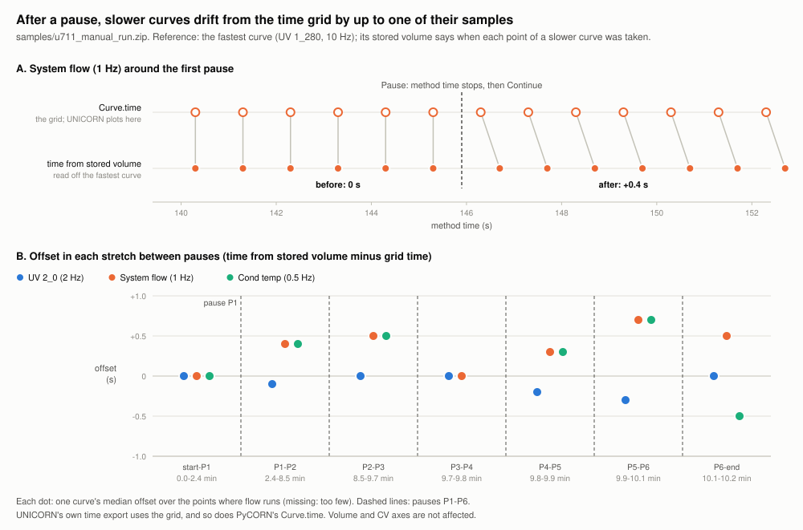

# Time axis of slower curves after a pause

UNICORN records curves at different rates: the first UV curve often 10 times a second,
conductivity, pH, flow and pressure once a second, temperatures every 2 s. Each curve stores
a value and the volume pumped for every point, but no time. The time is a regular grid:
point i is at `start + i * step` (`docs/FACTS.md`, F1).

During a pause, method time stops. After the pause, a slower curve's stored volumes no longer
match its grid: each point's volume was reached up to one of that curve's samples earlier or
later than its grid time says. The offset stays the same until the next pause, then changes.
Before the first pause it is 0, and the fastest curve is never affected.

The figure and this table come from `python tools/draw_time_grid_after_pause.py --table FILE.md`.
The numbers in panel B (seconds):

| Curve | start-P1 | P1-P2 | P2-P3 | P3-P4 | P4-P5 | P5-P6 | P6-end |
|---|---:|---:|---:|---:|---:|---:|---:|
| UV 2_0 (2 Hz) | 0 | -0.1 | 0 | 0 | -0.2 | -0.3 | 0 |
| System flow (1 Hz) | 0 | +0.4 | +0.5 | 0 | +0.3 | +0.7 | +0.5 |
| Cond temp (0.5 Hz) | 0 | +0.4 | +0.5 | - | +0.3 | +0.7 | -0.5 |

## What PyCORN does

`Curve.time` keeps the grid, as UNICORN does: UNICORN's own time export (`.asc`) gives the same
times. Nothing is corrected.

- **Volume and CV axes:** not affected. Every point's stored volume is used.
- **Time axis:** after a pause, a slower curve can sit up to one of its samples off the fastest
  curve: up to 1 s at 1 Hz, 2 s at 0.5 Hz. This touches time-axis plots, UTC per point,
  windows on the time axis, and the CADET export's conductivity, pH and flow.

Pauses that UNICORN logs only as `Continue (System)` count too (e.g. around a system wash).
