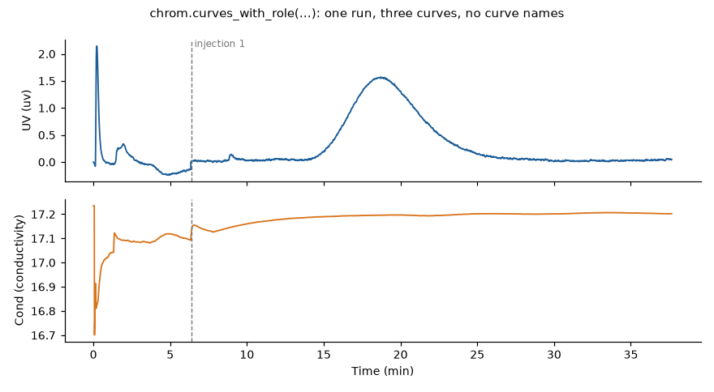
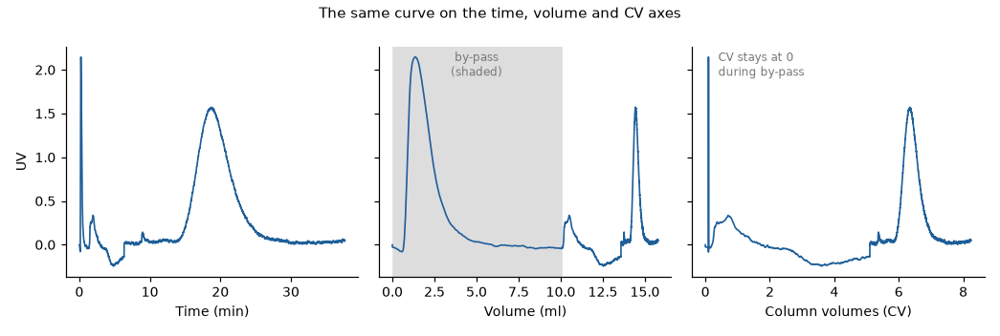

# PyCORN User Guide: the Run Model

This guide is for people who use PyCORN to read ÄKTA runs into Python. Every reader (a
result `.zip`, a `.UFol` folder export, or the UNICORN database) gives you the same object:
a `Run`. This guide shows what a `Run` holds, how its axes are worked out, and what to check
before relying on the numbers.

> PyCORN has been checked only against the UNICORN files and databases we had access to.
> Other instruments, UNICORN versions and methods may behave differently. Read
> `run.warnings` and check the results ("Warnings and What to Check" below).

## Loading a Run

### From files

```python
from pycorn import open_run, open_folder

run = open_run("my_run.zip")        # UNICORN 6+ result (.zip, or a .Result from a folder export)
runs = open_folder("project.UFol")  # a list of Runs, one per result in the folder export
```

`open_run()` refuses a `.UFol` file and tells you to use `open_folder()`. For each run of a
folder export, `run.container` says where it sat in the export (folder, original result id,
original path). For a standalone `.zip` it is None.

Both readers take the same options:

- `adjust_axes=False`: keep the adjusted axes equal to the stored ones (see "Axes").
- `column_volume=`, `column_volume_unit=`: your own column volume (Vc), which wins over every
  stored value.
- `use_name_hint=True`: also accept a volume written in the run or folder name, such as
  "5 ml" (off by default).

Legacy UNICORN 3-5 `.res` files use the older `PcRes3` class (`from pycorn import PcRes3`).
It does not give a `Run`. See [`pycorn/docs/USAGE_pycorn_module.md`](../pycorn/docs/USAGE_pycorn_module.md).

### From the database

Set up `sql/.env` first (see [`sql/CONNECTOR_GUIDE.md`](../sql/CONNECTOR_GUIDE.md)). It holds the server and login as
`UNICORN_*` settings. Then:

```python
from pycorn import PyCORNDatabase

db = PyCORNDatabase()
cat = db.find(folder="/DefaultHome/Projects/**", has_curve_roles=["uv"])  # one page, filtered in SQL
run = db.load_run(cat.iloc[0])          # one catalog row, or a ResultID

for run in db.load_many(cat):           # one Run at a time (a generator)
    print(run.name)
```

`find()` returns one page (500 rows by default). Use `find_pages()` for all pages and
`count()` for the total. A database run has the same structure as a file run, plus
`run.tables`: every database row tied to the result, by table name. `load_many()` also takes
rows from `catalog_from_files()`, so files and database results can share one catalog. To
search and write runs to files from a shell, see the export guide ([`docs/EXPORT_GUIDE.md`](EXPORT_GUIDE.md)).

## What a Run Holds

```
Run
  result, metadata, variables()     what the run is: name, method variables, stored records
  chromatograms                     OrderedDict, usually one ('Chrom.1')
    curves                          OrderedDict of Curve: measured signals
    event_curves                    OrderedDict of EventCurve: run log, injections, fractions
    peak_tables                     list of PeakTable (only after evaluation)
  warnings                          what was assumed or could not be worked out
```

```python
run.name, run.created, run.unicorn_version
run.source            # 'zip', 'ufol' or 'sql'
chrom = run.chromatogram()            # the run's original one; run.chromatogram("Chrom.2") by name
list(chrom.curves)                    # curve names as this instrument stores them
```

### Several chromatograms: original, imported, derived

A result usually holds one chromatogram, the run itself. In UNICORN's Evaluation, users can
add more: chromatograms imported from other results (for comparison or integration), and
chromatograms or curves derived from existing ones. PyCORN tells them apart from what the
result stores:

| `chrom.kind` | What it is | How it is recognised |
|---|---|---|
| `original` | The run's own chromatogram | Its curves (or events) are original data (`IsOriginalData`) |
| `imported` | Copied in from another result | It stores `OriginalResultID` / `OriginalResultName`; every curve is non-original and the run log is an `ImportedLogbook` event curve |
| `derived` | Made in Evaluation | Every curve and event curve is non-original, and it names no original result |

An imported chromatogram can be a copy of this same run (the source result is the run
itself: same ResultID, or the same name where a file stores no ResultID).

```python
chrom.kind                     # 'original', 'imported' or 'derived'
chrom.source_result            # imported: {'id': OriginalResultID, 'name': OriginalResultName}; else None
run.describe_chromatograms()   # per chromatogram: name, kind, source_result_id, source_result_name,
                               # copy_of_run, label ('imported from X (a copy of this run)')
run.select_chromatograms()                     # default: the original chromatogram(s)
run.select_chromatograms(["imported", "Chrom.1"])  # names and/or 'all', 'original', 'imported', 'derived'
```

The default everywhere is the run's original chromatogram: `run.chromatogram()`, the exports,
the CADET export and the web page. Every other chromatogram is selectable:
`ExportOptions(chromatograms=[...])` and `pycorn export --chromatogram NAME|all|imported|derived`
(see the export guide), `pycorn.export_cadet(chromatogram=...)`, the `chrom=` argument of
`phase_windows`, `build_experiment`, `run_log_sections` and the other per-chromatogram
functions, and the chromatogram picker in the web page's run list.

An imported chromatogram keeps its source run's log as an `ImportedLogbook` event curve, on
the same time and volume axes as its curves. PyCORN reads it as that chromatogram's run log
(`chrom.run_log()`). So the phase, injection and fraction tables, the process sections, phase
window statistics, the column volumes (CV), the column by-pass and the UTC axis of an imported
chromatogram are the source run's, and so is its CADET export. Everything read from it is
labelled as the source result's: `chrom.run_log_source()` (also `run_log_source` in
`run_log_sections()` and in the CADET experiment's `source`) gives the source result's ID and
name, and the warnings say "imported chromatogram: run log ... is the source result's". In the
tables, injections and fractions come from its event curves except pooled-fraction curves and
marks of another method run (a different stored method start), since every event curve of an
imported chromatogram is stored as non-original.

This result's own run-level data (method, system configuration, column type, mixer and delay
volumes, run information, run name, run start date) belong to this result's run, not the
source's. They are still used for an imported chromatogram, since it is often the same system
and column, and each one used adds one warning: "imported chromatogram: <what> taken from this
result (ResultID ...), which may differ from the source result's run" (`run.holds_run_of(chrom)`
is False). An imported copy of this same run is the run itself: no warning.

A source result can itself hold overlays of other method runs. In an imported chromatogram,
curves and event curves whose stored `MethodStartTime` differs from its run log's are of
another method run: such curves stay in its curves (and in the curves table) but have no role,
so `curves_with_role()`, plots by role, window statistics and the CADET signals leave them out
(`chrom.other_run_curves()` lists them; the export warns with their count). The original
chromatogram's outputs do not change. Derived chromatograms are read as before.

- **`Curve`**: `values`, `time`, `volume`, `unit`, `time_unit`, `volume_unit`, `data_type`
  (UNICORN's CurveDataType, such as 'UV' or 'Conduction'), plus the axes worked out at load
  (`time_adjusted`, `volume_adjusted`, `cv`, `utc`). `curve.to_frame()` gives all of them
  as a DataFrame.
- **`EventCurve`**: `type` ('Logbook' for the run log, 'Injection', 'Fraction'), `events`
  (each with `time`, `volume`, `text`, `type`, `subtype` and the same worked-out axes).
  `ec.to_frame()` gives one row per event.
- **`PeakTable`**: `name`, `curve_number` (the curve it was integrated on), `info` and
  `peaks`; `table.to_frame()` gives one row per peak.
  `pycorn.run_export.peak_summary_frame(chrom, run)` lays `info` out as UNICORN's report
  does, with the readable baseline and resolution-algorithm names, and
  `pycorn.run_export.peak_uv_normalized(run, chrom, table)` says whether a UV peak table's
  heights and areas are of the UV normalized to 1 cm path length (from the evaluation log
  when not stored; `None` when nothing tells).
- **`run.origin`**: where the run was read from. For a database run it holds connection
  details: don't print or log it.
- **`run.metadata`**: the stored `*Data` records (method, system, column types, ...) as
  parsed XML, for anything this guide doesn't cover.

### Method variables

```python
run.variables()            # DataFrame: kind, variable, value, number, unit, scouting
run.variable("Flow rate")  # one variable; the error lists the names this run has
```

These are the values the run actually used. A scouted variable shows its scouting value
(`scouting=True`). `value` is the stored text (significant figures kept) and `number` is the
parsed number (NaN when the text is not a number). Variable names are chosen by the method's
author, so take them from your own method, not from this guide.

For the list as UNICORN shows it, by phase and block in method order, with `{base}` replaced
by the block's base (CV, ml or min), use `pycorn.run_details.method_variables_frame(run)`.
The exports and the web page use it. The other method tables of UNICORN's report are in
`pycorn.run_details` too: `method_steps_frame(run)` (the method text in call order, a Watch's
action block right after its Watch, `called_from` naming the calling step),
`scouting_runs_frame(run)` (`run` from 1 beside the stored `position`) and
`start_questions_frame(run)` (number, question, answer type, answer).

## Finding Curves: by Role, Not by Name

Curve names depend on the instrument and its setup. One system calls its UV curve
`UV 1_280`, a process-scale system calls it `UV_280`, and curve numbers change between runs.
Code that hardcodes a name works on one system and breaks on the next. So look curves up by
what they measure:

```python
uv = chrom.curves_with_role("uv")            # every UV channel, in stored order
cond = chrom.curves_with_role("conductivity")
flow = chrom.curves_with_role("flow")         # system flow; 'sample_flow' for the sample pump
```

Roles: `uv`, `conductivity`, `conductivity_percent`, `ph`, `pressure`, `temperature`,
`conc_b` (%B), `conc_q` (quaternary valve Q1-Q4), `flow`, `sample_flow`. An unknown role raises
`KeyError` with the list. A role can match several curves (three UV channels, several
pressures), so pick from the list on purpose. Roles are matched on the stored type and unit;
a name pattern is used only where those can't tell curves apart (%B against Q1-Q4, system
against sample flow). `pycorn.curve_roles.ROLES` can be extended for an instrument whose
names don't match yet.



Other lookups:

```python
chrom.curves_of_type("UV")            # by stored CurveDataType, as stored
chrom.event_curves_of_type("Logbook") # the run log; also 'Injection', 'Fraction'
chrom.curve(name)                     # exact name, e.g. one a user picked from list(chrom.curves)
```

`chrom.curve(name)` raises `KeyError` listing the names the run has. It never guesses a
similar name. By default the role and type lookups skip curves that are not original on the
run's original chromatogram, and take every curve of an imported or derived one, whose curves
are all non-original (`original_only=True` / `False` to choose).

## Axes

Every curve and event carries the same set of axes:

| Axis | Attribute | What it is |
|------|-----------|------------|
| Time | `time` | Elapsed method time, as stored (stops during a pause) |
| Volume | `volume` | Volume pumped, as stored |
| Adjusted | `time_adjusted`, `volume_adjusted` | Zero at the injection UNICORN uses for its plots |
| CV | `cv` | Column volumes through the column since method start |
| UTC | `utc` | Wall clock, rebuilt from the run log |

The stored `time` and `volume` are never changed.



**Adjusted axes.** `chrom.retention_zero` says where zero is and where that came from
(`source`: the saved layout, UI settings, peak table, or 'default' = injection 1, as
UNICORN's own export does). With `adjust_axes=False` at load, the adjusted axes equal the
stored ones. To zero at another row of the phase, injection or fraction table, subtract
`chrom.zero_offsets("injection", 1)` (one value per axis; row 0 is the pseudo-row described
under "Tables").

### Column volume (Vc) and CV

CV = volume that went through the column / Vc. Volume pumped while the column valve is in
by-pass doesn't count, so CV stays flat then.

Vc is not always stored, so every source in the run is collected and the first usable one is
used, in this order: your `column_volume=`, the curves' stored column volume, the run
information written at run time, the run log's 'Base CV' text, the ratio of a flow curve to
its CV/h twin, the peak table. The method's stored value is recorded but never used. A name
hint is used only with `use_name_hint=True`. A column geometry you give is a last resort.

```python
info = chrom.column_volume_info
info["value"], info["unit"], info["source"], info["location"]
info["candidates"]      # every value found, with source and confidence
info["disagreements"]   # usable values more than 1% off the chosen one
chrom.column_path["bypass"]     # by-pass intervals as (start, end) volumes in ml
run.column_volume, run.column_volume_source   # the same, for the first chromatogram
```

When no Vc is found, `cv` is None and `run.warnings` says so. Set one and recompute:

```python
from pycorn.axes import add_axes

add_axes(run, column_volume=0.7, column_volume_unit="ml")   # your Vc wins over stored ones
add_axes(run, geometry_volume=(0.785, "ml", "my column"))   # used only when nothing is stored (else a warning)
```

`add_axes` recomputes Vc, CV and UTC for every chromatogram and replaces its earlier warnings.
Every reader runs it once at load.

### UTC and pauses

Stored time stops during a pause, so UTC is rebuilt: the chromatogram start plus elapsed time
plus every pause before that point. Pauses come from the run log's Pause/Continue texts. Some
stops UNICORN doesn't log as a pause (washes, pump synchronization, alarms) are found from the
wall-clock gap at the next timestamped entry.

```python
tl = chrom.timeline
tl["quality"]          # 'exact', 'inferred', 'ambiguous', 'unresolved', or None (no start)
tl["start_utc"], tl["end_utc"], tl["total_paused_s"]
tl["pauses"]           # each with elapsed_s, duration_s, source, quality
tl["valid_until_s"]    # set when UTC stops being known part way (then NaT after it)
```

Check `quality` before using UTC. 'inferred' means at least one pause length was worked out
from a clock gap, not logged. 'ambiguous' and 'unresolved' mean UTC is left empty from the
point given in `valid_until_s`. Curve and event `utc` are both numpy `datetime64[us]` in UTC
without a zone (an event's is `None` when unknown), so they compare and subtract directly. The
timeline's own `start_utc` and `end_utc` are timezone-aware Python `datetime`s.

## Units

Stored values and unit strings are never changed. `run.normalized()` returns a converted copy:

```python
run_l = run.normalized(units={"volume": "L", "flow": "L/h", "time": "h"})
```

Quantities are `volume`, `time`, `flow`, `linear_flow`, `cv_rate`, `absorbance` and others
listed in `pycorn.units.CANONICAL`. An unknown quantity or a unit of the wrong quantity raises
`UnitError`. A converted curve records what was done in `curve.conversion`: the values' `raw_unit`, `unit`
and `factor`, and under `axes` each converted time or volume axis.
Curves that can't be converted are kept as they are, with a warning.

**UV path length.** Plain mAU values are relative to the UV cell's path length:

```python
from pycorn.units import uv_path_length_cm
uv_path_length_cm(uv[0])     # (0.2, 'NominalUVPathLength'), or (None, reason)
run.normalized(uv_path_length_cm=1.0)   # rescale plain absorbance curves to a 1 cm path
```

The path comes from the curve's own stored UV information. Curves already in a per-cm unit
(mAU/cm) are never rescaled.

**Decimals shown.** Values are never rounded in PyCORN; only the page and Excel's cell formats
show fewer decimals. How many comes from what UNICORN specifies, not from the digits of a value:

- Curve values use the curve's `AmplitudePrecision` (`curve.precision`).
- Time, volume, CV, flow and %B use the decimals UNICORN prints in its run log: min 2, ml 3,
  CV 2, ml/min 3 and % 1. UNICORN stores no precision for these.
- Every conversion carries the decimals with it (`pycorn.units.convert_decimals`). Powers
  of 10 shift exactly: ml to L takes 3 to 6, keeping the same significant figures. Other
  factors are never shown coarser than the source step: 0.01 min is 0.6 s, so s gets 1.
- Converted curves (`normalized()`, mg/ml) carry theirs in `curve.precision`.
- `pycorn.units.display_decimals(unit)` gives any unit's decimals.

## Tables and Derived Data

### Phases, injections and fractions

```python
chrom.phase_table()
chrom.injection_table()
chrom.fraction_table()
```

Each row has start and end on every axis (`start_time`, `end_time`, `start_volume`,
`start_cv`, `start_utc`, ...). A phase ends where the next one starts. An injection or
fraction ends where the next of its kind starts. The first row, number 0, is a pseudo-row
(`pseudo=True`) from method start to the first real row: 'Before injection', 'Waste' for
fractions, the first run-log text for phases. `length_time`, `length_volume` and `length_cv`
are end minus start (stored time stops during a pause).

Each row also says what ran in it, from the run-log sections the CADET export uses (the
export and the in-browser page have the same columns; the page shows a default set and
"Columns" picks more, downloads hold all of them; pass `sections=run_log_sections(run, chrom)`
when you have built them already): `blocks`, `system_flow_ml_min`, `column_flow_ml_min` (0 while the column is by-passed),
`percent_b`, `percent_q`, `inlets`, `inlets_source`, `column_position`, `injection_valve`,
`sample_use` and `set_marks`. Each lists its values in time order (`5 -> 1`); a %B ramp reads
`ramp 0 to 100`. `inlets` are the
inlets the run draws from: line A below 100 %B, line B above 0 %B (`A1+B1` at a constant mix, `ramp A1 to B1`),
the quaternary shares as logged (`Q1 50%+Q2 50%`), `Loop`
while the injection valve is at Inject, the sample inlet at Direct inject. A position the run
log set is shown as logged (`B2`). Where it set none, the system configuration stored with the
result decides (see "Inlet valves and pumps" below): a line with no inlet valve is one fixed
line, shown alone (`B`); a line with a valve takes the valve's first position, marked
`(assumed)` (`B1 (assumed)`; the sample inlet valve `Buffer (assumed)`); when the
configuration doesn't say, `B (not known)`. `inlets_source` says how sure: `known`,
`assumed` or `not known` (the least sure line used decides). The quaternary valve's lines are
taken, for now, as feeding the A and B pumps (provisional; a warning says so). The run log
writes a phase's start about a second before the phase's own settings, so a phase often
begins with the previous phase's value (`1 -> 5`).

### Inlet valves and pumps

```python
config = run.system_configuration()
config.present("inlet_valve_b")   # True installed, False not installed, None not known
config.role("inlet_valve_b").state  # 'installed', 'none', 'disabled', 'not listed', ...
config.summary()                  # plain data, per role
```

Each result stores its system's components (`SystemData` and `StrategyData`, the same from a
`.zip`, a `.UFol` and the database). `pycorn.system_configuration` maps them to five roles:
inlet valve A, inlet valve B, sample inlet valve, sample pump and quaternary valve. Names
differ by system family, so a component gets its role from its name or from the hardware
code in its display name (`V9-IB`, `V9-IS`, `P9-S`, `Q9`, ...); a name in neither gives
"not known", never a guess. The rules key on the hardware each result lists, never on the
system model. A role the configuration marks as none (`Inlet B none`) or lists but doesn't
enable is not installed; a role it doesn't list at all is not known.

### Pooled fractions

```python
from pycorn import pools

pools.pool_rows(chrom)          # one row per pool: pool, fractions, first/last fraction, start/end on every axis
pools.pooled_curves(chrom)      # the pooled fraction curves found
```

Fractions pooled in UNICORN's evaluation (Pool Fractions) are stored as an extra event curve.
It is found by its stored type, not its name (the user may rename it): type `Fraction`, made
in evaluation (not original data), with UNICORN's default name ending `,POOL` or an event
that stores a second text (`EventText2`, the pool's last fraction; the database stores it, a
.zip does not). Each mark of that curve ends where the next starts; a mark that holds two or
more fractions of the instrument's fraction curve (or stores `EventText2`) is a pool. A pool
is named by its first and last fraction (`3.A.2-3.A.3`). The export's Fractions table has a
`pool` column with that name (empty when a fraction is in no pool), and the pools are their
own table (Pooled fractions).

### Process sections from the run log

```python
from pycorn.run_log_sections import run_log_sections, to_frame

result = run_log_sections(run, chrom)
to_frame(result)       # one row per section: times, flows, %B, valves, pauses
result["warnings"]
```

Sections are built from the instructions that actually ran (the run log), not from the
method. Each instruction holds until the next one of its kind. Gradients ramp %B. Pauses are
zero-flow sections. The measured curves are used only as a check (`result["checks"]`):
a mismatch is a warning, never a correction.

### Concentration (mg/ml) from UV

```python
from pycorn.concentration import concentration

mg = concentration(uv[0], epsilon=1.0)   # ml/(mg*cm); or epsilon_molar= with molecular_weight=
mg.values, mg.unit, mg.conversion        # conversion: epsilon, path length and its basis
```

The extinction coefficient is always yours. It depends on the protein and the wavelength.
PyCORN never assumes one. The result is a new curve with the same axes, and the stored curve
is not changed. `fallback_path_cm=` gives a path only for curves whose run stores none.

**Treat the result as an estimate.** It can be off by several percent or more: a textbook
coefficient against what this detector actually reads, detector saturation and non-linear
absorbance at high signal, baseline drift and the path length all add error. A measured
coefficient or a correction factor is an estimate too. Every result carries this note in
`mg.conversion["note"]`, and the exports write it to their warnings (GitHub issue #1).

- `response_factor=0.92`: what the detector reads against what the coefficient predicts
  (here 8 % low); the coefficient used is epsilon * 0.92. There is no default.
- `absorbance_limit=2500` (stored units, mAU by default): points above it become NaN. Also no
  default: take it from your detector's linear range.

### Extinction coefficient from the by-pass

Many runs send sample through the column by-pass before loading (priming, a UV check of the
sample). The UV there reads the sample itself, so with its concentration from an offline
assay you get the coefficient this detector gives:

```python
from pycorn.uv_calibration import bypass_uv_readings, epsilon_from_injection

rows = bypass_uv_readings(run, sample_concentration=1.2)          # mg/ml; one row per window and UV channel
rows[0]["kind"], rows[0]["max"], rows[0]["epsilon_ml_per_mg_cm"], rows[0]["warnings"]
rows = bypass_uv_readings(run, sample_concentration=1.2, loop_volume=20, loop_volume_unit="ul",
                          absorbance_limit=2500)
```

- **Plateau** (the signal holds at its maximum): epsilon = (max - level before) / (path *
  concentration).
- **Pulse** (a small loop; the maximum stays below the sample's own absorbance): epsilon =
  area / (path * loop volume * concentration). Give the loop volume: the volume the valve
  period sends is only an upper bound (a fixed loop empties early), so it is reported, not used.
- Warnings flag a flat top (saturation), a maximum above your `absorbance_limit` (then no
  coefficient), a cut pulse and drift. Plateaus can sit at the top of a typical linear
  range: check yours.

For a dedicated calibration run, `epsilon_from_injection(chrom, "UV 1_280", 0.05, "mg",
window=(1.0, 2.0))` integrates one peak in a volume window you give (default: the run's single
by-pass interval) over the injected mass you give.
On the command line: `pycorn bypass-uv runs/*.zip --sample-conc "1.2 mg/ml"` prints the
readings (`--csv` writes them), and `pycorn export --bypass-uv` adds a `_by_pass_uv` table.

### Curve statistics over phase windows

Mean, median, SD, min, max and the number of points of any curve over a window you give
relative to a phase (`pycorn.window_stats`). A window is a name, a phase, two offsets and a
unit; the unit sets the axis (time, volume or CV). A number counts from the phase start,
`end`, `end-N`, `end+N` from its end:

```python
from pycorn.window_stats import parse_window, phase_windows, window_stats, window_stats_rows, to_frame

chrom = run.chromatogram()
rows, warnings = window_stats_rows(run, chrom, ["eq=Equilibration:end-2:end CV",
                                                "load=Sample Application:1:3 CV"], ["conductivity", "ph"])
to_frame(rows)            # one row per phase occurrence x window x curve

# the two steps on their own
windows, warnings = phase_windows(run, [parse_window("tail=Elution:end-2:end CV")])
windows[0]["start_time"], windows[0]["end_cv"], windows[0]["occurrence"]
window_stats(chrom.curves_with_role("uv")[0], windows[0])   # {'n', 'mean', 'median', 'sd', 'min', 'max', 'warnings'}
window_stats(curve, {"axis": "volume", "start": 10, "end": 12, "unit": "ml"})   # a window on the run's axes
```

- Curves by name or role, windows always yours: there is no default window or curve.
- Interim phase rule (until the lead-in and repeats decisions): phase start and end as logged
  (the phases table), no lead-in folding; a repeated phase gives one window per occurrence,
  numbered from 1. A phase missing from the run, or a CV window without Vc, gives a warning
  and no window.
- A window is clipped to its phase (warned); an empty one gives `n` 0 and no statistics.
  Each curve is read on its own points (bounds inclusive, NaN left out); SD is the sample SD
  (n - 1). Values are not rounded.
- `STATISTICS` in the module lists the statistics; each takes the points' axis values and
  values, so more (slope, start and end value) can be added.

On the command line: `pycorn export --window "eq=Equilibration:end-2:end CV" --window-curves
conductivity,ph` adds a `_phase_window_statistics` table (see `docs/EXPORT_GUIDE.md`).

### Column geometry

```python
from pycorn.column_geometry import column_geometry

g = column_geometry(run)
g.name, g.length_m, g.diameter_m, g.particle_radius_m, g.sources, g.warnings
g = column_geometry(run, bed_height=(10, "cm"), diameter=(1, "cm"))   # your values
```

Geometry is read only when the run names a column type and holds its record. A run set to
the column 'Any' has no geometry. Your values fill only what the run doesn't store
(`override=True` makes yours win). Stored geometry is checked against Vc (`g.vc_check`) but is
never used as Vc.

### Method hints

```python
from pycorn.method_hints import method_hints

h = method_hints(run, chrom)
h.blocks, h.injections, h.sample_application, h.warnings
```

The method is a plan, not a record of what ran. These hints compare planned block lengths
and injection volumes with what the run log shows. Use them as a check only: what ran is in
the run log and the sections above. Exports call these tables "Planned vs run - blocks" and
"Planned vs run - injections".

## Warnings and What to Check

`run.warnings` is a list of plain sentences. Axes warnings read
`'<chromatogram>: Vc|CV|UTC: <message>'`. The table functions return their own warnings.
Before relying on a result, check:

- **Vc**: `chrom.column_volume_info["source"]` and `disagreements`. A wrong Vc makes every CV
  wrong.
- **By-pass**: `chrom.column_path["bypass"]`, if CV looks flat or short.
- **UTC**: `chrom.timeline["quality"]` and the pauses.
- **Retention zero**: `chrom.retention_zero["source"]`. 'default' means no saved setting was
  found, so injection 1 was used.
- **Curves picked by role**: when a role matches several curves, check which one you used.
- **Instruments not seen before**: run-log texts PyCORN doesn't recognize are reported, never
  guessed. If a result looks wrong for a new instrument or UNICORN version, open an issue
  with a sanitized `.zip` ([`tools/anonymize_zip.py`](../tools/anonymize_zip.py), see the README).

## Where Next

- [`docs/EXPORT_GUIDE.md`](EXPORT_GUIDE.md): `pycorn find` and `pycorn export`, which write runs to CSV, Excel
  or pickle, with every output file and column explained.
- [`docs/CADET_GUIDE.md`](CADET_GUIDE.md): building a CADET / CADET-Process experiment from a run.
- [`sql/CONNECTOR_GUIDE.md`](../sql/CONNECTOR_GUIDE.md): database settings, several servers and databases.
- [`samples/SAMPLE_ZIP_CONTENTS.md`](../samples/SAMPLE_ZIP_CONTENTS.md): what a UNICORN result file contains.
